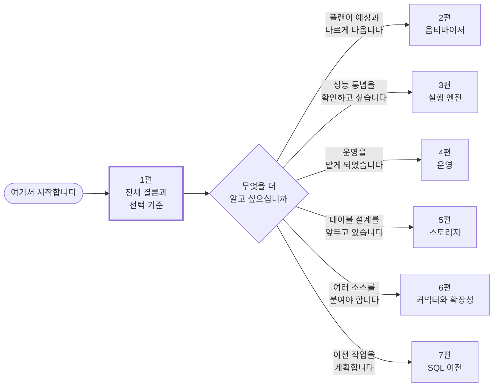
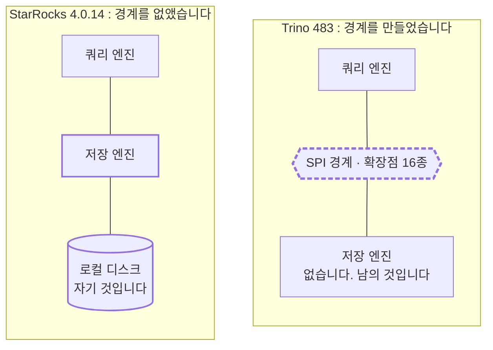
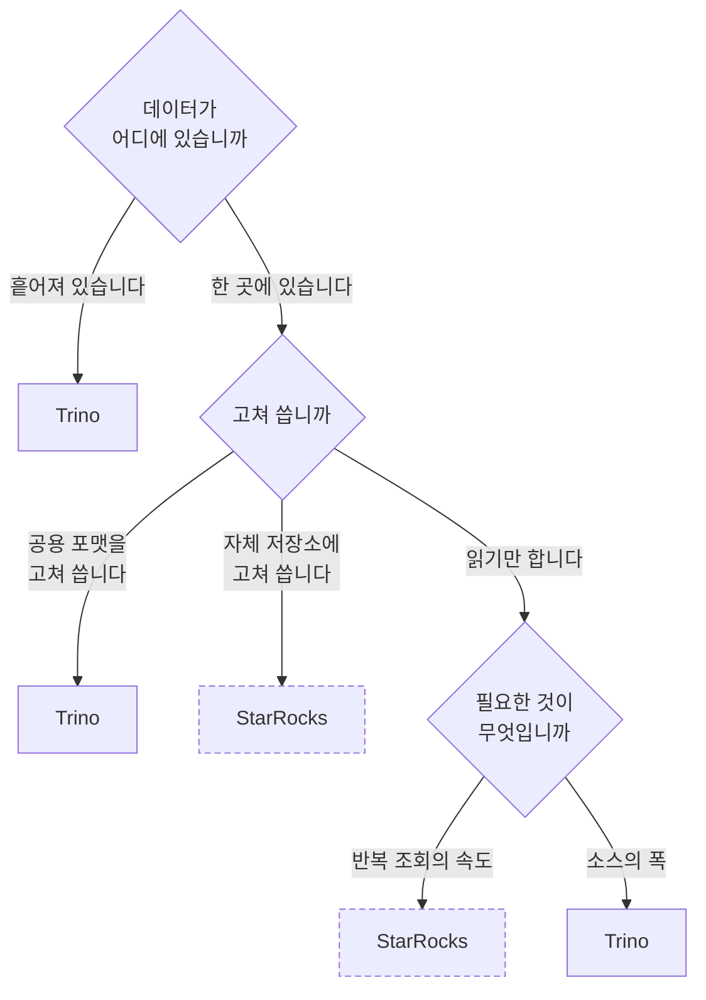
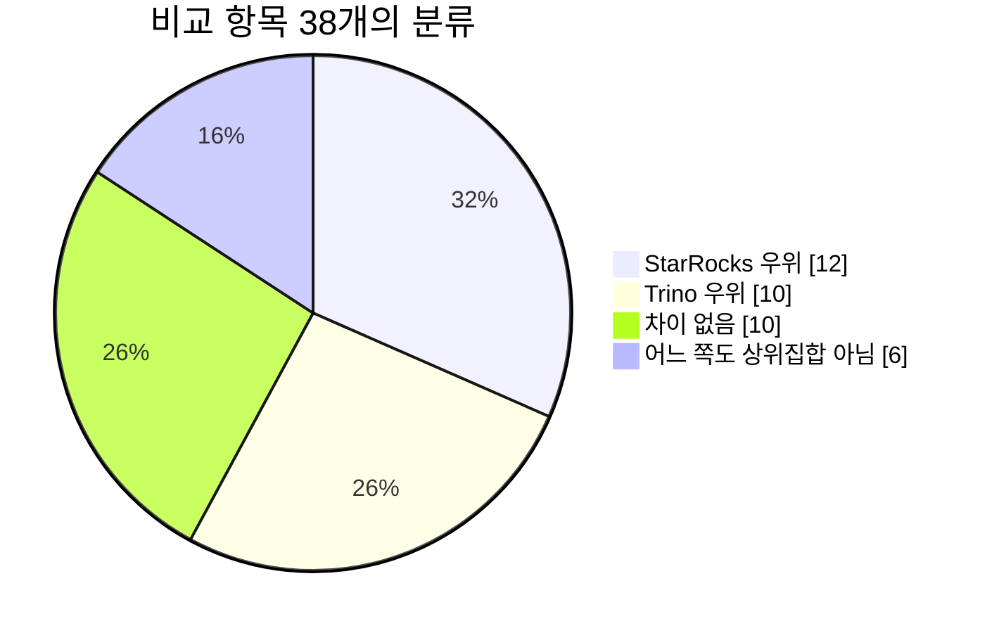
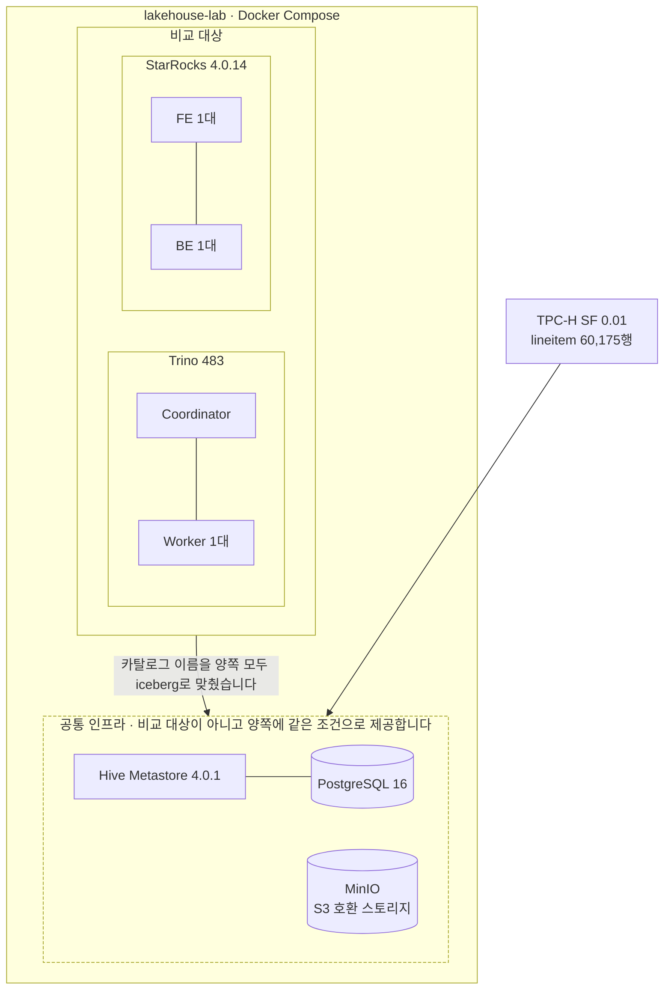

# Trino와 StarRocks를 소스코드까지 읽고 비교했습니다 (전 7편)

> 비교 기준: Trino **483** (`50b0b50b`) · StarRocks **4.0.14** (`7c18dd9d`) · 2026-10-16 기준
> 랩 구성: 같은 Iceberg 카탈로그(Hive Metastore 4.0.1 + MinIO)에 Trino coordinator 1대 + worker 1대, StarRocks FE 1대 + BE 1대
> 데이터: TPC-H SF 0.01 (`bench.lineitem` 60,175행)
> **이 시리즈는 "어느 쪽이 빠른가"에 답하지 않습니다.** 실행 시간을 한 번도 재지 못했습니다. 이유는 각 편의 마지막 절에 있습니다.

---

## 이 시리즈가 답하는 질문

**"우리 상황에서 Trino와 StarRocks 중 무엇을 고를까"** 하나입니다.

기능 목록을 대조하는 방식은 택하지 않았습니다. 양쪽 모두 되는 항목에서도 **되는 범위가 어긋나는** 경우가 가장 많았고, "왜 그런지"를 모르면 지금 없는 기능이 다음 버전에 생길 것인지 구조상 만들 수 없는 것인지 구분할 수 없기 때문입니다.

31개 항목을 비교하는 동안 거의 모든 차이가 **하나의 설계 결정**에서 갈라져 나왔습니다. 스토리지를 자기가 소유하는가입니다.

---

## 읽는 순서

**1편만 읽어도 선택에는 답이 나옵니다.** 나머지는 그 근거를 축별로 펼친 것이므로, 관심 있는 축만 골라 읽어도 됩니다.



| 편 | 다루는 질문 | 이런 분께 |
|---|---|---|
| **[1편 · 스토리지를 소유하는가](01-스토리지를-소유하는가.md)** | **전체 결론과 워크로드별 선택 기준** | 선택이 급한 분 |
| [2편 · 옵티마이저](02-옵티마이저-같은-쿼리-다른-플랜.md) | 같은 쿼리에 왜 다른 플랜이 나오는가 | 플랜이 예상과 다르게 나오는 분 |
| [3편 · 실행 엔진](03-실행-엔진-JVM과-C++.md) | "Java라서 느리다"는 사실인가 | 성능 통념을 확인하고 싶은 분 |
| [4편 · 운영](04-운영-메모리-격리-장애.md) | 메모리와 격리, 장애는 어떻게 갈리는가 | 운영을 맡게 된 분 |
| [5편 · 스토리지](05-스토리지-한쪽에만-있는-계층.md) | StarRocks에만 있는 계층은 무엇을 해 주는가 | 테이블 설계를 앞둔 분 |
| [6편 · 커넥터와 확장성](06-커넥터와-확장성-경계의-값.md) | 경계를 만든 값은 얼마인가 | 여러 소스를 붙여야 하는 분 |
| [7편 · SQL 이전](07-SQL-이전-조용히-깨지는-것들.md) | SQL을 옮길 때 조용히 깨지는 것은 무엇인가 | 이전 작업을 계획하는 분 |

---

## 한 문장으로 줄이면

**두 엔진의 거의 모든 차이는 스토리지를 소유하는지 여부라는 하나의 결정에서 갈라져 나옵니다.**

Trino는 소유하지 않기로 결정하고 **SPI라는 경계를 만들어 그 뒤쪽을 외부에 맡겼습니다.** StarRocks는 소유하기로 결정하고 **경계를 없애 전부 직접 처리합니다.**



**그래서 선택의 질문은 셋으로 좁혀집니다.**

1. 우리 데이터가 **한 시스템 안에 있는가, 여러 시스템에 흩어져 있는가**
2. 우리가 그 데이터를 **고쳐 쓰는가, 읽기만 하는가**
3. 우리에게 필요한 것이 **반복 조회의 속도인가, 연결할 수 있는 소스의 폭인가**



세 답이 한 방향으로 모이면 선택은 이미 정해져 있습니다. 답이 갈린다면 **두 엔진을 같은 Iceberg 카탈로그에 함께 붙이는 구성**이 현실적인 답이고, 실제로 잘 동작합니다. 이 비교의 랩 자체가 그 증거입니다.

---

## 확인된 격차의 규모

**StarRocks 12개, Trino 10개로 숫자가 비슷했고, "차이 없음"으로 끝난 항목이 10개였습니다.**



예상과 달리 같다는 결론으로 끝난 축이 셋 있습니다. 플랜 내부 푸시다운(실측 6항목 전부 동등), 데이터 표현 모델(같은 방식, 규모 대등), 실행 모델(양쪽 모두 다단계 피드백 큐로 수렴)입니다.

**그래서 이 비교의 결론은 "어느 쪽이 낫다"가 아닙니다.**

---

## 이 비교가 스스로 고친 것

**계획 단계의 전제가 일곱 번 틀렸습니다.** 소스코드를 비교하는 작업에 선입견이 얼마나 자주 개입하는지 보여 주는 기록이라서 각 편에 남겨 두었습니다. 대표적인 것은 이렇습니다.

- "Trino는 Java라서 SIMD를 못 쓴다"는 틀렸습니다. Java Vector API를 실제로 씁니다([3편](03-실행-엔진-JVM과-C++.md))
- "캐시는 StarRocks에만 있다"는 틀렸습니다. Trino 483에 Alluxio 기반 파일 캐시가 있습니다([4편](04-운영-메모리-격리-장애.md))
- "StarRocks는 cgroup으로 격리한다"는 틀렸습니다. CPU 친화도 바인딩과 가중 vruntime입니다([4편](04-운영-메모리-격리-장애.md))

**그리고 코드만 읽고 내린 판단이 실측에 두 번 뒤집혔습니다.** "임계값 때문에 StarRocks가 left-deep 플랜을 만든다"고 읽었으나 원인은 통계 부족이었고([2편](02-옵티마이저-같은-쿼리-다른-플랜.md)), "StarRocks 커넥터는 함수 술어를 밀어 내리지 못한다"고 읽었으나 `date_format`에서는 완전히 프루닝했습니다([6편](06-커넥터와-확장성-경계의-값.md)).

---

## 이 비교의 가장 큰 한계

**실행 시간을 한 번도 재지 못했습니다.**

랩 데이터가 TPC-H SF 0.01로 너무 작고, SF 1을 쓰는 프로파일은 검증 호스트에서 띄울 수 없었습니다. 컨테이너 한도가 15.3GB인데 호스트 RAM이 15.6GB이고 swap이 0이어서 초과분이 곧바로 OOM killer로 갑니다.

**그리고 노드가 1대씩이라 다중 노드 항목이 전부 빠졌습니다.** 셔플 전송 계층 전체, 리소스 그룹이 가중치대로 CPU를 나누는지, 한 노드가 죽어도 나머지로 계속 처리하는지가 모두 미검증으로 남았습니다.

**그래서 이 시리즈는 "두 엔진이 무엇을 어떻게 하는가와 그 이유"이고, "어느 쪽이 더 빠른가"가 아닙니다.** 성능 비교 없이 우열을 말할 수 없다는 것이 이 비교의 정직한 결론입니다.

---

## 재현 방법

**이 시리즈의 모든 측정은 같은 랩에서 나왔고, 그 랩은 저장소에 들어 있습니다.** 두 엔진을 같은 Iceberg 카탈로그에 붙이고 같은 SQL 문자열을 던지는 Docker 구성입니다.

| 구성 요소 | 버전 (digest 고정) |
|---|---|
| Trino | `trinodb/trino:483` |
| StarRocks FE / BE | `starrocks/fe-ubuntu:4.0.14` / `starrocks/be-ubuntu:4.0.14` |
| 메타스토어 | Hive Metastore 4.0.1 + PostgreSQL 16 |
| 오브젝트 스토리지 | MinIO |
| 데이터 | TPC-H SF 0.01 |



**카탈로그 이름을 맞췄기 때문에 같은 SQL 문자열이 두 엔진에서 그대로 돌아갑니다.**

```bash
# 버전 기준선은 파일 하나가 지배합니다
cat scripts/testenv/versions.env

# 랩 기동과 시드
scripts/testenv/bin/up.sh
scripts/testenv/bin/seed.sh

# 양쪽에 같은 쿼리 실행
scripts/testenv/bin/q.sh trino     "SELECT count(*) FROM iceberg.bench.lineitem"
scripts/testenv/bin/q.sh sr        "SELECT count(*) FROM iceberg.bench.lineitem"
```

**이것이 비교가 성립하는 조건입니다.**

**검증한 호스트 조합**을 밝혀 둡니다. macOS arm64(Docker Desktop 14 CPU / 25GB)와 linux/amd64(8 CPU / RAM 16.7GB)에서 기동과 시드, 양쪽 행 수 일치를 확인했습니다. **성능 측정용 프로파일은 두 호스트 모두에서 띄우지 못했습니다.** RAM 24GB 이상과 swap이 있는 호스트가 필요합니다.

**arm64와 x86의 성능 숫자는 서로 옮길 수 없습니다.** StarRocks BE는 x86에서 AVX2/AVX512, arm에서 NEON 경로를 탑니다. 랩의 측정 결과 파일이 호스트 아키텍처를 항상 기록하는 이유입니다.

---

## 아직 받지 못한 검토

**양쪽 프로젝트 커뮤니티에서 사실 검토를 받지 않았습니다.** 이 시리즈의 모든 주장은 소스코드 인용과 실측 기록으로 뒷받침했지만, 메인테이너의 확인을 거치지는 않았습니다. **사실 오류를 발견하시면 알려 주시면 고치고 수정 이력을 남기겠습니다.**

---

## 출처와 라이선스

- Trino: [trinodb/trino](https://github.com/trinodb/trino) tag `483`, Apache License 2.0. Copyright Trino 프로젝트 기여자
- StarRocks: [StarRocks/starrocks](https://github.com/StarRocks/starrocks) tag `4.0.14`, Apache License 2.0. Copyright StarRocks 프로젝트 기여자
- Apache Iceberg, Apache Hive, Apache Ranger: Apache License 2.0
- 인용한 코드는 모두 30줄 이하이고 출처를 커밋 태그가 포함된 영구 링크로 표시했습니다
- 프로젝트 로고와 마스코트는 사용하지 않았습니다

### 기반 자료

이 시리즈는 같은 저장소의 기술 문서를 블로그 형태로 다시 쓴 것입니다.

- 기술 문서 31편: [목차](../00-목차.md)
- 실험 기록 18편: `docs/evidence/`
- 종합 결론: [99-종합-결론](../99-종합-결론.md)
- 경영 보고용 종합판: [report/11-종합-보고서](../report/11-종합-보고서.md)

**두 프로젝트의 다음 메이저 릴리스가 나오면 달라진 점을 각 편 상단에 적겠습니다.** 비교 글은 갱신할수록 오래 쓰입니다.
