# 스토리지를 소유하는가: Trino와 StarRocks를 소스코드까지 읽고 비교했습니다

> 비교 기준: Trino **483** (`50b0b50b`) · StarRocks **4.0.14** (`7c18dd9d`) · 2026-10-16 기준
> 랩 구성: 같은 Iceberg 카탈로그(Hive Metastore 4.0.1 + MinIO)에 Trino coordinator 1대 + worker 1대, StarRocks FE 1대 + BE 1대
> 데이터: TPC-H SF 0.01 (`bench.lineitem` 60,175행)
> 다루지 않는 것: **실행 시간 비교**(6절), 다중 노드 동작, 연합 질의, StarRocks shared-data 모드

---

## 결론부터

**데이터가 여러 시스템에 흩어져 있고 그 데이터를 고쳐 써야 한다면 Trino입니다. 데이터가 한 시스템 안에 있고 같은 집계를 반복해서 읽는다면 StarRocks입니다.**

두 엔진의 차이를 기능 목록으로 외울 필요는 없습니다. 31개 항목을 비교하는 동안 거의 모든 차이가 **하나의 설계 결정**에서 갈라져 나왔습니다. 스토리지를 자기가 소유하는가입니다.

Trino는 소유하지 않기로 결정하고 **SPI라는 경계를 만들어 그 뒤쪽을 외부에 맡겼습니다.** StarRocks는 소유하기로 결정하고 **경계를 없애 전부 직접 처리합니다.**

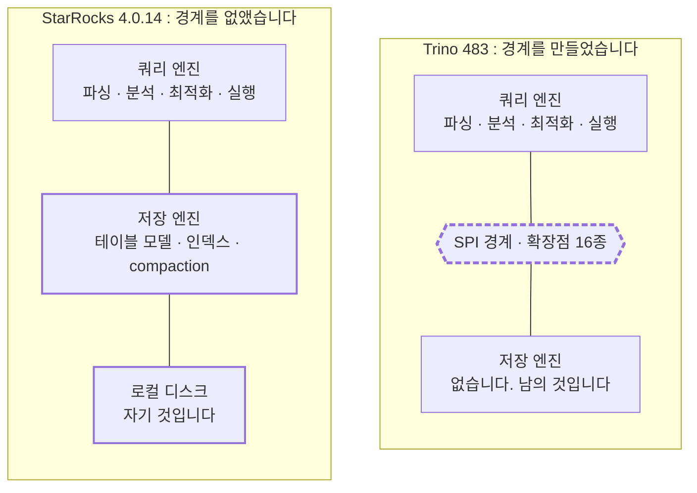

**이 그림 하나가 이 시리즈 전체의 뼈대입니다.** 점선이 Trino의 SPI 경계이고, **그 아래는 Trino 코드가 아닙니다.** 플러그인이 담당하고 제3자가 만들어 붙일 수도 있습니다. StarRocks 쪽에는 그 선이 없습니다. FE와 BE는 하나의 제품을 둘로 쪼갠 것이지 확장점이 아닙니다.

이 글은 그 결정이 어떤 코드로 나타나고, 어떤 기능의 유무로 이어지는지를 정리합니다.

---

## 1. 비교 범위와 버전

| 항목 | 내용 |
|---|---|
| 비교 대상 | Trino 483 (tag `483`, `50b0b50b`) / StarRocks 4.0.14 (tag `4.0.14`, `7c18dd9d`) |
| 비교 방법 | 소스코드 분석 31편 + 같은 조건의 랩에서 실측 18편 |
| 랩 구성 | 두 엔진을 **같은 Iceberg 카탈로그**에 붙이고 **같은 SQL 문자열**을 실행 |
| 검증 호스트 | macOS arm64 (Docker Desktop 14 CPU / 25GB), linux/amd64 (8 CPU / RAM 16.7GB) |
| 비교 축 | SQL 해석 · 옵티마이저 · 실행 엔진 · 데이터 교환 · 커넥터 · 운영 · 스토리지 · 코드베이스 |

카탈로그 이름을 양쪽 모두 `iceberg`로 맞췄습니다. 그래서 `SELECT ... FROM iceberg.bench.lineitem`이라는 **같은 문자열**이 두 엔진에서 그대로 돌아갑니다. 비교 쿼리를 한 벌만 관리하기 위한 선택입니다.

기능 목록을 대조하는 방식은 택하지 않았습니다. 이유가 두 가지 있습니다.

- **양쪽 모두 되는 항목에서도 되는 범위가 어긋납니다.** 이 비교에서 가장 자주 나온 형태이고, 5절에 따로 정리했습니다.
- **왜 그런지를 모르면 예측할 수 없습니다.** 지금 없는 기능이 다음 버전에 생길 것인지, 구조상 만들 수 없는 것인지가 갈립니다.

---

## 2. 두 엔진이 푸는 문제

### 2-1. 프로세스 구성

Trino는 **남의 데이터를 읽는 엔진**입니다. Worker는 디스크를 갖지 않아도 동작하고, 보관하는 것은 실행 중인 쿼리의 상태뿐입니다.

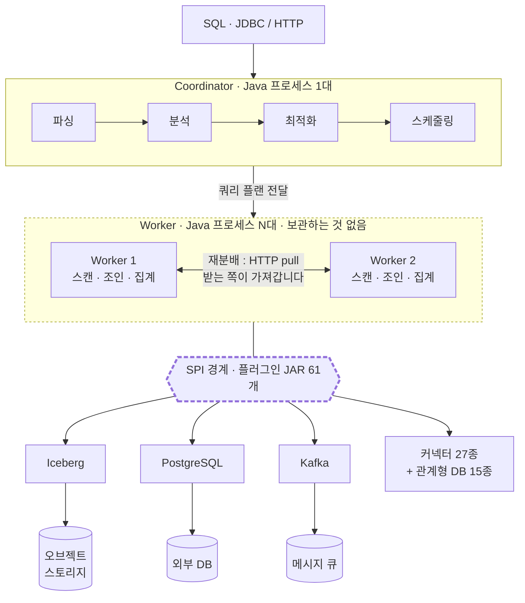

**세 가지를 눈여겨볼 값어치가 있습니다.** Worker에 디스크가 없어도 되므로 캐시 기본값이 꺼짐이고, Coordinator를 이중화하는 계층이 아예 없으며(보관할 메타데이터가 없기 때문입니다), 데이터는 전부 경계 바깥에 있습니다.

StarRocks는 **자기 데이터를 읽는 엔진**입니다. BE 프로세스 안에 실행 엔진과 저장 엔진이 함께 있습니다.

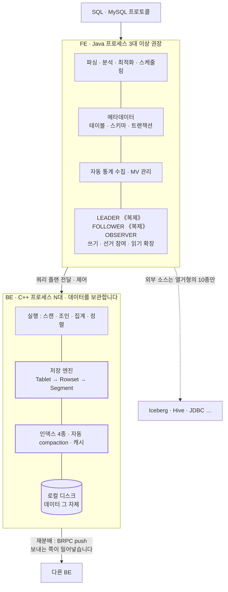

**경계선이 없다는 점이 핵심입니다.** 그리고 **BE 상자 안에 실행 엔진과 저장 엔진이 함께 있습니다.** 이것이 시리즈 전체의 열쇠입니다.

### 2-2. 같은 쿼리가 흐르는 모양

같은 쿼리를 **같은 단계 수로 나란히** 놓으면 차이가 드러납니다.

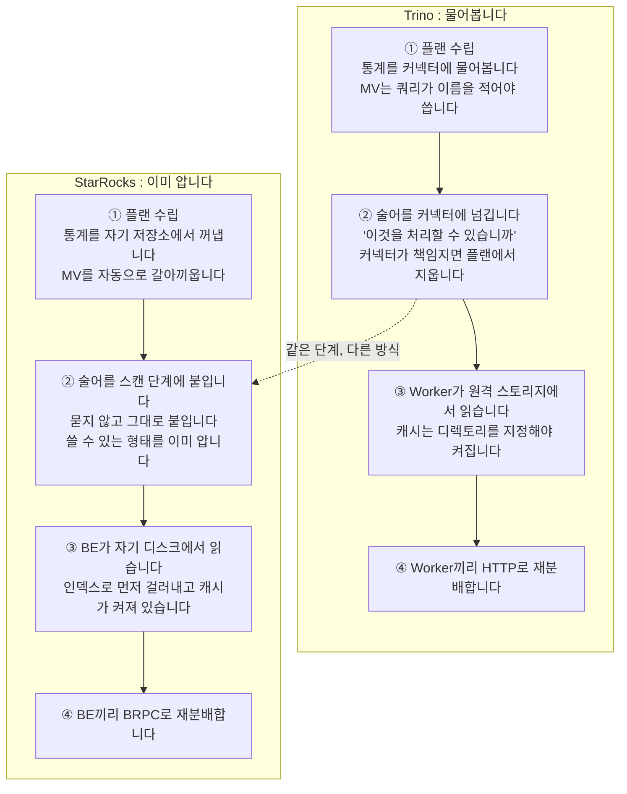

①②③에서 **StarRocks는 이미 알고 있어서 한 단계씩 건너뜁니다.** 물어볼 필요가 없고, 인덱스가 있고, 캐시가 켜져 있습니다. 전부 데이터를 자기가 보관하기 때문입니다.

그런데 ②에서 Trino가 "물어보는" 그 장치가 **27종의 데이터 소스를 붙일 수 있게 하는 바로 그 구조**입니다. 같은 설계가 한쪽에서는 비용이고 다른 쪽에서는 능력입니다.

---

## 3. 경계가 코드에 있는 모습

### 3-1. Trino: 확장점이 별도 모듈로 분리되어 있습니다

`core/trino-spi`는 파일 **558개, 73,858줄**짜리 독립 모듈입니다. 커넥터 개발자는 이 모듈만 의존하고 엔진 본체(`trino-main`)를 참조하지 않습니다. 커넥터가 구현할 것은 인터페이스 네 개입니다.

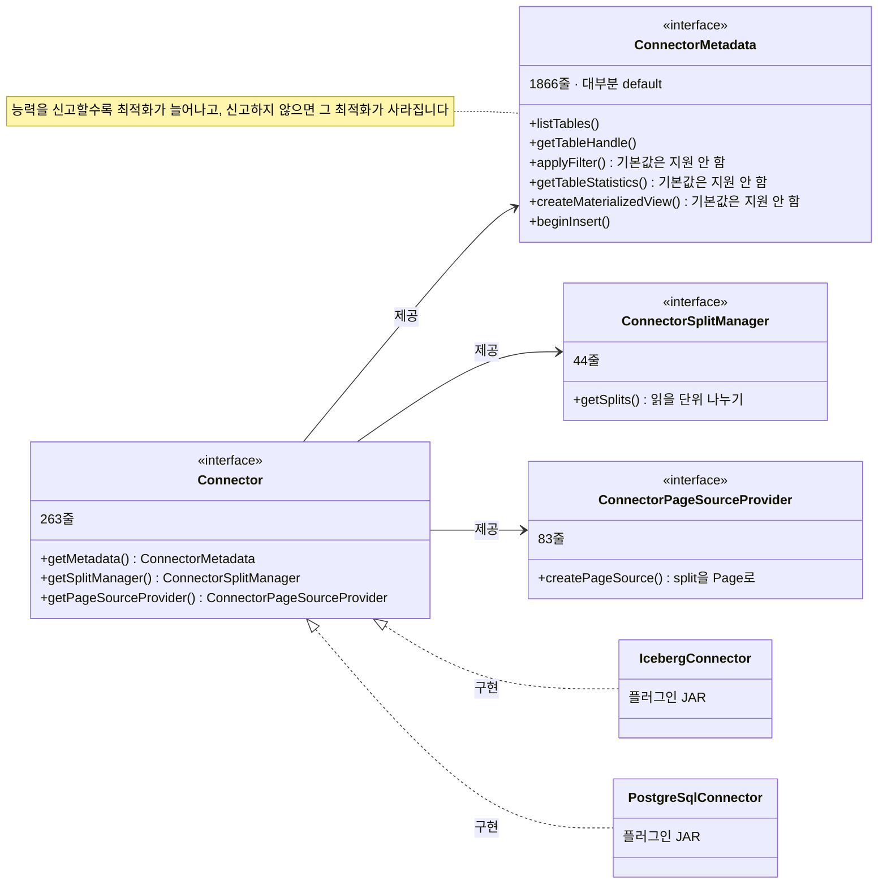

**`ConnectorMetadata`가 1,866줄로 가장 크지만 대부분이 `default` 구현입니다.** `applyFilter`, `createMaterializedView`, `getTableStatistics`가 모두 "지원하지 않음"을 돌려주는 기본 구현을 가지고 있습니다. **최소 구현은 아주 작고, 능력을 더 신고할수록 최적화가 늘어납니다.**

그 결과 `plugin/` 아래에 플러그인 **61개**가 있고, 그중 커넥터가 **28개**입니다. `base-jdbc` 위에 관계형 데이터베이스 커넥터 12종이 더 얹혀 있습니다. **이들은 엔진 코드를 한 줄도 건드리지 않고 붙어 있습니다.**

### 3-2. StarRocks: 붙일 수 있는 소스가 열거형에 적혀 있습니다

```java
// fe/fe-core/src/main/java/com/starrocks/connector/ConnectorType.java#L36-L45 @ 4.0.14
    ES("es", ElasticsearchConnector.class, EsConfig.class),
    HIVE("hive", HiveConnector.class, null),
    ICEBERG("iceberg", IcebergConnector.class, null),
    JDBC("jdbc", JDBCConnector.class, null),
    HUDI("hudi", HudiConnector.class, null),
    DELTALAKE("deltalake", DeltaLakeConnector.class, null),
    PAIMON("paimon", PaimonConnector.class, null),
    ODPS("odps", OdpsConnector.class, null),
    KUDU("kudu", KuduConnector.class, null),
    UNIFIED("unified", UnifiedConnector.class, null);
```

[ConnectorType.java#L36-L45](https://github.com/StarRocks/starrocks/blob/4.0.14/fe/fe-core/src/main/java/com/starrocks/connector/ConnectorType.java#L36-L45)

**10종이고, 새로 붙이려면 이 열거형에 항목을 추가해야 합니다.** 플러그인을 떨어뜨려 넣는 경로가 없습니다. 그리고 커넥터 구현이 FE와 BE 양쪽에 걸쳐 있습니다. FE(Java)의 `connector/` 아래에 하위 패키지 21개가 있고, BE(C++)의 `be/src/connector/` 아래에 또 8개가 있습니다. 실행 계획을 주고받는 Thrift 정의(`gensrc/thrift/PlanNodes.thrift`)에도 스캔 노드 종류가 열거되어 있습니다.

**즉 새 소스를 붙이려면 최소 네 곳을 함께 고쳐야 합니다.**

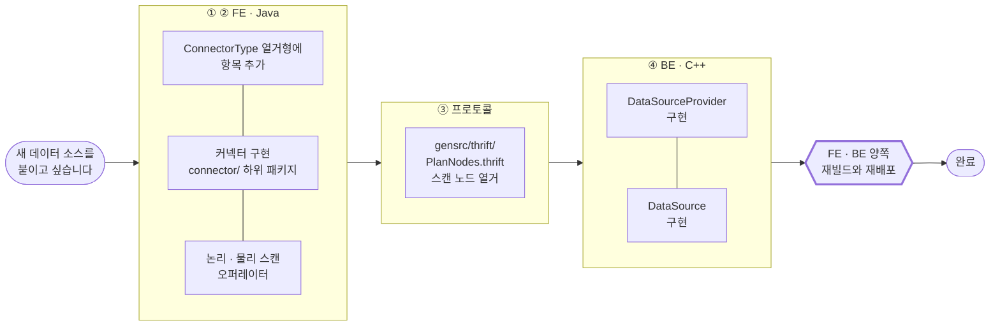

**Trino 쪽 같은 작업과 비교하면 이렇습니다.**


| | Trino 483 | StarRocks 4.0.14 |
|---|---|---|
| 확장점 위치 | 별도 모듈 (`trino-spi` 558파일 73,858줄) | 엔진 코드 안 |
| 배포 단위 | 플러그인 JAR | 없음, 엔진 빌드에 포함 |
| 건드릴 언어 | Java | Java + C++ + Thrift |
| 소스 목록 | 열려 있습니다 | 열거형에 고정되어 있습니다 |
| 제3자 확장 | 가능합니다 | 포크가 필요합니다 |

### 3-3. 같은 결정이 모든 축에서 되풀이되었습니다

31편을 쓰는 동안 이 구도가 **축을 가리지 않고 반복해서 나타났습니다.**

| 축 | Trino (소유하지 않습니다) | StarRocks (소유합니다) |
|---|---|---|
| 타입 체계 | SPI 뒤에 있어서 확장할 수 있습니다 | FE 열거형과 BE의 C++ 구현이 짝을 이룹니다 |
| MV 재작성 | 커넥터가 MV를 소유하므로 옵티마이저가 개입하지 못합니다 | 자기 스토리지이므로 재작성 전용 코드를 18,000줄 갖추었습니다 |
| 통계 | 테이블 포맷에 돌려주어 다른 엔진과 공유합니다 | 자기 안에 쌓아 더 많은 정보를 담습니다 |
| 메모리 | 쿼리만 회계하고 30%를 비워 둡니다 | 적재와 compaction, 복제까지 회계하고 90%를 사용합니다 |
| 캐시 | Worker에 디스크가 없을 수도 있어서 기본값이 꺼짐입니다 | BE에 디스크가 있으므로 기본값이 켜짐입니다 |
| 고가용성 | 메타데이터를 보관하지 않으므로 그 계층 자체가 없습니다 | 복제 저널과 자동 선거를 갖추었습니다 |
| 파일 리더 결함 | 쿼리 하나가 실패합니다 | 데이터를 보유한 BE 프로세스가 중단됩니다 |
| 빌드 | Maven 하나를 씁니다 | Maven과 CMake에 Python 코드 생성을 더합니다 |

**그래서 제품을 선택하는 일은 기능 목록을 대조하는 작업이 아니라, 이 결정이 자기 상황에 맞는지를 묻는 작업입니다.**

---

## 4. 확인된 격차

우열이 분명한 항목만 모았습니다. **StarRocks 12개와 Trino 10개로 숫자가 비슷했습니다.**

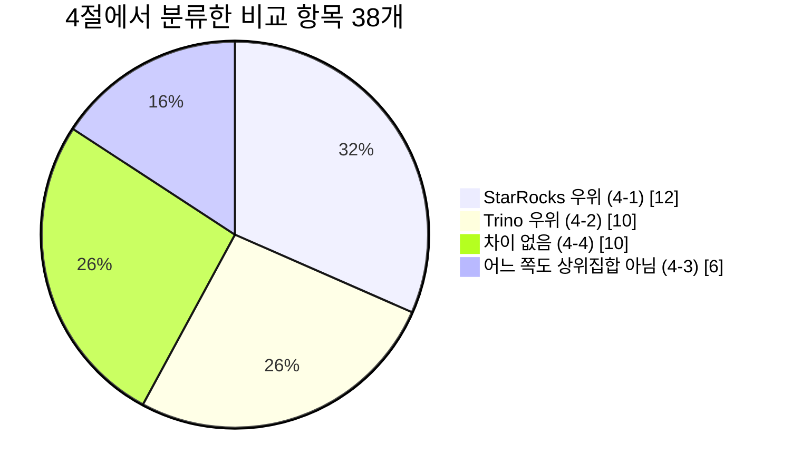

**두 우위 조각의 크기가 비슷하고, "차이 없음"이 그만큼 큽니다.** 이 그림이 "어느 쪽이 낫다"고 말할 수 없는 이유입니다.

### 4-1. StarRocks가 앞서는 곳

| 항목 | 격차의 크기 | 상세 |
|---|---|---|
| MV 쿼리 재작성 | 재작성 전용 코드 18,000줄 대 **규칙 0개** | [2편](02-옵티마이저-같은-쿼리-다른-플랜.md) |
| 통계 자동 수집 | 데몬이 쿼리를 관찰해 컬럼을 스스로 고릅니다(실측) | [2편](02-옵티마이저-같은-쿼리-다른-플랜.md) |
| 테이블 모델 | 4종. `UPDATE`와 부분 컬럼 갱신은 `PRIMARY KEY` 모델에서만 가능합니다 | [5편](05-스토리지-한쪽에만-있는-계층.md) |
| 인덱스 종류 | 비트맵과 n-gram. `LIKE '%…%'`는 Iceberg 통계로 전혀 걸러지지 않습니다 | [5편](05-스토리지-한쪽에만-있는-계층.md) |
| 자동 compaction | BE가 3종을 자동으로 수행합니다 | [5편](05-스토리지-한쪽에만-있는-계층.md) |
| 적재 경로 | Routine Load로 Kafka 상시 구독을 데이터베이스가 직접 소유합니다 | [5편](05-스토리지-한쪽에만-있는-계층.md) |
| 리소스 격리의 강제력 | 스캔 도중에 쿼리를 중단시킵니다(실측) | [4편](04-운영-메모리-격리-장애.md) |
| 캐시 기본 켜짐 | 설정하지 않아도 적중합니다(실측) | [4편](04-운영-메모리-격리-장애.md) |
| CTE 재사용 | Trino에는 기능 자체가 없습니다 | [2편](02-옵티마이저-같은-쿼리-다른-플랜.md) |
| spill 범위 | 12계열 대 4계열. 다만 양쪽 모두 기본값이 꺼짐입니다 | [3편](03-실행-엔진-JVM과-C++.md) |
| 메타데이터 HA | 복제와 자동 선거를 갖추었습니다. Trino에는 이 계층이 없습니다 | [4편](04-운영-메모리-격리-장애.md) |
| 쿼리 내부 관측 | Parquet 리더 내부까지 계측하고 끝난 쿼리를 SQL로 조회합니다 | [4편](04-운영-메모리-격리-장애.md) |

### 4-2. Trino가 앞서는 곳

| 항목 | 격차의 크기 | 상세 |
|---|---|---|
| 커넥터 확장성 | SPI 16종, 플러그인 JAR로 배포합니다. StarRocks는 재빌드가 필요합니다 | [6편](06-커넥터와-확장성-경계의-값.md) |
| 커넥터 다양성 | 27종(+관계형 DB 15종) 대 10종. 관계형 데이터베이스는 **15 대 1** 입니다 | [6편](06-커넥터와-확장성-경계의-값.md) |
| Iceberg 쓰기 | StarRocks는 `INSERT`와 CTAS만 가능하고 `UPDATE`·`DELETE`·`MERGE`가 막혀 있습니다 | [6편](06-커넥터와-확장성-경계의-값.md) |
| 장수 쿼리 내결함성 | FTE가 태스크 단위로 재시도해 진행분을 보존합니다 | [4편](04-운영-메모리-격리-장애.md) |
| 함수 추가 비용 | 애노테이션 하나와 플러그인 JAR로 끝납니다 | [7편](07-SQL-이전-조용히-깨지는-것들.md) |
| 접근제어의 세밀함 | 검사 지점 **84개 대 31개**. OPA 연동은 Trino에만 있습니다 | [4편](04-운영-메모리-격리-장애.md) |
| 컬럼 수준 계보 | 엔진이 직접 계산해 이벤트로 내보냅니다. StarRocks에는 없습니다 | [4편](04-운영-메모리-격리-장애.md) |
| 결함의 영향 범위 | 리더 결함이 Trino는 쿼리 실패, StarRocks는 BE 프로세스 중단입니다 | [6편](06-커넥터와-확장성-경계의-값.md) |
| 타입 표현력 | Iceberg `timestamptz`를 구분하고 `UUID`를 읽습니다 | [7편](07-SQL-이전-조용히-깨지는-것들.md) |
| (반대) DECIMAL 정밀도 | **이 항목만 반대입니다.** 76 대 38이며, Iceberg 상한이 38이라 외부 테이블에서는 실익이 없습니다 | [7편](07-SQL-이전-조용히-깨지는-것들.md) |

### 4-3. 어느 쪽도 상위집합이 아닌 것

**이 비교에서 가장 자주 나온 형태입니다.** 양쪽 모두 되지만 되는 범위가 어긋납니다.

| 항목 | 어떻게 어긋나는가 |
|---|---|
| 함수 술어 프루닝 | Trino는 `year`와 `date_trunc`를, StarRocks는 `date_format`을 벗겨 냅니다 |
| 서브쿼리 언네스팅 | 15종 가운데 12종이 같고 **2종이 정반대** 입니다 |
| 윈도우 최적화 | 최적화 대상인 쿼리 모양이 어긋나 각각 하나씩 우위를 가집니다 |
| 런타임 필터 | TopN·집계 필터는 StarRocks에만, 파일 필터와 행 필터의 분리는 Trino에만 있습니다 |
| 조인 순서 탐색 | 테이블 5~8개는 Trino가 넓게 탐색하고, 9개 이상은 StarRocks만 재배치합니다 |
| 예약어 | StarRocks에만 99개, Trino에만 27개가 있습니다 |

### 4-4. 차이가 없었던 것

**차이가 없다는 사실도 결과입니다.** 다를 것이라고 예상하고 착수했으나 같다는 결론으로 끝난 축이 열 개입니다.

| 항목 | 실측 결과 |
|---|---|
| 플랜 내부 푸시다운 (술어 전이, outer join 단순화, LIMIT 관통) | 실측 6항목이 전부 동등했습니다 |
| 파티션 프루닝 (맨 앞 컬럼 술어) | **165행과 1파일로 완전히 일치했습니다** |
| 파일 리더 호환성 | 복합 타입, 압축 코덱 4종, Iceberg 삭제 파일에서 결과가 전부 일치했습니다 |
| 스키마 진화 | `ADD`·`DROP`·`RENAME`이 상호운용됩니다 |
| 시간 여행 | 스냅샷 7개를 양쪽이 똑같이 셉니다 |
| 데이터 표현 모델 | 같은 컬럼너 배치 모델을 쓰고 규모도 대등합니다 |
| 실행 모델 | 양쪽 모두 다단계 피드백 큐로 수렴했습니다 |
| 파서의 오류 처리 | 양쪽 모두 SLL에서 LL로 넘어가는 2단계 방식입니다 |
| 메모리 유효 바닥 | 16MB와 18MB로 같은 자릿수입니다 |
| min/max와 블룸필터 계층 | Iceberg 매니페스트와 ZoneMap이 대등합니다 |

---

## 5. 측정 결과

**이 비교는 "어느 쪽이 빠른가"에 답하지 않습니다.** 가장 중요한 한계를 먼저 밝힙니다.

실행 시간을 한 번도 재지 못했습니다. 랩 데이터가 TPC-H SF 0.01(`lineitem` 60,175행)로 너무 작고, SF 1을 쓰는 `perf` 프로파일은 검증 호스트에서 띄울 수 없었습니다. 컨테이너 한도가 15.3GB인데 호스트 RAM이 15.6GB이고 swap이 0이어서, 초과분이 곧바로 OOM killer로 갑니다.

대신 실측한 것은 **동작의 유무와 경계값**입니다. 같은 SQL 문자열을 두 엔진에 넣고 결과와 실행계획을 대조하는 방식입니다. 그렇게 확인한 값 가운데 선택에 직접 쓰이는 것을 모았습니다.

| 측정 항목 | Trino 483 | StarRocks 4.0.14 |
|---|---|---|
| 노드 사망 감지 (BE/Worker 1대 정지) | 62.25초 동안 재시도했습니다 | 즉시 실패한 뒤 19초 만에 복구했습니다 |
| 메모리 한도의 유효 바닥 | 16MB | 18MB |
| 1kB 메모리 한도로 스캔 | 통과시켰습니다 | 즉시 중단시켰습니다 |
| 파티션 프루닝 (맨 앞 컬럼) | 165행 / 1파일 | 165행 / 1파일 |
| 근사 집계 `approx_distinct` 계열 | 15,432 | 15,022 |
| `'a' \|\| 'b'` | `'ab'` | **`NULL`** (경고 없음) |

환경: macOS arm64 Docker Desktop 14 CPU / 25GB, `functional` 프로파일, Hive Metastore 4.0.1, Iceberg 카탈로그 단일 구성. **노드 수가 1대씩이므로 셔플과 다중 노드 항목은 측정에서 전부 빠졌습니다.**

맨 위 행의 62.25초와 즉시 실패는 실행 노드를 실제로 정지시켜 얻은 값입니다. 두 엔진이 같은 상황을 다르게 가정한다는 점이 시퀀스로 드러납니다.

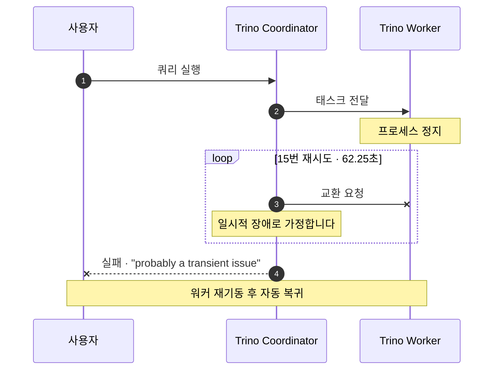

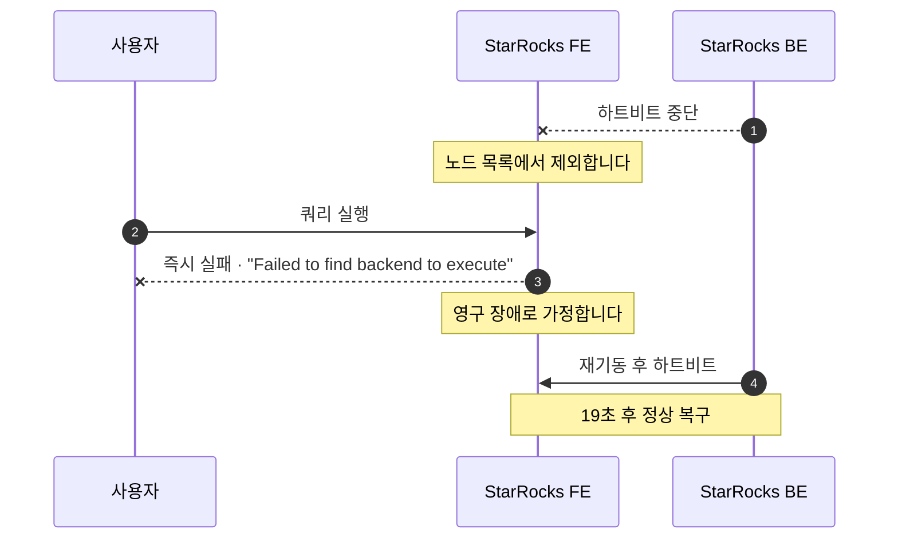

**어느 쪽이 옳은지는 가정의 차이입니다.** Trino의 62초는 GC 정지와 일시적 네트워크 문제를 넘기려는 것이고, StarRocks의 즉시 실패는 FE가 노드 상태를 이미 알고 있기 때문에 가능합니다. 다만 **실무에서는 Trino 쪽 62초가 더 자주 문제가 됩니다.** 대화형 쿼리가 1분간 멈춰 있다 실패하면 사용자는 "행 걸렸다"고 인식합니다.

---

## 6. 언제 무엇을 고를까

**결론의 세 질문을 흐름도로 옮기면 이렇습니다.**

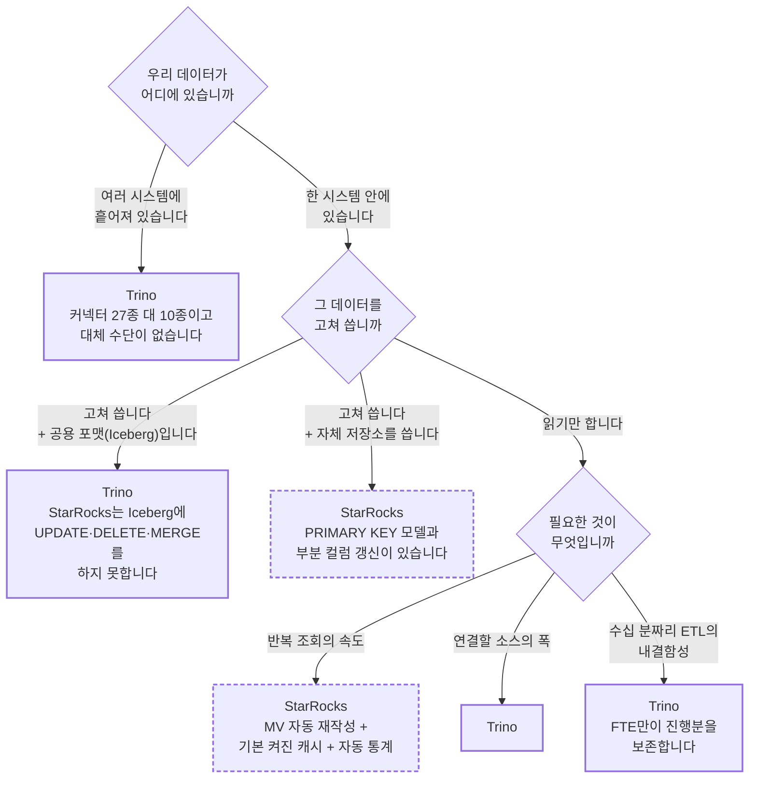

**세 답이 한 방향으로 모이면 선택은 이미 정해져 있습니다.** 답이 갈린다면 아래 "함께 쓰는 구성"이 현실적인 답입니다.

| 상황 | 선택 | 결정적 근거 |
|---|---|---|
| 서로 다른 시스템을 한 쿼리로 조인해야 합니다 | **Trino** | 커넥터 27종 대 10종이고 대체 수단이 없습니다 |
| Iceberg를 고쳐 써야 합니다 (CDC upsert, 개인정보 삭제) | **Trino** | StarRocks는 Iceberg에 `UPDATE`·`DELETE`·`MERGE`를 수행하지 못합니다 |
| 수십 분 이상 실행되는 ETL이 있습니다 | **Trino** | FTE만이 진행분을 보존합니다 |
| 여러 엔진이 같은 레이크를 함께 씁니다 | **Trino** | 통계가 테이블 포맷에 남아서 공유됩니다 |
| 정책을 Rego로 통일해 관리합니다 | **Trino** | OPA 연동은 Trino에만 있습니다 |
| 엔진을 직접 고쳐 쓸 계획이 있습니다 | **Trino** | SPI로 대부분 해결되고 빌드도 단일 언어입니다 |
| BI 대시보드와 반복 조회가 주된 용도입니다 | **StarRocks** | MV 자동 재작성, 기본으로 켜진 캐시, 자동 통계를 모두 갖추었습니다 |
| upsert가 잦은 서비스 데이터를 다룹니다 | **StarRocks** | `PRIMARY KEY` 모델과 부분 컬럼 갱신을 지원합니다 |
| Kafka에서 테이블로 들어가는 파이프라인이 필요합니다 | **StarRocks** | Routine Load가 구성 요소를 하나 줄여 줍니다 |
| `LIKE '%…%'` 검색이 잦습니다 | **StarRocks** | n-gram 인덱스가 있습니다 |
| 운영 인력이 적습니다 | **StarRocks** | 통계와 compaction, 캐시가 자동입니다. 다만 자원 계획은 더 어렵습니다 |

### 두 엔진을 함께 쓰는 구성

**두 엔진을 같은 Iceberg 카탈로그에 붙이는 방식은 실제로 잘 동작합니다.** 이 비교의 랩 자체가 그 증거입니다. 두 엔진의 강점이 겹치지 않기 때문에 역할을 나눌 수 있습니다.

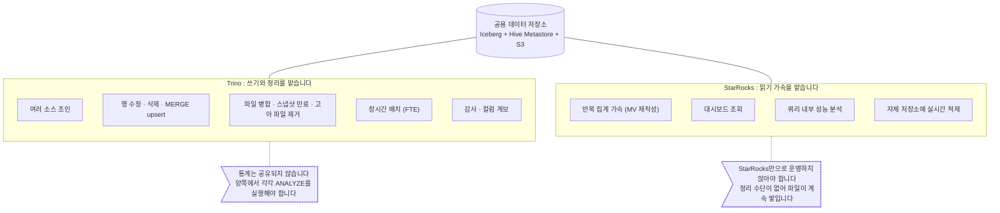

| 작업 | 담당 |
|---|---|
| 적재(append), 조회, 시간 여행 | 양쪽 모두 가능합니다 |
| **행 수정과 삭제, MERGE upsert** | **Trino만 가능합니다** |
| **파일 병합, 스냅샷 만료, 고아 파일 제거** | **Trino만 가능합니다** |
| 반복 집계 가속 (MV 재작성) | StarRocks가 담당합니다 |
| 감사와 컬럼 계보 | Trino가 담당합니다 |
| 성능 분석 | StarRocks의 프로파일을 사용합니다 |

주의할 점이 두 가지 있습니다.

1. **통계는 공유되지 않습니다.** 양쪽에서 각각 `ANALYZE`를 실행해야 합니다.
2. **StarRocks만으로 Iceberg를 운영하지 않아야 합니다.** 적재는 가능하지만 정리할 수단이 없어서 파일이 계속 쌓입니다.

---

## 7. 확인하지 못한 것

보고의 신뢰는 무엇을 확인하지 못했는지를 밝히는 데서 나옵니다.

| 항목 | 확인하지 못한 이유 | 필요한 조건 |
|---|---|---|
| **어느 쪽이 실제로 빠른가** | 실행 시간을 한 번도 재지 않았습니다. 데이터가 6만 행으로 작고, 큰 데이터로 재려면 메모리가 부족했습니다 | RAM 24GB 이상 + swap |
| 다중 노드 동작 | 각 엔진을 1대씩으로만 구성했습니다 | 3대 이상 구성 |
| 셔플 전송 계층 전체 | 노드가 1대이므로 원격 셔플 경로가 생기지 않았습니다 | 위와 같습니다 |
| 리소스 그룹이 가중치대로 CPU를 나누는가 | 이 축의 핵심 주장인데 1대에서는 확인할 수 없습니다 | 위와 같습니다 |
| 연합 질의 | 카탈로그가 Iceberg 하나뿐이었습니다 | 다중 카탈로그 구성 |
| Ranger와 OPA 연동 | 정책 서버가 없었습니다 | 별도 구성 |
| Stream/Broker/Routine Load | Kafka와 브로커가 없었습니다 | 별도 구성 |
| StarRocks shared-data 모드 | 클러스터를 다시 구성해야 합니다 | 클러스터 재구성 |
| 커밋 활동과 릴리스 주기 | `works/`를 얕은 클론으로 받아 이력이 없습니다 | 전체 클론 |

미해결 과제가 하나 있습니다. StarRocks 4.0.1에서 관찰한 BE SIGSEGV가 arm64 환경에만 해당하는지 확인하지 못했습니다. 디스크 여유가 부족해 4.0.1과 4.0.14 이미지를 함께 둘 수 없었습니다.

### 이 비교가 스스로 고친 것

계획 단계의 전제가 **일곱 번 틀렸습니다.** 소스코드를 비교하는 작업에 선입견이 얼마나 자주 개입하는지 보여 주는 기록이라서 남깁니다.

| 계획 단계의 전제 | 실제로 확인한 내용 |
|---|---|
| 문법이 `core/trino-parser`에 있습니다 | 483에서 `core/trino-grammar`로 분리되었습니다 |
| 협력적 멀티태스킹과 논블로킹 폴러로 대비됩니다 | 성립하지 않습니다. 양쪽 모두 다단계 피드백 큐로 수렴했습니다 |
| Trino의 MV는 Iceberg와 Hive 커넥터에 한정됩니다 | Hive 커넥터는 MV를 구현하지 않습니다 |
| StarRocks는 BE cgroup으로 격리를 수행합니다 | cgroup을 쓰지 않습니다. CPU 친화도 바인딩과 가중 vruntime으로 구현되어 있습니다 |
| 캐시는 StarRocks에만 있습니다 | Trino 483에 Alluxio 기반 분산 파일 캐시가 있습니다. 없는 것은 결과 캐시뿐입니다 |
| StarRocks는 내장 RBAC만 제공합니다 | Apache Ranger 통합이 있습니다 |
| StarRocks의 전역 딕셔너리에 Trino는 대응물이 없습니다 | 맞지만 레이크 테이블에서는 StarRocks 자신도 기본으로 쓰지 않습니다 |

코드만 읽고 내린 판단이 실측에 두 번 뒤집히기도 했습니다. "임계값 때문에 StarRocks가 left-deep 플랜을 만든다"고 읽었으나 원인은 통계 부족이었고, "StarRocks 커넥터는 함수 술어를 밀어 내리지 못한다"고 읽었으나 `date_format`에서는 완전히 프루닝했습니다.

---

## 8. 다음 편

이 글은 결론만 모았습니다. 축마다 어떤 코드를 읽고 무엇을 측정했는지는 각 편에 있습니다.

| 편 | 다루는 질문 |
|---|---|
| [2편 · 옵티마이저](02-옵티마이저-같은-쿼리-다른-플랜.md) | 같은 쿼리에 왜 다른 플랜이 나오는가 |
| [3편 · 실행 엔진](03-실행-엔진-JVM과-C++.md) | JVM 바이트코드 생성과 C++ 벡터화는 무엇이 다른가 |
| [4편 · 운영](04-운영-메모리-격리-장애.md) | 메모리와 격리, 장애는 어떻게 갈리는가 |
| [5편 · 스토리지](05-스토리지-한쪽에만-있는-계층.md) | StarRocks에만 있는 계층은 무엇을 해 주는가 |
| [6편 · 커넥터](06-커넥터와-확장성-경계의-값.md) | 경계를 만든 값은 얼마인가 |
| [7편 · SQL 이전](07-SQL-이전-조용히-깨지는-것들.md) | SQL을 옮길 때 조용히 깨지는 것은 무엇인가 |

---

## 출처와 라이선스

- Trino: [trinodb/trino](https://github.com/trinodb/trino) tag `483`, Apache License 2.0. Copyright Trino 프로젝트 기여자
- StarRocks: [StarRocks/starrocks](https://github.com/StarRocks/starrocks) tag `4.0.14`, Apache License 2.0. Copyright StarRocks 프로젝트 기여자
- 인용한 코드는 모두 30줄 이하이고 출처를 영구 링크로 표시했습니다
- 비교 원본: 기술 문서 31편([목차](../00-목차.md)), 실험 기록 18편(`docs/evidence/`), 종합 결론([99-종합-결론](../99-종합-결론.md))
