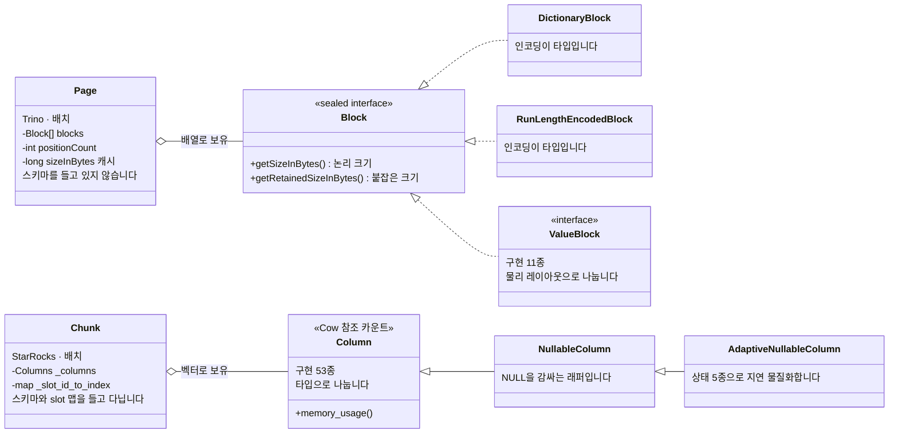
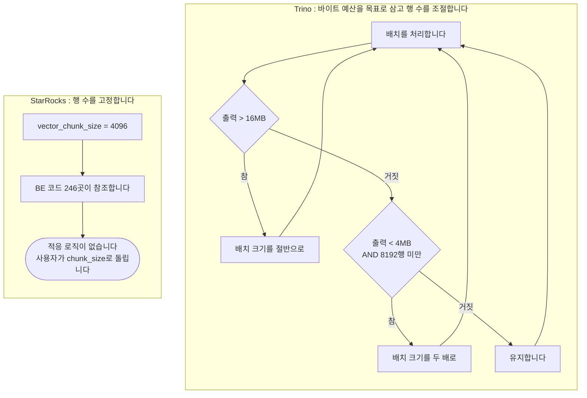
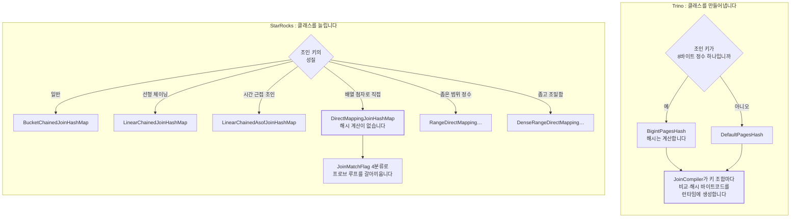
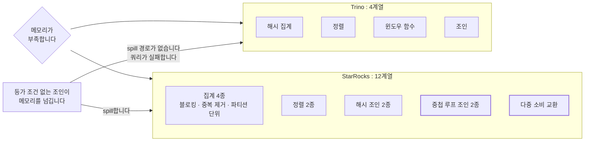
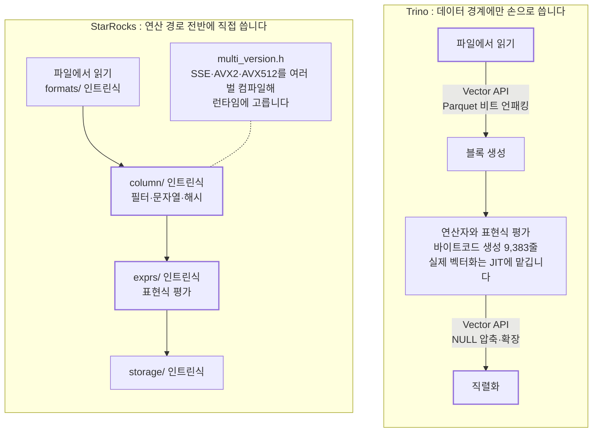

# "Java라서 느리다"를 코드로 확인해 보았습니다: 두 실행 엔진 비교

> 비교 기준: Trino **483** (`50b0b50b`) · StarRocks **4.0.14** (`7c18dd9d`) · 2026-10-16 기준
> 랩 구성: 같은 Iceberg 카탈로그, Trino worker 1대 / StarRocks BE 1대, TPC-H SF 0.01
> 다루지 않는 것: **실행 시간과 처리량 비교**(5절), 다중 노드 스케줄링, spill 발생 시의 동작
> 시리즈: [1편 · 전체 결론](01-스토리지를-소유하는가.md) · [2편 · 옵티마이저](02-옵티마이저-같은-쿼리-다른-플랜.md)

---

## 결론부터

**두 실행 엔진의 구조는 생각보다 많이 수렴해 있습니다. 남은 차이는 대부분 언어 제약의 귀결이고, 우열이 아닙니다.**

비교를 시작할 때 세웠던 전제 두 개가 코드를 읽고 틀린 것으로 드러났습니다.

- **"Trino는 Java라서 SIMD를 못 쓴다"** 는 483 기준으로 틀렸습니다. Java Vector API를 실제로 씁니다. 다만 범위가 좁습니다.
- **"협력적 멀티태스킹 대 논블로킹 폴러"** 라는 대비도 성립하지 않았습니다. 양쪽 모두 다단계 피드백 큐로 수렴했습니다.

코드로 확인된 실질적 차이는 셋입니다. **배치 단위의 기준**(바이트 대 행 수), **spill 가능 범위**(4계열 대 12계열), 그리고 **특수화를 컴파일 시점에 하는가 실행 시점에 하는가**입니다.

**그리고 이 글은 어느 쪽이 빠른지에 답하지 않습니다.** 실행 시간을 한 번도 재지 못했습니다. 이유는 5절에 있습니다.

---

## 1. 비교 범위와 버전

| 항목 | 내용 |
|---|---|
| 비교 대상 | Trino 483 (Java) / StarRocks 4.0.14 BE (C++) |
| 측정 환경 | macOS arm64, Docker Desktop 14 CPU / 25GB, `functional` 프로파일 |
| 데이터 | TPC-H SF 0.01, `bench.lineitem` 60,175행, Iceberg 외부 테이블 |
| 비교 축 | 데이터 표현 · 스케줄링 · 연산자 알고리즘 · 런타임 필터 · 표현식 평가 |

**이 축은 런타임으로 볼 수 있는 것이 적습니다.** 블록과 컬럼의 메모리 배치는 플랜에도 프로파일에도 드러나지 않고, 어느 해시 조인 구현이 선택되었는지도 노출되지 않습니다. 그래서 이 글은 **코드 비교가 중심이고 실측은 보조**입니다. 실측으로 확인한 것은 설정값의 존재와 효과, 그리고 생성 여부까지입니다.

---

## 2. 두 엔진이 같은 결론에 도달한 곳

### 2-1. 데이터 표현 모델이 대등합니다

양쪽 모두 컬럼너 배치 처리입니다. 행 하나씩이 아니라 수천 행 묶음을 컬럼 단위로 들고 다닙니다. 규모도 비슷합니다.

| | Trino 483 | StarRocks 4.0.14 |
|---|---|---|
| 배치 이름 | `Page` | `Chunk` |
| 배치 패키지 규모 | 블록 64파일 **13,754줄** | 컬럼 69파일 **16,364줄** |
| 메모리 회계 | `getSizeInBytes` / `getRetainedSizeInBytes` | `container_memory_usage` + `reference_memory_usage` |



**무엇을 타입으로 승격시켰는지가 다릅니다.** Trino는 딕셔너리와 RLE를, StarRocks는 NULL과 상수를 승격시켰습니다.

메모리 회계가 놀랍도록 비슷하게 갈라져 있습니다. 양쪽 모두 "논리 크기"와 "실제로 붙잡고 있는 크기"를 구분합니다. 같은 문제의식입니다. 데이터를 공유하면 중복 계산이 발생하므로, 그것을 따로 세지 않으면 메모리 회계가 크게 틀립니다.

소유권 모델만 수단이 다릅니다. Trino의 블록은 **불변이고 GC가 수거**하며, StarRocks의 컬럼은 **참조 카운트 기반 copy-on-write**입니다. 참조자가 하나뿐이면 제자리에서 고치고 여럿이면 복사합니다. 같은 목표("공유하되 안전하게")를 서로 다른 수단으로 얻습니다.

### 2-2. 스케줄링 구조도 수렴했습니다

비교를 설계할 때는 "Trino의 협력적 멀티태스킹"과 "StarRocks의 논블로킹 폴러"를 대비시킬 생각이었습니다. **483과 4.0.14에서는 그 대비가 성립하지 않습니다.**

| | Trino 483 | StarRocks 4.0.14 |
|---|---|---|
| 기본 실행기 | 드라이버당 스레드 + `FairScheduler` | 스레드 풀 + 다단계 피드백 큐 |
| 옛 실행기 | `TimeSharingTaskExecutor`(5단계 큐), 설정으로 되돌릴 수 있습니다 | 없습니다 |
| 다단계 큐 | 옛 실행기 5단계 (1초~5분) | **8단계** (0.2초~7.4초) |
| 연산자 인터페이스 | `needsInput` / `getOutput` | `need_input` / `pull_chunk` |

**연산자 인터페이스가 거의 동형입니다.** 그리고 양쪽 모두 다단계 피드백 큐 계보입니다.

남은 차이는 **상수와 표현 방식**입니다.

- **양자가 1초 대 100ms로 10배 다릅니다.** 짧으면 짧은 쿼리의 응답이 빨라지고, 길면 문맥 전환 비용이 줄어듭니다.
- **진행 불가의 표현이 다릅니다.** Trino의 `isBlocked()`는 미래 객체 하나를 돌려줍니다. "언제 깨워 달라"입니다. StarRocks는 **상태 열거 12종**으로 "왜 못 간다"를 말합니다. `OUTPUT_FULL`(하류가 막힘)과 `INPUT_EMPTY`(상류가 안 줌)는 대처가 달라야 하므로, 후자가 스케줄러에 정보를 더 줍니다.

**대가는 결합도입니다.** 상태가 늘면 연산자 구현이 그 상태를 정확히 보고해야 하고, 새 연산자를 추가할 때 실수할 여지가 커집니다. Trino의 미래 객체는 **연산자가 스케줄러의 내부 사정을 몰라도 되게** 만듭니다. 플러그인이 연산자를 제공하는 구조에서는 이 단순함이 값을 합니다.

### 2-3. spill 기본값이 양쪽 모두 꺼짐입니다

```java
// core/trino-main/src/main/java/io/trino/FeaturesConfig.java#L110 @ 483
private boolean spillEnabled;
```

[FeaturesConfig.java#L110](https://github.com/trinodb/trino/blob/483/core/trino-main/src/main/java/io/trino/FeaturesConfig.java#L110)

초기값이 없으므로 기본 `false`입니다. StarRocks도 `enableSpill = false`입니다. **메모리가 부족하면 기본 동작은 양쪽 모두 spill이 아니라 쿼리 실패입니다.**

spill은 성능을 크게 떨어뜨리므로 "느려도 끝나는 것"이 "빠르게 실패하는 것"보다 나을 때만 켭니다. **기본값이 같다는 것은 두 엔진이 이 판단을 공유한다는 뜻입니다.**

---

## 3. 실질적으로 갈리는 세 곳

### 3-1. 배치 단위: 바이트 예산 대 행 수 고정

Trino에는 "행 몇 개짜리 배치"라는 고정값이 없습니다. 대신 상한(8,192행)과 목표 바이트(1MB, 하한 4MB, 상한 16MB)가 있고, **런타임에 배치 크기를 스스로 바꿉니다.**

```java
// core/trino-main/src/main/java/io/trino/operator/project/PageProcessor.java#L220-L231 @ 483
private void updateBatchSize(int positionCount, long pageSize)
{
    // if we produced a large page, halve the batch size for the next call
    if (positionCount > 1 && pageSize > MAX_PAGE_SIZE_IN_BYTES) {
        projectBatchSize = projectBatchSize / 2;
    }

    // if we produced a small page, double the batch size for the next call
    if (pageSize < MIN_PAGE_SIZE_IN_BYTES && projectBatchSize < MAX_BATCH_SIZE) {
        projectBatchSize = projectBatchSize * 2;
    }
}
```

[PageProcessor.java#L220-L231](https://github.com/trinodb/trino/blob/483/core/trino-main/src/main/java/io/trino/operator/project/PageProcessor.java#L220-L231)



**바이트가 목표이고 행 수는 그것을 맞추는 수단입니다.** 컬럼 폭이 제각각인 환경에서 "행 4,096개"가 어떤 때는 40KB, 어떤 때는 400MB가 되는 문제를 이렇게 피합니다.

StarRocks는 반대입니다.

```cpp
// be/src/common/config.h#L854 @ 4.0.14
CONF_Int32(vector_chunk_size, "4096");
```

[config.h#L854](https://github.com/StarRocks/starrocks/blob/4.0.14/be/src/common/config.h#L854)

**행 수 고정값이고 적응 로직이 없습니다.** BE 코드에서 이 값을 참조하는 지점이 **246곳**으로, 실행 전체의 기본 단위입니다.

이 차이는 각자의 위치에서 자연스럽습니다. **Trino는 컬럼 폭을 모르는 데이터를 상대합니다.** 커넥터가 27종이고 어떤 테이블은 컬럼이 3개, 어떤 테이블은 300개입니다. "행 4,096개"라는 약속으로는 메모리 사용량을 통제할 수 없습니다. **StarRocks는 자기 스토리지의 스키마를 압니다.** 행 수를 고정해도 메모리가 폭발하지 않고, 고정값이면 컴파일 시점에 버퍼 크기를 정할 수 있어 C++ 최적화에 유리합니다.

**대신 튜닝 손잡이가 반대입니다.** StarRocks는 사용자가 `chunk_size`를 돌릴 수 있고 실제로 효과가 있습니다(5-1에서 측정했습니다). Trino는 돌릴 것이 없고 엔진이 알아서 합니다. 자동 조절은 대부분 옳지만, **틀렸을 때 고칠 방법이 없습니다.**

### 3-2. 특수화: 클래스를 늘리는 쪽과 코드를 만들어내는 쪽

컬럼 구현 수가 **11종 대 53종**입니다. 숫자만 보면 StarRocks가 훨씬 잘게 나눈 것 같지만, **표현 가능한 범위는 비슷합니다.** 차이는 타입 정보를 어디에 담는가입니다.

Trino는 **물리 레이아웃**으로 나눕니다. `BIGINT`와 `DOUBLE`이 같은 `LongArrayBlock`을 쓰고, `DoubleType`이 `doubleToLongBits`로 변환해 넣습니다. 논리 타입은 `Type` 객체가 따로 들고 있습니다. StarRocks는 **타입별 템플릿 인스턴스**로 펼쳤습니다. `Int64Column`과 `DoubleColumn`이 별개 클래스입니다.

**이것은 취향이 아니라 언어 제약의 귀결입니다.** Java에서 타입마다 블록 클래스를 만들면 `Block.getLong()` 호출 지점이 megamorphic해져 JIT이 인라이닝을 포기합니다. C++ 템플릿은 반대로 컴파일 시점에 단형화되므로 타입마다 클래스를 만들어도 가상 호출이 늘지 않습니다.

같은 구도가 연산자 층에서도 반복됩니다. 해시 조인의 조회표가 **2종 대 6종**입니다.



```java
// core/trino-main/src/main/java/io/trino/operator/join/JoinHashSupplier.java#L91-L94 @ 483
this.pagesHash = switch (getPagesHashType(addresses, singleBigintJoinChannel)) {
    case BIGINT -> new BigintPagesHash(...);
    case DEFAULT -> new DefaultPagesHash(...);
};
```

[JoinHashSupplier.java#L91-L94](https://github.com/trinodb/trino/blob/483/core/trino-main/src/main/java/io/trino/operator/join/JoinHashSupplier.java#L91-L94)

두 갈래뿐이고, 타입별 최적화는 **바이트코드 생성**이 맡습니다. `JoinCompiler`가 조인 키 조합마다 비교와 해시 코드를 만들어냅니다. **클래스를 늘리는 대신 클래스를 만들어내는 방식**입니다.

StarRocks는 키의 성질마다 전용 구현을 둡니다.

| 클래스 | 겨냥하는 상황 |
|---|---|
| `BucketChainedJoinHashMap` | 일반적인 버킷 체이닝 |
| `LinearChainedJoinHashMap` | 선형 체이닝 |
| `LinearChainedAsofJoinHashMap` | ASOF 조인(시간 근접 조인) |
| **`DirectMappingJoinHashMap`** | **키를 배열 첨자로 직접 쓸 수 있을 때** |
| `RangeDirectMappingJoinHashMap` | 키가 좁은 범위의 정수일 때 |
| `DenseRangeDirectMappingJoinHashMap` | 위와 같되 조밀할 때 |

[join_hash_map_method.h#L250](https://github.com/StarRocks/starrocks/blob/4.0.14/be/src/exec/join/join_hash_map_method.h#L250)

`DirectMapping` 계열이 특징적입니다. 조인 키가 1~100 범위의 정수라면 **해시를 계산하지 않고 배열 첨자로 바로 찾습니다.** Trino의 `BigintPagesHash`도 정수 특수화이지만 해시 계산은 합니다.

매칭 결과의 성질까지 미리 분류합니다. `JoinMatchFlag`가 `NORMAL` / `ALL_NOT_MATCH` / `ALL_MATCH_ONE` / `MOST_MATCH_ONE`로 나뉘어, 외래키 조인처럼 대부분 1:1인 경우에 프로브 루프를 갈아끼웁니다.

**두 방식 모두 "타입별 전용 코드"라는 같은 목표에 도달합니다.** 차이는 그 코드가 컴파일 시점에 만들어지는가, 실행 시점에 만들어지는가입니다. 후자는 첫 실행에 컴파일 비용이 붙지만 실제 데이터 분포를 보고 결정할 여지가 있습니다.

### 3-3. spill 범위: 4계열 대 12계열

**이 축에서는 StarRocks가 뚜렷하게 넓습니다.**



| | Trino 483 | StarRocks 4.0.14 |
|---|---|---|
| spill 가능 연산자 | **4계열** (해시 집계, 정렬, 윈도우, 조인) | **12계열** |
| 중첩 루프 조인 spill | 없습니다 | 있습니다 |
| 다중 소비 교환 spill | 해당 기능 자체가 없습니다 | 있습니다 |

**12계열 대 4계열은 "메모리가 부족할 때 살아남는 쿼리의 범위"입니다.** Trino에서 중첩 루프 조인(등가 조건이 없는 조인)이 메모리를 넘기면 spill할 방법이 없어 쿼리가 실패합니다. StarRocks에는 그 경로가 있습니다.

다중 소비 교환의 spill은 CTE 재사용의 중간 결과를 디스크로 내릴 수 있다는 뜻입니다. **CTE 재사용 기능 자체가 Trino에 없으므로 대응물이 있을 수 없습니다.**

다만 2-3에서 본 대로 **양쪽 모두 기본이 꺼져 있습니다.** 평시 동작에는 차이가 없습니다.

Trino 쪽에도 특징적인 부분이 있습니다. 집계 spill이 한도를 두 개 듭니다. `memoryLimitForMerge`와 `memoryLimitForMergeWithMemory`입니다. **"합칠 때 쓸 메모리"와 "메모리에 남은 것과 함께 합칠 때 쓸 메모리"를 구분합니다.** 다시 읽어 들이며 합치는 단계의 메모리까지 별도 한도로 관리하는 구조입니다.

---

## 4. 통념 두 가지를 정정합니다

### 4-1. "Trino는 Java라서 SIMD를 못 쓴다"는 483 기준으로 틀렸습니다

Trino 483은 **Java Vector API(`jdk.incubator.vector`)를 실제로 씁니다.** 다만 범위가 좁습니다.

| | Trino 483 | StarRocks 4.0.14 |
|---|---|---|
| SIMD 사용 파일 수 | **14개** (벤치마크 포함) | **45개** |
| 쓰는 곳 | 블록 직렬화 시 NULL 압축·확장, Parquet 비트 언패킹 | `exprs/`, `column/`, `storage/`, `util/` 연산 경로 전반 |
| CPU 판별 | 런타임(`/proc/cpuinfo` 플래그 → `SimdCapability` 8종) | 컴파일 다중 버전 + 런타임 디스패치 |
| 연산자·표현식 평가 | **바이트코드 생성 + JIT 자동 벡터화** (56파일 9,383줄) | **인트린식 직접 작성** |



**차이는 "SIMD를 쓰는가"가 아니라 "어디까지 직접 쓰는가"입니다.** Trino는 데이터 경계(직렬화와 파일 디코딩)에만 손으로 쓴 SIMD를 두고, 연산 자체는 JIT에 맡깁니다. StarRocks는 필터와 해시, 표현식까지 직접 씁니다. StarRocks 쪽 `column/` 아래 5개 파일은 필터 적용, 문자열 처리, 해시 계산 같은 **핵심 경로**입니다.

이것도 언어 제약입니다. Java Vector API는 아직 incubator 단계이고 `module-info.java`에 `requires jdk.incubator.vector`를 넣어야 쓸 수 있습니다. 커넥터 플러그인이 이것을 쓰게 만들 수는 없습니다.

**성능 차이의 크기는 측정하지 않았습니다. 코드 표면적만으로 결론을 내면 안 됩니다.**

### 4-2. "StarRocks는 JIT을 쓰니 더 빠르다"도 그대로 읽으면 안 됩니다

표현식 평가의 구조가 반대입니다.

| | Trino 483 | StarRocks 4.0.14 |
|---|---|---|
| 표현식 실행 코드 | **바이트코드 생성** (항상, 끌 수 없습니다) | 미리 컴파일된 벡터화 함수 + **LLVM JIT(선택)** |
| 끌 수 있는가 | 없습니다 | `jit_level` 단계값, 기본 **1** |

**Java에서 코드 생성은 선택이 아닙니다.** 인터프리터 방식 표현식 평가는 가상 호출이 매 행마다 발생해 실용적이지 않습니다. Trino가 9,383줄을 들여 바이트코드 생성기를 만든 것은 그 때문입니다.

**C++에서는 선택입니다.** 미리 컴파일된 벡터화 함수가 이미 SIMD를 쓰고 가상 호출도 컬럼 단위로 한 번만 일어납니다. JIT이 더 벌어 주는 것은 여러 연산을 한 루프로 융합하는 부분이고, 그것이 항상 이득은 아닙니다. **`jit_level`이 기본 1단계에 머무는 것 자체가 "무조건 이득이 아니다"의 방증입니다.**

### 4-3. 전역 딕셔너리는 레이크 테이블에서 StarRocks 자신도 쓰지 않습니다

비교 계획 단계에서는 "StarRocks의 전역 딕셔너리에 Trino는 대응물이 없다"고 적었습니다. 맞는 설명이지만 **한정이 빠져 있었습니다.**

`l_returnflag`는 고유값이 3개로 저카디널리티 최적화의 교과서적 대상입니다. 그런데 플랜에 `DictDecodeNode`가 나타나지 않았습니다.

| 설정 | 플랜에 `DictDecodeNode`가 있는가 |
|---|---|
| 기본값 | 없습니다 |
| `SET low_cardinality_optimize_on_lake = true` | **여전히 없습니다** |

이유가 두 겹입니다. 첫째로 데이터레이크 테이블은 기본 대상이 아닙니다(`useLowCardinalityOptimizeOnLake = false`). 둘째로 켜도 발동하지 않은 것은 전역 사전이 수집되어 있지 않기 때문으로 보입니다. 사전 수집은 자체 스토리지 경로에 붙어 있고 이 랩의 테이블은 전부 Iceberg 외부 테이블입니다. **두 번째 이유는 추정이며 확정하지 않았습니다.**

개입 층이 다른 것이 이 차이의 뿌리입니다. Trino는 **실행 중 표현식 층**에서 파일이 이미 딕셔너리 인코딩해 준 경우에 활용하고, StarRocks는 **계획 시점**에 "이 컬럼은 정수로 다루자"고 결정합니다. 후자가 적용 범위가 훨씬 넓습니다(조인, 집계, 정렬 전 구간). 대신 자기 저장소에 묶입니다.

Trino 쪽은 **인코딩을 타입 시스템에 올려 두었습니다.**

```java
// core/trino-spi/src/main/java/io/trino/spi/block/Block.java#L21-L24 @ 483
public sealed interface Block
        permits DictionaryBlock,
                RunLengthEncodedBlock,
                ValueBlock
```

[Block.java#L21-L24](https://github.com/trinodb/trino/blob/483/core/trino-spi/src/main/java/io/trino/spi/block/Block.java#L21-L24)

**모든 연산자가 "이 블록이 딕셔너리일 수 있다"를 타입 수준에서 마주합니다.** 덕분에 딕셔너리 블록을 받은 연산자가 사전만 처리하고 인덱스를 그대로 넘기는 최적화를 안전하게 할 수 있습니다. 반대로 StarRocks는 NULL과 상수를 래퍼 컬럼으로 두고 `AdaptiveNullableColumn`까지 갔습니다. **적재 중에는 NULL 마스크를 만들지 않고 상태만 들고 있다가 실제로 섞이면 그때 물질화합니다.** Trino에 대응물이 없습니다.

**즉 무엇을 타입으로 승격시켰는가가 다릅니다.** Trino는 인코딩을, StarRocks는 NULL과 상수를 승격시켰습니다.

---

## 5. 측정 결과

환경: macOS arm64 Docker Desktop 14 CPU / 25GB, `functional` 프로파일, TPC-H SF 0.01, Trino worker 1대 / StarRocks BE 1대. **실행 시간은 재지 않았습니다.**

### 5-1. 청크 크기는 실제 메모리 단위입니다

`chunk_size`를 바꾸고 같은 쿼리의 `QueryAllocatedMemoryUsage`를 읽었습니다(각 2회, 편차 0.5% 미만).

| `chunk_size` | 할당 메모리 |
|---|---|
| 64 | 3.745 / 3.733 MB |
| **4096** (기본) | **3.172 / 3.169 MB** |
| 32768 | 7.076 / 7.077 MB |

8배로 키우면 할당량이 **2.2배**가 됩니다. 반대로 64로 줄이면 오히려 **늘었습니다.** 청크당 고정 비용에 청크 수가 곱해지기 때문입니다. **결과는 세 설정에서 모두 같았고 Trino와도 같았습니다.** 배치 크기는 성능 손잡이이지 의미를 바꾸지 않습니다.

Trino 쪽에는 대응하는 손잡이가 없습니다.

| 엔진 | 노출된 설정 | 값 | 성격 |
|---|---|---|---|
| StarRocks | `chunk_size` | 4,096행 | 실행 전체의 기본 배치 |
| Trino | `filter_and_project_min_output_page_row_count` | 256행 | filter/project 출력의 **하한** |
| Trino | `filter_and_project_min_output_page_size` | 500kB | 같은 것의 바이트 축 |

### 5-2. 런타임 필터는 양쪽 모두 만들지만 보이는 곳이 다릅니다

```sql
SELECT count(*) FROM lineitem JOIN orders ON l_orderkey = o_orderkey
WHERE o_orderdate < DATE '1993-01-01';
```

| 엔진 | 생성 | 어디에 보이는가 |
|---|---|---|
| Trino 483 | 합니다 | **기본 `EXPLAIN`** 에 `dynamicFilters = {l_orderkey = #df_343}` |
| StarRocks 4.0.14 | 합니다 | **`EXPLAIN VERBOSE`에서만** 보입니다: `build runtime filters: - filter_id = 0, …` |

**기본 `EXPLAIN`만 보면 StarRocks가 런타임 필터를 만들지 않는 것처럼 보입니다.** 진단할 때 알고 있어야 하는 차이입니다.

그리고 StarRocks는 조인 분배에 따라 필터 범위를 바꿉니다.

| 조인 분배 | 런타임 필터 |
|---|---|
| `INNER JOIN (BROADCAST)` (기본) | `remote = false` |
| `INNER JOIN (PARTITIONED)` (`[shuffle]` 힌트) | `remote = true` |

같은 쿼리에서 조인 방식만 바꿨는데 필터의 전파 범위가 따라 바뀌었습니다. Trino도 내부적으로는 두 경우의 임계값을 다르게 쓰지만 플랜에 그 구분이 드러나지 않습니다.

**여기서도 코드만 읽고 내린 판단이 한 번 어긋났습니다.** 코드의 임계값(128KB)대로라면 빌드측이 약 27KB인 이 쿼리는 필터를 만들지 않아야 합니다. **그런데 만들었습니다.** 임계값을 1로 낮춰도 변화가 없었습니다. 즉 이 경로에서는 그 설정이 발화 지점이 아닙니다. **코드에서 읽은 임계값이 실제로 어디에 적용되는지 확정하지 못했습니다.**

### 5-3. 배치 단위는 관측 지표로 노출되지 않습니다

| 엔진 | 프로파일에 보이는 단위 |
|---|---|
| Trino 483 | `Input: 60175 rows (587.64kB)` 행과 바이트를 함께 보여줍니다 |
| StarRocks 4.0.14 | `OutputRows: 60.175K` + 타이머 + `InstanceAllocatedMemoryUsage` |

**페이지나 청크 개수를 보여주는 카운터는 어느 쪽에도 없습니다.** 여기서도 3-1의 성격이 비칩니다. Trino는 바이트를 함께 보여주고 StarRocks는 행과 시간을 보여줍니다.

### 5-4. 실행 시간을 재지 못한 이유

랩 데이터가 TPC-H SF 0.01(`lineitem` 60,175행)로 너무 작습니다. SF 1을 쓰는 `perf` 프로파일은 검증 호스트에서 띄울 수 없었습니다. 컨테이너 한도가 15.3GB인데 호스트 RAM이 15.6GB이고 swap이 0이어서 초과분이 곧바로 OOM killer로 갑니다.

그 결과 이 글의 주제에서 가장 알고 싶었던 항목들이 전부 미측정으로 남았습니다.

- C++ 벡터화와 JVM 바이트코드 생성 사이의 실제 처리량 차이
- 해시 조인 구현이 6종인 쪽과 2종인 쪽의 성능 차이
- `DirectMapping`이 이론상 유리한데 실제로 얼마나 유리한가
- spill이 발생했을 때 성능이 어떻게 변하는가
- 바이트코드 생성과 JIT의 컴파일 비용(첫 실행 지연)

**데이터가 6만 건이라 어느 연산자도 메모리 한도에 닿지 않고, 쿼리가 전부 수십 ms라 컴파일 비용과 실행 비용을 분리할 수 없습니다.**

---

## 6. 축별 정리

| 축 | Trino 483 | StarRocks 4.0.14 | 평가 |
|---|---|---|---|
| 데이터 표현 모델 | 컬럼너 배치, 64파일 13,754줄 | 컬럼너 배치, 69파일 16,364줄 | **대등합니다** |
| 배치 크기 기준 | 바이트 예산(1~16MB), 런타임 적응 | 행 수 고정(4,096) | 갈립니다 |
| 사용자 손잡이 | 없습니다 | `chunk_size` | StarRocks만 있습니다 |
| 컬럼 구현 수 | 11종 (물리 레이아웃 기준) | 53종 (타입 기준) | 언어 제약의 귀결입니다 |
| 타입으로 승격한 것 | 딕셔너리·RLE | NULL·상수 | 서로 다릅니다 |
| 소유권 | 불변 + GC | COW 참조 카운트 | 같은 목표, 다른 수단 |
| 실행 모델 | 다단계 피드백 큐 계보 | 다단계 피드백 큐 | **수렴했습니다** |
| 양자 | 1초 | 100ms | 10배 차이입니다 |
| 진행 불가 표현 | 미래 객체("언제") | 상태 12종("왜") | 정보량 대 단순함 |
| 해시 조회표 | 2종 + 바이트코드 생성 | 6종 + 매칭 성질 4분류 | 같은 목표, 다른 시점 |
| spill 범위 | 4계열 | **12계열** | StarRocks가 넓습니다 |
| spill 기본값 | 꺼짐 | 꺼짐 | **같습니다** |
| 정렬 | 비교기를 컴파일합니다 | 컬럼 단위 정렬 + 병렬 병합 | 접근이 다릅니다 |
| SIMD | 14파일, 직렬화·디코딩 한정 | 45파일, 연산 경로 전반 | 범위가 다릅니다 |
| 표현식 평가 | 바이트코드 생성(필수) | 벡터화 함수 + JIT(선택) | 언어 제약의 귀결입니다 |
| 런타임 필터 | 기본 `EXPLAIN`에 보입니다 | `VERBOSE`에만 보입니다 | 관측 경로가 다릅니다 |

---

## 7. 언제 무엇을 고려할까

**이 축만으로 엔진을 고르기는 어렵습니다.** 성능을 재지 못했기 때문입니다. 대신 운영에서 실제로 쓰이는 판단을 적습니다.

| 상황 | 판단 |
|---|---|
| 컬럼이 아주 넓은 테이블(수백 컬럼)을 다룹니다 | Trino의 바이트 기준 적응이 유리한 구조입니다. StarRocks는 `chunk_size`를 낮춰야 할 수 있습니다 |
| 행이 좁고 많은 테이블을 다룹니다 | StarRocks는 `chunk_size`를 올려볼 수 있습니다 |
| 메모리 사용량이 예측 가능해야 합니다 | Trino는 바이트 예산이 명시되어 있습니다. StarRocks는 행 수 × 컬럼 폭이라 스키마에 따라 달라집니다 |
| 배치 크기를 직접 튜닝하고 싶습니다 | **StarRocks만 가능합니다** |
| 등가 조건 없는 조인이 메모리를 넘깁니다 | StarRocks만 spill 경로가 있습니다. Trino에서는 쿼리가 실패합니다 |
| 런타임 필터를 진단해야 합니다 | StarRocks에서는 `EXPLAIN VERBOSE`를 써야 합니다 |

---

## 8. 확인하지 못한 것

| 항목 | 이유 |
|---|---|
| **실행 시간과 처리량 전부** | 5-4에 적은 대로 `perf` 프로파일을 띄울 수 없었습니다 |
| SIMD가 실제로 실행되는가 | CPU 카운터 수집이 필요합니다. 코드에 있다는 것과 도는 것은 다릅니다 |
| JIT 자동 벡터화의 실효 | Trino의 바이트코드 생성 결과가 실제로 벡터화되는지는 JVM 로그가 필요합니다 |
| 어느 해시 구현이 선택되었는가 | 플랜에도 프로파일에도 나오지 않습니다 |
| spill이 걸렸을 때의 성능 | 양쪽을 켜고 메모리를 좁히는 실험이 필요합니다 |
| 스케줄링 동작 | 동시 쿼리 다수와 워커 다수에서만 드러납니다. 현재 랩에서는 모든 쿼리가 첫 양자 안에 끝납니다 |
| Trino가 가상 스레드를 쓰는가 | `ThreadPerDriverTaskExecutor`의 스레드 생성 경로를 확인하지 않았습니다 |
| 런타임 필터 임계값의 적용 지점 | 5-2에 적은 대로 코드의 값과 관찰이 어긋났고 확정하지 못했습니다 |
| 전역 딕셔너리의 실제 이득 | StarRocks 자체 저장소 테이블이 필요합니다 |
| 런타임 필터가 얼마나 걸렀는가 | 6만 건에서는 필터 유무로 읽는 양이 유의미하게 달라지지 않습니다 |

**이 글의 결론은 "구조가 수렴했다"까지입니다.** 성능 우열은 더 큰 호스트에서 다시 재야 합니다.

---

## 출처와 라이선스

- Trino: [trinodb/trino](https://github.com/trinodb/trino) tag `483`, Apache License 2.0
- StarRocks: [StarRocks/starrocks](https://github.com/StarRocks/starrocks) tag `4.0.14`, Apache License 2.0
- 인용 코드는 모두 30줄 이하이고 출처를 영구 링크로 표시했습니다
- 상세 근거: [A-3-01 데이터 표현과 벡터화](../A-3-01-데이터-표현과-벡터화.md) · [A-3-02 실행 모델과 스케줄링](../A-3-02-실행-모델과-스케줄링.md) · [A-3-03 연산자 알고리즘](../A-3-03-연산자-알고리즘.md) · [A-3-04 런타임 필터](../A-3-04-런타임-필터.md) · [A-3-05 표현식 평가와 딕셔너리](../A-3-05-표현식-평가와-딕셔너리.md)

---

**다음 편**: [4편 · 운영: 메모리와 격리, 장애](04-운영-메모리-격리-장애.md)
