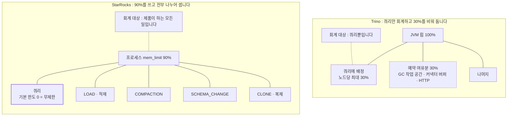
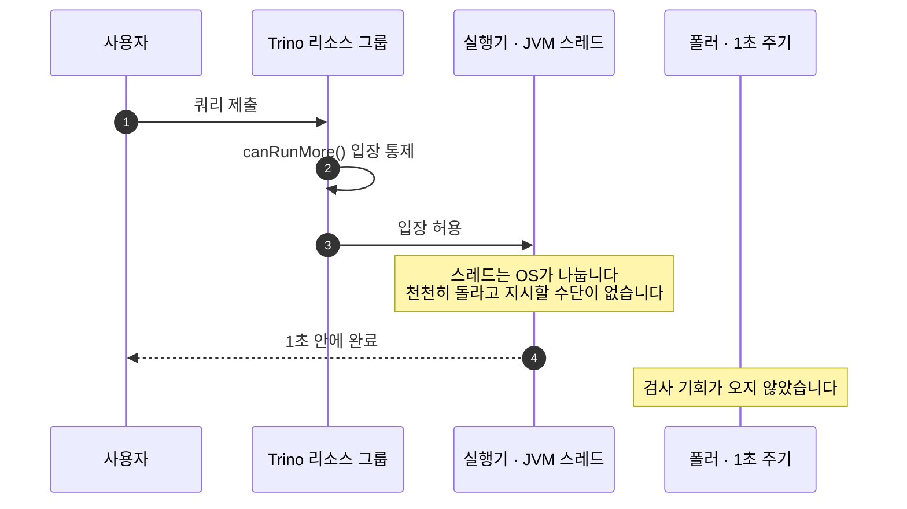
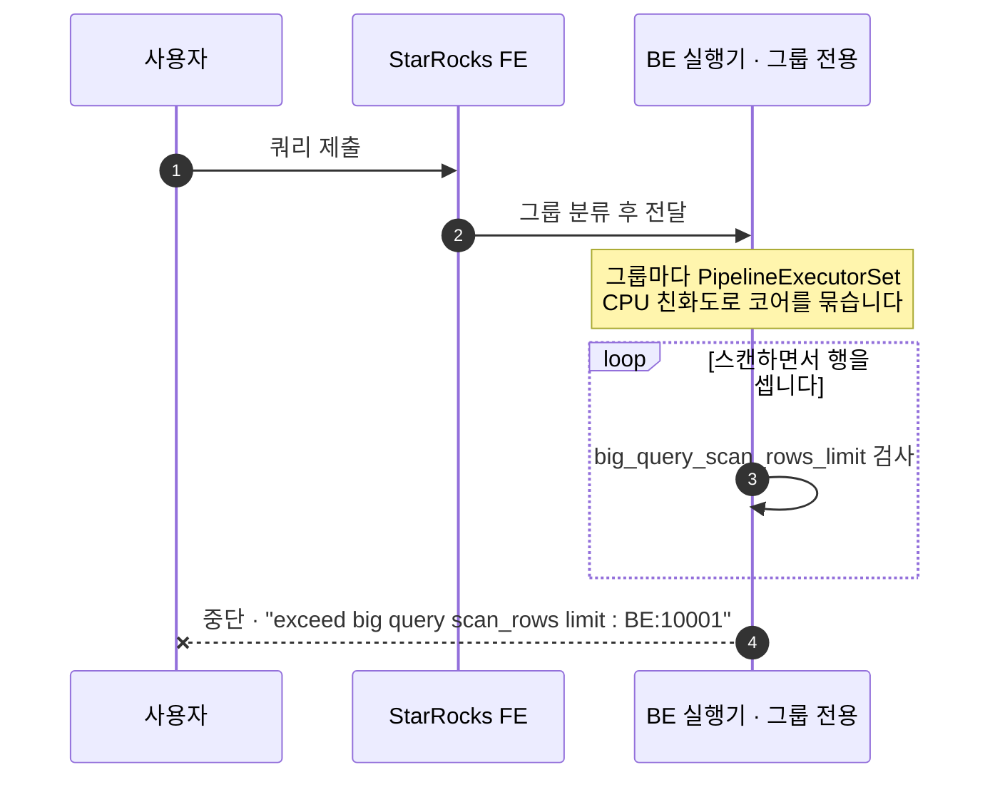
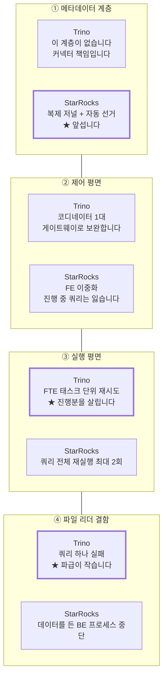
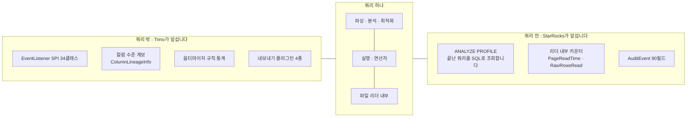

# 30%를 비우는 엔진과 90%를 쓰는 엔진: 운영에서 갈리는 지점

> 비교 기준: Trino **483** (`50b0b50b`) · StarRocks **4.0.14** (`7c18dd9d`) · 2026-10-16 기준
> 랩 구성: 같은 Iceberg 카탈로그, Trino worker 1대 / StarRocks BE 1대, TPC-H SF 0.01
> 다루지 않는 것: 다중 노드 경합, Trino 리소스 그룹 실측, Ranger·OPA 연동, 실행 시간 비교
> 시리즈: [1편 · 전체 결론](01-스토리지를-소유하는가.md) · [2편 · 옵티마이저](02-옵티마이저-같은-쿼리-다른-플랜.md) · [3편 · 실행 엔진](03-실행-엔진-JVM과-C++.md)

---

## 결론부터

**운영에서 가장 먼저 알아야 할 것은 두 엔진이 서로 다른 것을 지키도록 설계되었다는 사실입니다.** 층마다 강약이 반대로 나타나므로, "어느 쪽이 안정적인가"라는 질문에는 답이 없습니다.

| 지켜 주는 것 | 앞서는 쪽 |
|---|---|
| 메타데이터를 잃지 않는 것 | **StarRocks** (복제 저널 + 자동 선거). Trino에는 이 계층이 없습니다 |
| 수십 분짜리 쿼리의 진행분 | **Trino** (FTE가 태스크 단위로 재시도합니다) |
| 폭주 쿼리를 실제로 끊는 것 | **StarRocks** (스캔 도중 중단시킵니다) |
| 파일 리더 결함의 파급 억제 | **Trino** (쿼리만 실패합니다. StarRocks는 BE 프로세스가 중단됩니다) |
| 컬럼 단위 데이터 계보 | **Trino** (엔진이 직접 계산합니다) |
| 쿼리 내부 성능 분석 | **StarRocks** (Parquet 리더 내부까지 계측합니다) |

그리고 **운영자가 당장 손봐야 할 기본값이 양쪽에 각각 하나씩 있습니다.** Trino는 접근제어 설정 파일이 없으면 아무나 무엇이든 할 수 있고, StarRocks는 쿼리 메모리 한도가 무제한이라 무거운 쿼리 하나가 BE를 독차지할 수 있습니다.

---

## 1. 비교 범위와 버전

| 항목 | 내용 |
|---|---|
| 비교 대상 | Trino 483 / StarRocks 4.0.14 |
| 측정 환경 | macOS arm64, Docker Desktop 14 CPU / 25GB, `functional` 프로파일 |
| 데이터 | TPC-H SF 0.01, `bench.lineitem` 60,175행 |
| 비교 축 | 메모리 · 리소스 격리 · 캐시 · 장애 복구 · 보안 · 관측성 |

**노드가 1대씩인 랩의 한계가 이 축에 가장 크게 걸립니다.** "가중치대로 CPU가 나뉘는가"와 "한 노드가 죽어도 나머지로 계속 처리하는가"는 이 축의 핵심 질문인데 둘 다 측정할 수 없었습니다. 대신 **한도가 실제로 강제되는지**, **노드 사망을 감지하는 데 얼마나 걸리는지**는 노드를 실제로 정지시켜 측정했습니다.

---

## 2. 메모리: 30%를 비우는가, 90%를 쓰는가

### 2-1. 한도 설계가 반대 방향입니다

Trino는 힙의 30%를 아예 떼어 둡니다.

```java
// core/trino-main/src/main/java/io/trino/memory/NodeMemoryConfig.java#L33-L34 @ 483
private DataSize maxQueryMemoryPerNode = HeapSizeParser.DEFAULT.parse("30%");
private DataSize heapHeadroom = HeapSizeParser.DEFAULT.parse("30%");
```

[NodeMemoryConfig.java#L33-L34](https://github.com/trinodb/trino/blob/483/core/trino-main/src/main/java/io/trino/memory/NodeMemoryConfig.java#L33-L34)



**쿼리가 없어도 메모리를 쓰는 작업이 StarRocks에는 상시 돕니다.** 그래서 용량 계획이 달라집니다.

| 층 | 설정 | 기본값 |
|---|---|---|
| 클러스터 × 쿼리 | `query.max-memory` | 20GB |
| 노드 × 쿼리 | `query.max-memory-per-node` | 힙의 30% |
| 노드 예약 여유분 | `memory.heap-headroom-per-node` | 힙의 30% |

JVM이 GC를 돌리고 커넥터와 HTTP 버퍼가 쓸 자리입니다. **Trino는 쿼리가 쓰는 메모리만 회계하고 나머지는 넉넉히 비워 두는 것으로 대응합니다.**

StarRocks는 90%까지 씁니다.

```cpp
// be/src/common/config.h @ 4.0.14
CONF_String(mem_limit, "90%");
```

[config.h](https://github.com/StarRocks/starrocks/blob/4.0.14/be/src/common/config.h)

C++이라 할당을 직접 가로챌 수 있고 `MemTracker` 계층으로 **누가 얼마나 쓰는지 다 셉니다.** 대신 세지 못한 할당이 있으면 그대로 OOM입니다.

### 2-2. 회계 대상이 다릅니다. 이것이 용량 계획을 바꿉니다

**이 축에서 운영에 가장 크게 걸리는 지점입니다.**

Trino 워커의 메모리 소비자는 사실상 쿼리뿐입니다. 쿼리가 없으면 놀고, 쿼리 부하만 보면 용량 계획이 섭니다.

StarRocks BE는 다릅니다. `MemTracker::Type`에 `LOAD`, `COMPACTION`, `SCHEMA_CHANGE`, `CLONE`이 있다는 것은 **쿼리가 없어도 메모리를 쓰는 작업이 상시 돈다**는 뜻입니다. 특히 compaction은 적재량에 비례해 자동으로 돌므로 **적재가 몰리는 시간대에 쿼리 메모리가 줄어듭니다.**

**따라서 StarRocks의 용량 계획은 쿼리만 봐서는 안 됩니다.**

### 2-3. 넘쳤을 때의 정교함은 반대편에 있습니다

Trino에는 메모리 킬러 구현이 5종 있습니다.

| 클래스 | 정책 |
|---|---|
| `NoneLowMemoryKiller` | 죽이지 않습니다 |
| `TotalReservationLowMemoryKiller` | 가장 많이 쓰는 쿼리 |
| `TotalReservationOnBlockedNodesQueryLowMemoryKiller` | 막힌 노드에서 가장 많이 쓰는 쿼리 |
| `TotalReservationOnBlockedNodesTaskLowMemoryKiller` | 같은 기준으로 태스크만 |
| **`LeastWastedEffortTaskLowMemoryKiller`** | **버리는 작업량이 가장 적은 태스크** |

마지막 정책은 **FTE 없이는 의미가 약합니다.** 태스크를 죽여도 다시 만들 수 있어야 "버리는 작업량"을 기준으로 고르는 것이 성립합니다. StarRocks에 대응물이 없는 것도 같은 이유로 읽힙니다. 중간 결과가 남지 않으니 태스크만 죽여도 쿼리 전체를 다시 돌려야 합니다. 그래서 **kill 정책 대신 리소스 그룹으로 애초에 격리하는 방향**을 택했습니다.

### 2-4. 기본값의 방향이 반대입니다

**Trino는 좁게 시작해서 넓힙니다.** 쿼리당 힙의 30%이므로 한 쿼리가 노드를 독차지하지 못합니다.

**StarRocks는 넓게 시작해서 좁힙니다.** `query_mem_limit = 0`, 즉 무제한입니다. 한 쿼리가 프로세스 한도까지 쓸 수 있습니다.

**StarRocks를 쓴다면 `query_mem_limit`을 기본값으로 두지 않아야 합니다.** 무거운 쿼리 하나가 BE의 메모리를 다 먹고 다른 쿼리를 밀어낼 수 있습니다. 막으려면 한도를 명시적으로 걸거나 리소스 그룹을 써야 합니다.

### 2-5. 측정: 유효 바닥은 대등하고, spill은 판별되지 않았습니다

고카디널리티 복합 키 중복 제거로 해시 집계에 부담을 주고 쿼리 단위 한도만 좁혔습니다. 기준선은 양쪽 모두 60,175행으로 일치합니다.

| 한도 | Trino 483 (spill off / on) | StarRocks 4.0.14 (spill off / on) |
|---|---|---|
| 2 · 4 · 8MB | 실패 / 실패 | 실패 / 실패 |
| 16MB | **60175** / 60175 | 실패 / 실패 |
| 18MB 이상 | 60175 / 60175 | **60175** / 60175 |

**Trino 16MB, StarRocks 18MB로 같은 자릿수입니다.** 이 쿼리에서 어느 쪽이 메모리를 아낀다고 말할 수 없습니다.

**spill은 켜나 끄나 결과가 같았습니다.** 실패하는 한도에서는 켜도 실패하고, 성공하는 한도에서는 필요가 없습니다. 그 사이의 창이 이 데이터 규모에는 없습니다. 다만 StarRocks에서 임계값을 낮추자 플랜에 `SPILL_PROCESS` 노드가 등장했습니다. **기계는 실제로 연결되어 있습니다.** spill 바이트 카운터가 나타나지 않은 것은 흘릴 만큼 쌓이지 않았다는 뜻입니다.

오류 메시지의 성격도 서로 보완적입니다.

```
Trino:     Query exceeded per-node memory limit of 2MB
           [Allocated: 856B, Delta: 2MB, Top Consumers: {PagePartitioner=856B}]

StarRocks: Memory of Query01a06c84-... exceed limit. Pipeline Backend: starrocks-be,
           fragment: 01a06c84-... Used: 2232112, Limit: 2097152.
           You can change the limit by set session variable query_mem_limit.
```

**Trino는 어느 연산자가 먹고 있었는지를 말해 주고, StarRocks는 어디서 터졌고 무엇을 바꾸면 되는지를 말해 줍니다.**

---

## 3. 리소스 격리: 입장을 통제하는가, 실행을 통제하는가

### 3-1. 계획 단계의 전제가 틀렸습니다

비교를 설계할 때 "StarRocks는 BE cgroup으로 실제 격리를 수행한다"고 적었습니다. **cgroup을 쓰지 않습니다.** 실제 격리는 **CPU 친화도 바인딩 + 가중 vruntime + 전용 코어 + 그룹 간 코어 대여**로 된 자체 스케줄러입니다.





```cpp
// be/src/exec/workgroup/work_group.h#L66 @ 4.0.14
int64_t runtime_ns() const { return _vruntime_ns * cpu_weight(); }
```

[work_group.h#L66](https://github.com/StarRocks/starrocks/blob/4.0.14/be/src/exec/workgroup/work_group.h#L66)

그룹마다 별도 실행기 묶음(`PipelineExecutorSet`)을 두고 거기에 CPU를 붙입니다. "이 그룹은 코어 4개에서만 돈다"가 성립합니다.

**이것이 가능한 이유는 BE가 자기 스레드를 직접 만들어 CPU에 붙이기 때문입니다.** Trino 483의 기본 실행은 드라이버당 스레드이고, 스레드는 JVM이 OS에 맡깁니다. Trino가 "이 스레드는 천천히 돌아라"라고 지시할 수단이 없습니다. 결국 조절할 수 있는 것은 **몇 개를 동시에 돌릴 것인가**뿐입니다. 그래서 **입장 통제에 정교함이 집중되었습니다.** soft와 hard 이중 한도, 선형 페널티, 대기열 정책 4종, 계층형 그룹입니다.

| 관점 | Trino 483 | StarRocks 4.0.14 |
|---|---|---|
| 설정 수단 | 플러그인(파일/DB) + SPI 11종 | **SQL** (`CREATE RESOURCE GROUP`) |
| 분류 기준 | 사용자·소스·쿼리 타입·클라이언트 태그 | 위 + DB + **옵티마이저 추정 비용 범위** |
| 강제 지점 | **입장 통제** (`canRunMore()`) | **실행 통제** (BE 스캔·연산 중) |
| 실행 중 한도 | 그룹 밖 쿼리 설정, **1초 폴링** | 그룹 속성, **즉시** |

### 3-2. 측정: 짧은 쿼리가 Trino의 한도를 빠져나갑니다

`lineitem`의 실제 물리 입력은 1.34MB입니다. 그보다 한참 작은 한도를 걸었습니다.

| `query_max_scan_physical_bytes` | 결과 |
|---|---|
| 1GB | 1536127.0 |
| 100kB | 1536127.0 (통과) |
| 10kB | 1536127.0 (통과) |
| **1kB** | **1536127.0** (통과) |

**1kB 한도에서도 1.34MB를 읽고 성공했습니다.** 버그가 아니라 설계입니다. 검사가 1초 주기 폴링이고 이 쿼리는 1초 안에 끝나므로 **한 번도 검사받지 않았습니다.**

같은 조건에서 StarRocks는 끊었습니다.

```sql
CREATE RESOURCE GROUP rg_probe TO (user='root')
WITH ('cpu_weight'='4','mem_limit'='0.2','concurrency_limit'='2','big_query_scan_rows_limit'='1000');
```

| 쿼리 | 결과 |
|---|---|
| `SELECT count(n_name) FROM nation` (25행) | 25 |
| `SELECT sum(l_quantity) FROM lineitem` (60,175행) | 실패: `exceed big query scan_rows limit: current is 60175 but limit is 1000: BE:10001` |

**오류 출처가 `BE:10001`입니다.** FE가 계획 단계에서 막은 것이 아니라 **BE가 스캔하면서 행을 세다가 끊었습니다.**

**이 결과를 "Trino의 한도가 무용하다"로 읽으면 안 됩니다.** 이 한도는 폭주하는 장수 쿼리를 잡기 위한 것이고, 그런 쿼리는 반드시 1초 이상 돕니다. 다만 **짧고 무거운 쿼리가 다수 몰리는 상황에는 무력합니다.** 그런 워크로드라면 동시 실행 수 제한이 실질적인 유일한 수단입니다.

**측정 설계의 함정도 하나 기록해 둡니다.** 이 한도를 `count(*)`로 시험하면 안 됩니다. 메타데이터 최적화로 행을 읽지 않기 때문에 그대로 통과합니다.

---

## 4. 캐시: 기본값이 배포 형태에서 나옵니다

### 4-1. 계획 단계의 전제가 또 틀렸습니다

"캐시는 StarRocks에만 있고 Trino에는 없다"고 적었습니다. **Trino 483에 Alluxio 기반 분산 파일 캐시가 있습니다.** 없는 것은 쿼리 결과 캐시뿐입니다.

**갈리는 것은 기본값입니다.**

| 관점 | Trino 483 | StarRocks 4.0.14 |
|---|---|---|
| 파일/블록 캐시 | 있습니다 (Alluxio 기반, Hive·Iceberg·Delta) | 있습니다 (메모리 + 디스크 2단) |
| 기본값 | **꺼짐** (`fs.cache.directories` 빈 목록) | **켜짐** (`datacache_enable=true`) |
| 크기 | 명시 지정이 필요합니다 | 메모리 20% + 디스크 100% |
| TTL | 7일 | 없습니다 (용량 축출) |
| 블록 단위 | 1MB | 256KB |
| 쿼리 결과 캐시 | 없습니다 | 있습니다. 단 **네이티브 테이블 전용**이고 기본 꺼짐입니다 |

**이 차이는 단순한 기본값 선택이 아니라 제품이 상정한 배포 형태에서 나옵니다.** StarRocks BE는 태블릿을 저장해야 하므로 어차피 디스크가 있고, 남는 공간을 캐시로 쓰는 것은 추가 비용이 아닙니다. Trino 워커는 디스크를 전제하지 않습니다. 상태 없는 워커라 디스크가 없거나 아주 작을 수 있으므로 **운영자가 명시적으로 열어 주어야 합니다.**

### 4-2. 측정: 설정하지 않았는데 적중했습니다

랩의 BE가 `datacache_enable=true`를 보고합니다. **compose 파일에 캐시 설정이 없는데도 켜져 있습니다.** 같은 쿼리를 두 번 돌리고 두 번째 프로파일을 읽었습니다.

```
FooterCacheReadCount: 1          PageCacheReadCounter: 1
FooterCacheWriteCount: 0         PageCacheWriteCounter: 0
```

**읽기 1, 쓰기 0입니다.** 두 번째 실행은 Parquet footer와 페이지를 캐시에서 가져왔고 새로 채우지 않았습니다.

Query Cache는 Iceberg에 적용되지 않았습니다. 세션 변수를 켜도 프로파일에 캐시 연산자가 나타나지 않습니다. 코드와 일치하는 결과입니다.

**Trino 파일 캐시는 랩에 구성하지 않아 실측하지 못했고, 캐시로 인한 속도 이득도 재지 않았습니다.** SF 0.01에서는 캐시가 있든 없든 밀리초 단위라 판별력이 없습니다.

### 4-3. 상태 없음의 대가가 드러나는 자리

Trino에는 `CacheSplitAffinityProvider`라는 장치가 있습니다. 워커가 상태 없이 아무 스플릿이나 받는 것이 Trino의 강점(탄력적 확장, 노드 교체 자유)인데, **캐시는 정확히 그 반대를 원합니다.** 같은 데이터가 같은 노드로 와야 합니다.

그래서 "선호"라는 절충이 나옵니다. 강제하면 스케줄링 유연성을 잃고, 하지 않으면 캐시가 무력해집니다. **StarRocks에는 이 긴장이 없습니다.** 대신 노드를 늘리거나 줄일 때 데이터를 옮겨야 하는 다른 비용을 치릅니다.

---

## 5. 장애 복구: 층마다 강약이 반대입니다

### 5-1. 측정: 62초를 기다리는 쪽과 즉시 실패하는 쪽

노드를 실제로 정지시켰습니다.

**Trino**

```
Query ... failed: Encountered too many errors talking to a worker node. The node
may have crashed or be under too much load. This is probably a transient issue,
so please retry your query in a few minutes.
(... - 15 failures, failure duration 62.25s, total failed request time 67.25s)
```

**62.25초 동안 15번 재시도했습니다.** 이 숫자가 코드의 `maxErrorDuration = 1분`과 정확히 맞습니다. **오류 메시지에 판단이 들어 있습니다.** "This is probably a transient issue"입니다. Trino는 노드 사망을 **일시적 장애로 가정하고 오래 기다립니다.**

**StarRocks**

```
ERROR 1064 (HY000) at line 1: Failed to find backend to execute
```

**기다리지 않습니다.** FE가 실행 가능한 BE 목록을 항상 들고 있어 계획 단계에서 곧장 거부합니다. 복구는 19초 후였습니다.

| | 감지 | 복구 |
|---|---|---|
| Trino | 62.25초 재시도 후 실패 | 워커 재기동 후 자동 복귀 |
| StarRocks | 즉시 실패 | **19초** 후 정상 |

**다만 이 메시지에는 함정이 있습니다.** `Failed to find backend to execute`는 BE가 죽은 원인이 무엇이든 똑같이 나타납니다. 정상 종료인지, 파일 리더 결함으로 프로세스가 죽은 것인지 사용자에게는 구분되지 않습니다.

### 5-2. 어느 쪽이 옳은지는 가정의 차이입니다

- **Trino의 62초**는 GC 정지와 일시적 네트워크 문제를 넘기려는 것입니다. 워커가 상태 없이 교체 가능하다는 전제에서, 잠깐 느린 노드를 죽은 것으로 취급하면 손해가 큽니다.
- **StarRocks의 즉시 실패**는 FE가 하트비트로 노드 상태를 이미 알고 있기 때문에 가능합니다. 기다릴 이유가 없습니다.

**실무에서는 Trino 쪽 62초가 더 자주 문제가 됩니다.** 대화형 쿼리가 1분간 멈춰 있다 실패하면 사용자는 "행 걸렸다"고 인식합니다. `exchange.max-error-duration`을 줄이는 것이 조정 수단입니다.

### 5-3. 층마다 강약이 정반대입니다



**양쪽 모두 약한 층이 하나 있습니다.** ②의 제어 평면입니다.

| 층 | Trino 483 | StarRocks 4.0.14 |
|---|---|---|
| **메타데이터** | 소유하지 않습니다. 커넥터 책임입니다 | **복제 저널 + LEADER/FOLLOWER/OBSERVER 자동 선거** |
| **제어 평면** | 코디네이터 1대(문서 명시). 대체 수단은 게이트웨이입니다 | FE 이중화. 단 진행 중 쿼리는 잃습니다 |
| **실행 평면** | **FTE, 태스크 단위 재시도**(기본 꺼짐) | 쿼리 전체 재실행 최대 2회 + BE 자동 블랙리스트 |

**각자 "잃으면 아까운 것"을 지키도록 설계했습니다.** StarRocks는 태블릿과 메타데이터가 클러스터 안에 있으니 잃으면 안 됩니다. 그래서 1층에 복제 저널과 선거를 넣었습니다. 계산 중간 결과는 데이터가 로컬에 있어 다시 읽으면 되므로 재실행이 합리적입니다. Trino는 잃을 메타데이터가 없으니 1층이 필요 없습니다. 그러나 계산은 원격 저장소에서 데이터를 끌어와야 하므로 다시 하는 비용이 큽니다. 그래서 3층에 FTE를 넣었습니다.

**제어 평면은 양쪽 모두 약합니다.** 이 점은 짚어 둘 값어치가 있습니다.

### 5-4. 쿼리가 길어지면 격차가 벌어집니다

| 쿼리 길이 | 노드 사망 시 손실 |
|---|---|
| 수 초 | 양쪽 모두 무시할 만합니다. 다시 돌리면 됩니다 |
| 수 분 | StarRocks는 처음부터. Trino도 기본 설정이면 마찬가지입니다 |
| **수십 분에서 시간** | StarRocks는 **전부 버립니다**(2회 재시도도 전부 다시). **Trino FTE만이 진행분을 살립니다** |

**그리고 길수록 노드를 잃을 확률 자체가 높아집니다.** 이 구간에서는 FTE가 선택이 아니라 요건에 가깝습니다.

### 5-5. BE 사망의 무게가 워커 사망보다 큽니다

**Trino 워커는 상태가 없어 죽어도 다시 띄우면 그만이지만, StarRocks BE는 태블릿을 들고 있습니다.** 죽은 BE가 갖고 있던 데이터는 복제본이 있어야 접근할 수 있고, 복귀하면 따라잡기가 필요합니다. `MemTracker::Type`에 `CLONE`이 있는 이유입니다.

**즉 StarRocks에서 BE 다중화는 성능이 아니라 가용성 요건입니다.**

---

## 6. 보안: 권한이 어디에 사는가

### 6-1. 계획 단계의 전제를 또 보완했습니다

"StarRocks는 내장 RBAC만 제공한다"고 적었습니다. **Apache Ranger 통합이 있고, Hive 서비스 정의를 재사용하는 방식까지 지원합니다.**

| 관점 | Trino 483 | StarRocks 4.0.14 |
|---|---|---|
| 인가 판단 위치 | **전부 SPI**(내장 정책도 플러그인입니다) | FE 내장 RBAC + 외부 연동 선택 |
| 권한 저장 | 설정 파일 또는 외부 서비스 | **메타데이터**(저널로 복제됩니다) |
| 검사 지점 수 | **84개** | 31개 |
| 외부 정책 엔진 | **Ranger + OPA** | Ranger |
| 행 필터·열 마스킹 | SPI 항목, 표현식 합성 | 같은 방식. 단 **정책 생성 SQL이 없어 Ranger가 사실상 필수입니다** |
| 랩 기본값 | **`allow-all`** (설정이 없으면 검사하지 않습니다) | **거부** (실측) |

**권한이 어디에 사는지가 다중 클러스터 운영에서 드러납니다.** Trino의 권한은 클러스터 밖에 삽니다. 클러스터를 새로 띄워도 권한이 그대로 따라옵니다. StarRocks의 권한은 메타데이터의 일부이고 FE 저널로 복제됩니다. **클러스터가 곧 권한 경계입니다.**

검사 지점이 84개 대 31개로 2.7배 차이인 것은 **커넥터 다양성 때문**입니다. 카탈로그마다 성격이 다르고 프로시저와 테이블 함수, 언어 함수까지 있으니 검사할 동작이 그만큼 많습니다. **세밀함이 항상 이득은 아닙니다.** 검사 지점이 많다는 것은 정책을 그만큼 많이 써야 한다는 뜻이기도 합니다. 다만 "이 동작만 막고 싶다"가 되는 것은 Trino 쪽입니다.

### 6-2. 기본값이 캐시와 반대 방향입니다

**Trino는 설정하지 않으면 검사하지 않습니다.** `access-control.properties`가 없으면 `allow-all`이고, 이 랩이 실제로 그 상태였습니다. **StarRocks는 설정하지 않아도 거부합니다.** 새 사용자는 아무 권한이 없습니다.

캐시는 StarRocks가 켜 두고 Trino가 꺼 두는데, **권한은 StarRocks가 잠가 두고 Trino가 열어 둡니다.** 각자 "운영자가 반드시 결정해야 하는 것"을 다르게 본 결과입니다.

**Trino를 운영에 쓴다면 `access-control.properties` 설정 여부를 가장 먼저 확인해야 합니다.**

---

## 7. 관측성: 쿼리 밖과 쿼리 안

| 관점 | Trino 483 | StarRocks 4.0.14 |
|---|---|---|
| 쿼리 이벤트 | **`EventListener` SPI 34클래스**, 플러그인으로 내보냅니다 | `AuditPlugin` + `AuditEvent` 90필드(평면) |
| **컬럼 계보** | **있습니다** (`ColumnLineageInfo`) | 없습니다 |
| 옵티마이저 관측 | `system.runtime.optimizer_rule_stats` | 없습니다 |
| 연산자 계측 | `EXPLAIN ANALYZE` (재실행이 필요합니다) | **`ANALYZE PROFILE`** (사후 조회가 가능합니다) |
| **리더 내부 계측** | 없습니다 | **있습니다** (`PageReadTime`, `RawRowsRead` 등) |
| 기본 활성 | `EXPLAIN ANALYZE`는 즉시 가능합니다 | **`enable_profile` 기본 꺼짐** |



**Trino는 쿼리 밖에 투자했습니다.** 수십 개 커넥터를 넘나드는 엔진이라 운영자의 질문이 "누가 어떤 데이터에 접근했나"인 경우가 많습니다. 컬럼 계보는 그 질문의 최종형입니다. **StarRocks는 쿼리 안에 투자했습니다.** 실행 계층과 스토리지를 직접 소유하므로 내부 카운터를 다 갖고 있고, 저지연 분석이 목표라 "왜 20ms가 아니라 200ms인가"에 답해야 합니다.

**StarRocks의 관측에는 실제 부담이 둘 있습니다.**

1. **`enable_profile`이 기본 꺼짐입니다.** 문제가 난 쿼리를 다시 돌려야 하고, **재현되지 않는 문제는 볼 수 없습니다.** 운영 전에 정책을 정해 두어야 합니다.
2. **비슷한 이름의 카운터가 여럿입니다.** 이 비교에서 `OutputRows`(필터 적용 후)를 Trino의 `Input rows`와 짝지으려다 틀렸습니다. 올바른 짝은 `RawRowsRead`(필터 전)입니다. **짝을 잘못 지으면 결론이 뒤집힙니다.**

그리고 **StarRocks에서 성능 문제를 볼 때 `EXPLAIN`으로 끝내면 안 됩니다.** 술어가 플랜에 찍혀 있어도 프루닝이 걸렸다는 뜻이 아닙니다. 프루닝 여부, 캐시 적중, 배압으로 막혔는지는 전부 프로파일을 켜야 보입니다.

---

## 8. 언제 무엇을 고를까

| 상황 | 선택 | 이유 |
|---|---|---|
| 수십 분 이상 도는 야간 배치가 있습니다 | **Trino** | FTE만이 진행분을 보존합니다 |
| 거버넌스와 규제에 대응해야 합니다 | **Trino** | 컬럼 계보를 엔진이 직접 계산합니다 |
| 정책을 Rego로 통일해 관리합니다 | **Trino** | OPA 연동은 Trino에만 있습니다 |
| 여러 클러스터에 같은 권한 정책을 적용합니다 | **Trino** | 권한이 클러스터 밖에 삽니다 |
| 메타데이터 이중화가 요건입니다 | **StarRocks** | Trino에는 이 계층이 없습니다 |
| 폭주 쿼리를 즉시 끊어야 합니다 | **StarRocks** | BE가 스캔 도중 중단시킵니다 |
| 운영 인력이 적습니다 | **StarRocks** | 캐시가 기본으로 켜져 있고 통계와 compaction이 자동입니다 |
| 쿼리 내부 성능을 깊이 분석해야 합니다 | **StarRocks** | 리더 내부까지 계측되고 사후 조회가 됩니다 |
| 기존 Hive/Ranger 정책이 있습니다 | **StarRocks** | Hive 서비스 정의 재사용으로 이전 비용이 줄어듭니다 |

### 두 엔진을 함께 쓸 때의 역할 분담

**감사와 계보는 Trino 쪽에서, 성능 분석은 StarRocks 쪽에서** 얻는 구성이 자연스럽습니다. 두 엔진의 관측이 서로 반대 방향으로 깊기 때문입니다.

### 운영 시작 전 점검 목록

1. **Trino**: `access-control.properties`가 있는지 확인합니다. 없으면 아무나 무엇이든 할 수 있습니다.
2. **StarRocks**: `query_mem_limit`을 명시적으로 걸거나 리소스 그룹을 만듭니다. 기본값은 무제한입니다.
3. **StarRocks**: `enable_profile` 정책을 미리 정합니다. 기본이 꺼짐이라 사고 후에는 재현해야 합니다.
4. **StarRocks**: 용량 계획에 적재와 compaction 몫을 포함합니다. 쿼리만 보면 부족합니다.
5. **Trino**: 대화형 쿼리가 주된 용도라면 `exchange.max-error-duration`(기본 1분)을 검토합니다.
6. **StarRocks**: BE를 2대 이상 둡니다. 다중화가 성능이 아니라 가용성 요건입니다.

---

## 9. 확인하지 못한 것

| 항목 | 이유 |
|---|---|
| **가중치대로 CPU가 나뉘는가** | BE 1대, worker 1대라 경합이 없습니다. **이 축의 핵심 주장이 미검증으로 남습니다** |
| **한 노드가 죽어도 계속 처리하는가** | 같은 이유입니다. 이 축의 핵심 질문입니다 |
| Trino 리소스 그룹 실측 | 랩에 구성하지 않았습니다. 3절의 Trino 쪽은 전부 코드 독해입니다 |
| FTE의 태스크 단위 재시도 | 노드가 1대이므로 재시도 경로가 생기지 않습니다 |
| FE FOLLOWER의 승격 | FE가 1대입니다 |
| Trino 파일 캐시 | 랩에 구성하지 않았습니다 |
| 캐시의 실제 속도 이득 | SF 0.01에서는 판별력이 없습니다 |
| spill이 걸렸을 때의 성능 | 2-5에 적은 대로 발동 창이 없었습니다 |
| Ranger와 OPA 연동 | 정책 서버가 없었습니다 |
| 컬럼 계보의 정확도 | 이벤트 리스너 플러그인을 구성하지 않았습니다 |
| 관측 오버헤드 | `enable_profile=true`가 실행 시간을 얼마나 늘리는지 재지 않았습니다 |
| 비정상 종료 시 BE 블랙리스트 동작 | 정상 종료로 시험했기 때문에 등록되지 않았습니다 |
| 적재·compaction과 쿼리의 경합 | 그것들이 리소스 그룹의 통제를 받는지 확인하지 않았습니다 |

**이 글에서 계획 단계의 전제가 세 번 틀렸습니다.** cgroup을 쓴다고 적었고(3-1), Trino에 캐시가 없다고 적었고(4-1), StarRocks에 Ranger 연동이 없다고 적었습니다(6-1). 세 건 모두 코드를 읽고 고쳤습니다.

---

## 출처와 라이선스

- Trino: [trinodb/trino](https://github.com/trinodb/trino) tag `483`, Apache License 2.0
- StarRocks: [StarRocks/starrocks](https://github.com/StarRocks/starrocks) tag `4.0.14`, Apache License 2.0
- 인용 코드는 모두 30줄 이하이고 출처를 영구 링크로 표시했습니다
- 상세 근거: [B-1-01 메모리와 spill](../B-1-01-메모리-관리와-spill.md) · [B-2-01 리소스 격리](../B-2-01-리소스-격리.md) · [B-3-01 캐시 계층](../B-3-01-캐시-계층.md) · [B-4-01 고가용성](../B-4-01-고가용성과-장애-복구.md) · [B-5-01 보안과 권한](../B-5-01-보안과-권한-모델.md) · [B-6-01 관측성](../B-6-01-관측성.md)

---

**다음 편**: [5편 · 스토리지: 한쪽에만 있는 계층](05-스토리지-한쪽에만-있는-계층.md)
