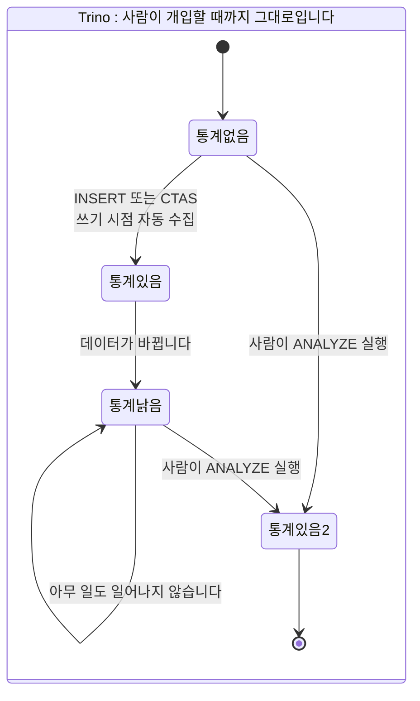
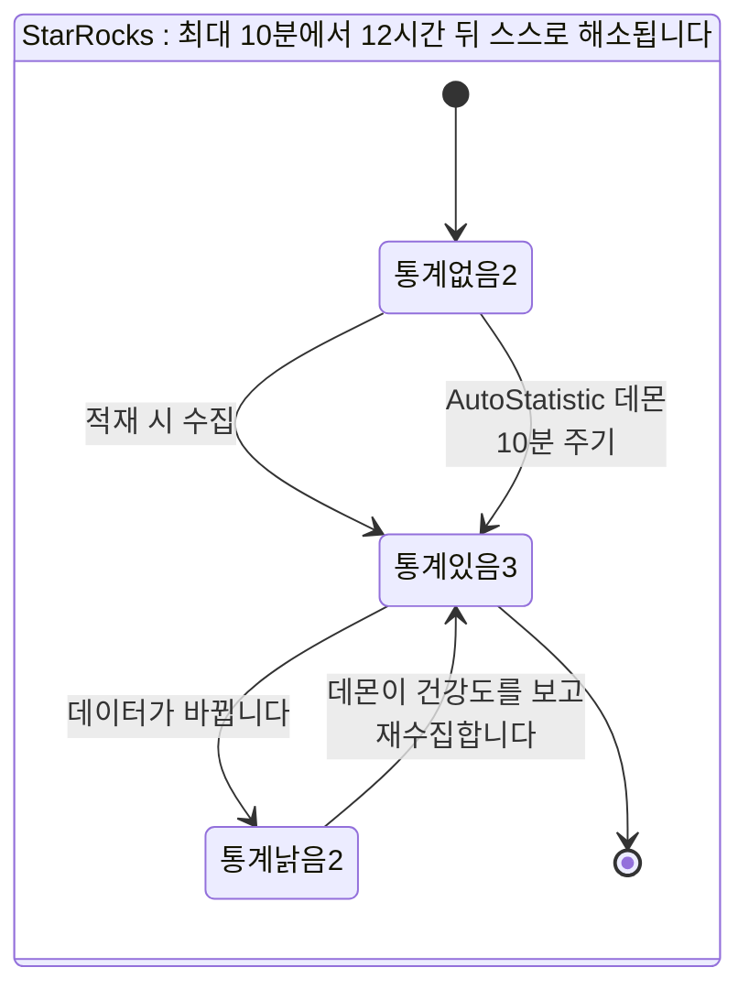
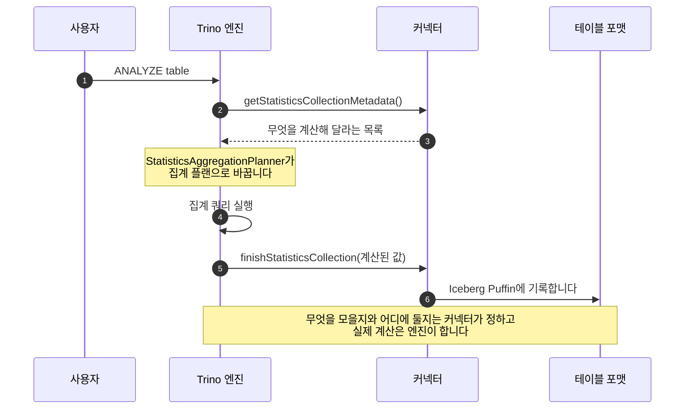
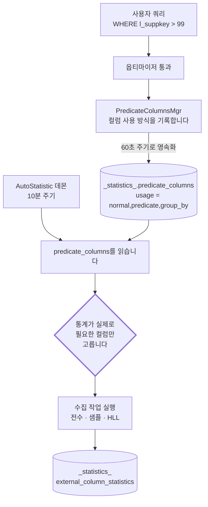
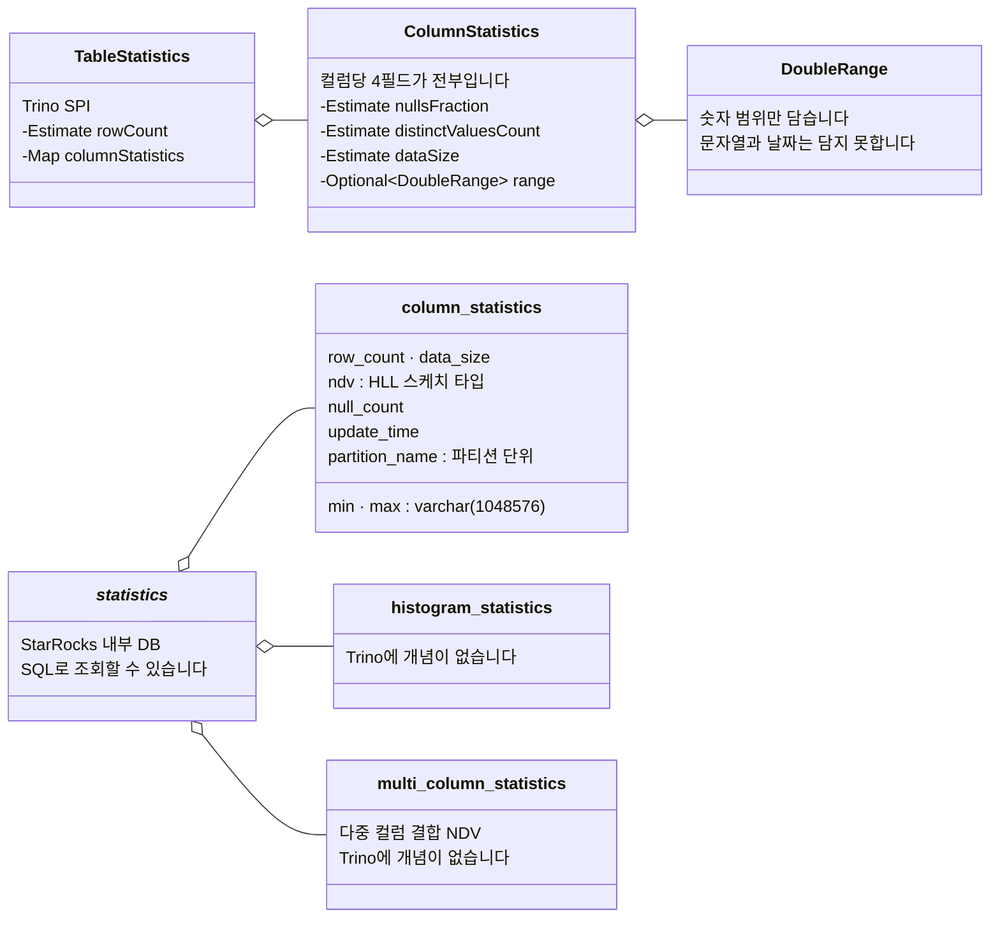
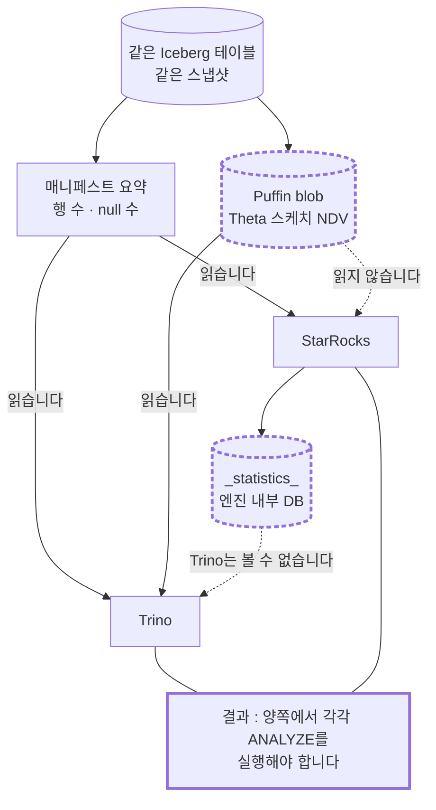

# 통계는 누가 만들고 어디에 두는가: 옵티마이저의 유일한 근거

> 비교 기준: Trino **483** (`50b0b50b`) · StarRocks **4.0.14** (`7c18dd9d`) · 2026-10-30 기준
> 랩 구성: 같은 Iceberg 카탈로그(Hive Metastore 4.0.1 + MinIO), Trino worker 1대 / StarRocks BE 1대
> 데이터: TPC-H SF 0.01 (`bench.lineitem` 60,175행), 설정은 전부 기본값입니다
> 다루지 않는 것: 수집 비용 측정, 히스토그램의 실효, Hive 등 다른 테이블 포맷, 실행 시간 비교
> 시리즈: [1편 · 전체 결론](01-스토리지를-소유하는가.md) · [2편 · 옵티마이저](02-옵티마이저-같은-쿼리-다른-플랜.md)의 심화편입니다

---

## 결론부터

**여러 엔진이 같은 레이크를 함께 쓴다면 Trino입니다. 테이블이 많고 통계를 관리할 인력이 없다면 StarRocks입니다.**

통계는 옵티마이저가 실행 방법을 고르는 **유일한 근거**입니다. 그런데 그 통계를 누가 만들고 어디에 두는지가 두 엔진에서 정반대입니다.

- **Trino는 통계를 테이블 포맷 안에 돌려줍니다.** Spark도 읽고 다른 Trino 클러스터도 읽습니다. 대신 **사람이 `ANALYZE`를 실행해야 하고**, 테이블 포맷이 표현할 수 있는 것만 담깁니다.
- **StarRocks는 통계를 자기 안에 쌓습니다.** 백그라운드 데몬이 **쿼리를 관찰해 필요한 컬럼을 스스로 고릅니다.** 대신 그 통계는 엔진 밖으로 나가지 못합니다.

**그리고 두 엔진을 함께 쓴다면 양쪽에서 각각 `ANALYZE`를 실행해야 합니다.** 같은 파일을 보면서도 통계는 공유되지 않습니다. 이것이 이 글에서 실무에 가장 직접 걸리는 항목입니다.

---

## 1. 비교 범위와 버전

| 항목 | 내용 |
|---|---|
| 비교 대상 | Trino 483 (tag `483`) / StarRocks 4.0.14 (tag `4.0.14`) |
| 비교 축 | 수집 주체 · 저장 위치 · 갱신 시점 · 수집 대상 선정 · 모델 표현력 |
| 측정 환경 | macOS arm64, Docker Desktop 14 CPU / 25GB, `functional` 프로파일 |
| 데이터 | TPC-H SF 0.01, 두 엔진이 **같은 Iceberg 테이블**을 봅니다 |
| 검증 방법 | Trino는 `SHOW STATS`, StarRocks는 `_statistics_` 테이블을 **SQL로 직접 조회**했습니다 |

**이 축을 따로 다루는 이유가 있습니다.** 앞선 편들에서 "통계가 없으면", "통계가 낡으면"이라는 단서가 반복해서 붙었습니다. 그 단서를 결정하는 계층이 바로 여기입니다.

- 통계가 없으면 Trino는 **조인 순서 재배치를 아예 포기합니다**([2편](02-옵티마이저-같은-쿼리-다른-플랜.md) 3-2).
- 통계 부족이 원인이었던 오판을 실제로 겪었습니다. "임계값 때문에 StarRocks가 left-deep 플랜을 만든다"고 읽었는데 원인은 통계였습니다([2편](02-옵티마이저-같은-쿼리-다른-플랜.md) 4-1).

따라서 운영에서 중요한 질문은 하나로 좁혀집니다. **통계 관리가 사람의 일인가, 제품의 일인가.**

---

## 2. 두 엔진이 푸는 문제

**Trino는 남의 테이블을 읽는 엔진입니다.** 통계를 자기 안에 쌓으려면 두 가지가 걸립니다. 카탈로그가 수십 개이고 각각 갱신 주기가 다른데 **언제 낡았는지 알 방법이 없고**, 코디네이터가 상태를 갖게 되어 무상태 설계가 깨집니다. 그래서 **통계를 테이블에 돌려주는** 길을 골랐습니다.

**StarRocks는 자기 스토리지를 갖고 있고 FE가 메타데이터를 소유합니다.** 통계를 자기 테이블에 쌓는 것이 자연스럽고, 적재와 갱신 시점을 알기 때문에 자동 수집도 가능합니다. 외부 카탈로그도 같은 틀에 얹었습니다.

**통계의 수명주기를 나란히 놓으면 차이가 드러납니다.**





**운영 부담이 다릅니다.** Trino에서는 통계 갱신이 운영자의 일이고, 잊으면 계속 나쁜 플랜이 나옵니다. StarRocks에서는 대체로 저절로 해결되지만 **언제 수집이 도는지 예측하기 어렵고** 수집 자체가 클러스터 자원을 씁니다.

---

## 3. 핵심 동작 비교

### 3-1. Trino: 엔진과 커넥터가 분업합니다

옵티마이저가 통계를 얻는 창구는 **하나**입니다.

```java
// core/trino-spi/src/main/java/io/trino/spi/connector/ConnectorMetadata.java#L452-L455 @ 483
default TableStatistics getTableStatistics(ConnectorSession session, ConnectorTableHandle tableHandle)
{
    return TableStatistics.empty();
}
```

[ConnectorMetadata.java#L452-L455](https://github.com/trinodb/trino/blob/483/core/trino-spi/src/main/java/io/trino/spi/connector/ConnectorMetadata.java#L452-L455)

**기본 구현이 빈 통계를 돌려줍니다.** 커넥터가 이것을 구현하지 않으면 엔진은 아무것도 모르는 채로 플랜을 짭니다.

수집 쪽도 SPI입니다. 그리고 **분업이 명확합니다.**



**엔진에는 통계 저장소도, 자동 수집 스레드도 없습니다.** `io.trino.cost`는 54파일 **7,056줄**인데 전부 소비 측입니다. 받은 통계로 추정하는 코드입니다.

Iceberg에서는 통계가 세 곳에서 옵니다. 행 수와 null 수는 **매니페스트 요약**에서, min/max는 **데이터 파일 메트릭**에서, NDV는 **Puffin blob**에서 읽습니다.

```java
// plugin/trino-iceberg/src/main/java/io/trino/plugin/iceberg/TableStatisticsReader.java#L290-L295 @ 483
for (Entry<Integer, BlobMetadata> entry : thetaBlobsByFieldId.entrySet()) {
    int fieldId = entry.getKey();
    BlobMetadata blobMetadata = entry.getValue();
    String ndv = blobMetadata.properties().get(APACHE_DATASKETCHES_THETA_V1_NDV_PROPERTY);
    if (ndv == null) {
        log.debug("Blob %s is missing %s property", blobMetadata.type(), APACHE_DATASKETCHES_THETA_V1_NDV_PROPERTY);
```

[TableStatisticsReader.java#L290-L295](https://github.com/trinodb/trino/blob/483/plugin/trino-iceberg/src/main/java/io/trino/plugin/iceberg/TableStatisticsReader.java#L290-L295)

`blobMetadata`는 Iceberg 표준이 정한 통계 저장 형식입니다. **즉 통계가 데이터의 일부로 저장됩니다.** Trino를 지워도 통계는 남습니다.

자동 수집은 **쓰기 시점에만** 있습니다.

```java
// plugin/trino-iceberg/src/main/java/io/trino/plugin/iceberg/IcebergConfig.java#L76-L77 @ 483
private boolean tableStatisticsEnabled = true;
private boolean collectExtendedStatisticsOnWrite = true;
```

[IcebergConfig.java#L76-L77](https://github.com/trinodb/trino/blob/483/plugin/trino-iceberg/src/main/java/io/trino/plugin/iceberg/IcebergConfig.java#L76-L77)

두 번째가 기본 켜짐입니다. `INSERT`나 CTAS 때 통계를 함께 계산해 저장합니다. **그러나 이후 데이터가 바뀌어도 갱신되지 않습니다.**

### 3-2. StarRocks: FE 데몬이 전부 담당합니다

통계 수집이 **독립된 서브시스템**입니다. `fe/fe-core/.../statistic/`이 파일 **70개, 13,830줄**이고, 소비와 캐시 측이 **10,348줄** 더 있습니다.

통계는 엔진 안의 **진짜 테이블**에 쌓입니다.

```java
// fe/fe-core/src/main/java/com/starrocks/statistic/StatsConstants.java#L66-L72 @ 4.0.14
public static final String STATISTICS_DB_NAME = "_statistics_";
public static final String SAMPLE_STATISTICS_TABLE_NAME = "table_statistic_v1";
public static final String FULL_STATISTICS_TABLE_NAME = "column_statistics";
public static final String EXTERNAL_FULL_STATISTICS_TABLE_NAME = "external_column_statistics";
public static final String HISTOGRAM_STATISTICS_TABLE_NAME = "histogram_statistics";
public static final String EXTERNAL_HISTOGRAM_STATISTICS_TABLE_NAME = "external_histogram_statistics";
public static final String MULTI_COLUMN_STATISTICS_TABLE_NAME = "multi_column_statistics";
```

[StatsConstants.java#L66-L72](https://github.com/StarRocks/starrocks/blob/4.0.14/fe/fe-core/src/main/java/com/starrocks/statistic/StatsConstants.java#L66-L72)

**이름이 무엇을 담는지 그대로 보여 줍니다.** 표본 통계, 컬럼 통계, 외부 데이터용 컬럼 통계, 히스토그램, 외부 데이터용 히스토그램, 다중 컬럼 결합 통계입니다. 그리고 **일반 SQL로 조회할 수 있습니다.**

수집은 FE 데몬이 주기적으로 돕니다.

```java
// fe/fe-core/src/main/java/com/starrocks/statistic/StatisticAutoCollector.java#L48-L50 @ 4.0.14
public StatisticAutoCollector() {
    super("AutoStatistic", Config.statistic_collect_interval_sec * 1000);
}
```

[StatisticAutoCollector.java#L48-L50](https://github.com/StarRocks/starrocks/blob/4.0.14/fe/fe-core/src/main/java/com/starrocks/statistic/StatisticAutoCollector.java#L48-L50)

기본 주기는 **10분**입니다. 수집 정책도 설정으로 표현되어 있습니다.

```java
// fe/fe-core/src/main/java/com/starrocks/common/Config.java#L2465-L2474 @ 4.0.14
@ConfField(mutable = true, comment = "The interval of auto stats for small tables")
public static long statistic_auto_collect_small_table_interval = 0; // unit: second, default 0

@ConfField(mutable = true, comment = "The interval of auto collecting histogram statistics")
public static long statistic_auto_collect_histogram_interval = 3600L * 1; // 1h

@ConfField(mutable = true, comment = "The interval of auto stats for large tables")
public static long statistic_auto_collect_large_table_interval = 3600L * 12; // unit: second, default 12h
```

[Config.java#L2465-L2474](https://github.com/StarRocks/starrocks/blob/4.0.14/fe/fe-core/src/main/java/com/starrocks/common/Config.java#L2465-L2474)

**"작은 테이블은 제한 없이 자주, 큰 테이블은 12시간에 한 번, 너무 크면 샘플링"** 이라는 정책입니다. 소/대 경계는 1,000만 행이고, 통계 관련 설정이 **40개**입니다.

### 3-3. 가장 특징적인 부분: 무엇을 수집할지 스스로 정합니다

쿼리가 옵티마이저를 지나갈 때마다 **각 컬럼이 어떻게 쓰였는지 기록합니다.**

```java
// fe/fe-core/src/main/java/com/starrocks/statistic/columns/ColumnUsage.java#L187-L192 @ 4.0.14
public enum UseCase {
    NORMAL,
    PREDICATE,
    JOIN,
    GROUP_BY,
    DISTINCT;
}
```

[ColumnUsage.java#L187-L192](https://github.com/StarRocks/starrocks/blob/4.0.14/fe/fe-core/src/main/java/com/starrocks/statistic/columns/ColumnUsage.java#L187-L192)

단순 참조인지, **술어에 쓰였는지**, 조인에 쓰였는지, 묶는 기준이었는지, 중복 제거에 쓰였는지를 구분합니다.



**Trino에는 이 개념 자체가 없습니다.** 무엇을 수집할지는 사람이 `ANALYZE` 문장에 적습니다.

### 3-4. 모델 표현력: 4필드와 7종 테이블



**`min`과 `max`의 타입이 갈림길입니다.** Trino는 `DoubleRange`라서 숫자만 담고, StarRocks는 `varchar`라서 문자열도 담습니다. 4-1의 실측에서 그 자리가 실제로 비어 있는 것을 확인했습니다.

| 항목 | Trino 483 | StarRocks 4.0.14 |
|---|---|---|
| 행 수 · null · NDV · 데이터 크기 | 있습니다 | 있습니다 |
| 숫자 min · max | 있습니다 | 있습니다 |
| **문자열과 날짜 min · max** | **없습니다** (`DoubleRange`) | 있습니다 (`varchar`) |
| **히스토그램** | **없습니다** (클래스 자체가 없습니다) | 있습니다 |
| **다중 컬럼 결합 NDV** | **없습니다** | 있습니다 |
| 파티션 단위 통계 | 커넥터에 위임합니다 | 있습니다 (`partition_name` 키) |
| NDV 표현 | Theta 스케치 (Puffin) | HLL 스케치 (`hll` 컬럼 타입) |

---

## 4. 측정 결과

환경: macOS arm64 Docker Desktop 14 CPU / 25GB, `functional` 프로파일, TPC-H SF 0.01, 설정은 전부 기본값입니다. 시험용으로 만든 테이블과 통계는 모두 삭제했습니다.

### 4-1. 같은 테이블인데 두 엔진이 아는 것이 다릅니다

| 컬럼 | 참 NDV | StarRocks | Trino | StarRocks min/max | Trino low/high |
|---|---|---|---|---|---|
| `l_orderkey` | 15,000 | **15,022** (+0.15%) | **14,819** (−1.2%) | 1 / 60000 | 1 / 60000 |
| `l_suppkey` | 100 | 100 | 100 | 1 / 100 | 1 / 100 |
| `l_shipdate` | 측정 안 함 | 2,530 | 2,518 | 1992-01-04 / 1998-11-29 | 1992-01-04 / 1998-11-29 |
| `l_returnflag` | 3 | 3 | 3 | **A / R** | **(빈칸)** |

두 가지가 드러납니다.

- **NDV는 양쪽 모두 근사값이고 오차 방향이 다릅니다.** Theta 스케치와 HLL 스케치의 차이입니다. 어느 쪽이 정확하다는 뜻이 아닙니다.
- **`l_returnflag`의 min/max가 Trino에는 없습니다.** 3-4에서 본 `DoubleRange` 제약이 그대로 나타납니다.

StarRocks 쪽 값은 `_statistics_.external_column_statistics`를 SQL로 직접 조회해 얻었습니다. `ndv`가 `hll` 타입이라 `hll_cardinality()`로 풀어야 보입니다.

### 4-2. Trino는 테이블을 만드는 것만으로 통계가 생겼습니다

```sql
CREATE TABLE iceberg.bench.statprobe2 AS SELECT l_orderkey, l_suppkey FROM iceberg.bench.lineitem;
```

`ANALYZE`를 돌리지 않았는데 `SHOW STATS`가 NDV를 보여줍니다. `l_orderkey` 14,830, `l_suppkey` 100입니다. 3-1의 `collectExtendedStatisticsOnWrite` 기본 켜짐이 확인됩니다.

### 4-3. StarRocks가 술어 컬럼만 골라 수집하는 장면을 포착했습니다

**시험 중에 제가 실행하지 않은 수집 작업이 이력에 나타났습니다.**

```
27494  iceberg.bench  statprobe   l_suppkey,l_shipdate   FULL  ONCE  SUCCESS  2026-09-04 01:55:34
27499  iceberg.bench  statprobe2  l_suppkey              FULL  ONCE  SUCCESS  2026-09-04 01:56:34
```

**수집된 컬럼이 제가 술어에 쓴 컬럼과 정확히 일치합니다.** `statprobe2`에는 `WHERE l_suppkey > 99` 하나만 던졌고 수집된 컬럼도 그것 하나입니다. 테이블을 만든 지 **약 1분** 만이었습니다. 3-3의 기록 장치가 실제로 작동했습니다.

> **투명성을 위한 기록**: 이 관찰은 **계획했던 시험이 아니라 다른 시험을 하던 중에 우연히 드러난 것**입니다. 따라서 수집 주기와 조건의 상호작용을 통제된 조건에서 재지는 못했습니다.

### 4-4. 두 엔진은 통계를 공유하지 않습니다

**같은 카탈로그, 같은 파일, 같은 스냅샷인데도 그렇습니다.**

| 확인 | 결과 |
|---|---|
| Trino가 쓰기 시점에 저장한 NDV | `l_orderkey` 14,830 · `l_suppkey` 100 |
| StarRocks의 `_statistics_.external_column_statistics` 행 수 | **0건** |
| StarRocks `EXPLAIN COSTS`의 컬럼 통계 | `l_suppkey-->[99.0, Infinity, 0.0, 1.0, 1.0]` **`UNKNOWN`** |
| StarRocks가 아는 행 수 | **60,175** (Iceberg 메타데이터에서 읽습니다) |



**행 수처럼 테이블 메타데이터에서 직접 읽는 값만 자동으로 공유됩니다.** Trino가 Puffin에 써 둔 NDV가 거기 있는데도 StarRocks는 "모름"으로 취급합니다.

### 4-5. 히스토그램은 이 랩에서 쓸 수 없었습니다

```
StarRocks: ANALYZE TABLE iceberg.bench.lineitem UPDATE HISTOGRAM ON l_shipdate WITH 32 BUCKETS
        → ERROR 1064: Can't create histogram statistics on table type is ICEBERG
Trino    : 문법 없음
```

**StarRocks에 저장 테이블과 수집 잡이 있지만 Iceberg 외부 테이블에는 적용되지 않습니다.** 네이티브 테이블에서의 동작은 확인하지 못했습니다.

---

## 5. 축별 정리

| 축 | Trino 483 (사실) | StarRocks 4.0.14 (사실) | 어떤 상황에 유리한가 |
|---|---|---|---|
| 수집 주체 | 커넥터가 무엇을·어디에, 엔진이 계산 | FE가 전부 | 카탈로그가 여러 종이면 Trino 구조가 필요합니다 |
| 저장 위치 | 테이블 포맷 안 (Iceberg Puffin, HMS) | 엔진 내부 DB `_statistics_` | 여러 엔진이 공유하면 Trino |
| 코드 규모 | 소비 측 7,056줄, 수집은 커넥터에 분산 | 수집 13,830줄 + 소비·캐시 10,348줄 | |
| 자동 수집 | 쓰기 시점만 (기본 켜짐) | 데몬 10분 주기 + 적재 시 + 갱신 시 | 운영 인력이 적으면 StarRocks |
| 수집 대상 선정 | 사람이 `ANALYZE`로 지정 | **쿼리 관찰 기반** (술어·조인·group by) | 테이블이 많으면 StarRocks |
| 설정 항목 수 | 커넥터별 소수 | FE Config **40개** | 예측 가능성은 Trino |
| 컬럼 통계 필드 | **4개**, 범위는 `DoubleRange` | 6개 이상, min/max는 `varchar` | 문자열 술어가 많으면 StarRocks |
| 히스토그램 | 없습니다 | 있습니다 (단 Iceberg 외부 테이블 불가) | |
| 다중 컬럼 결합 NDV | 없습니다 | 있습니다 | 여러 컬럼 group by가 많으면 StarRocks |
| 다른 엔진과 공유 | **가능합니다** | 불가능합니다 | 레이크하우스면 Trino |
| 통계 없을 때 지속 시간 | 사람이 개입할 때까지 | 최대 10분에서 12시간 | |
| 진단 수단 | `SHOW STATS FOR <table>` | `SHOW ANALYZE STATUS`, `_statistics_` 조회 | |

**"통계가 없다"의 의미가 서로 다릅니다.** Trino에서는 커넥터가 통계를 못 주거나 `ANALYZE`를 안 돌린 상태이고 **사람이 개입할 때까지 계속**입니다. StarRocks에서는 자동 수집이 아직 못 따라잡은 상태이고 **스스로 해소됩니다.**

**표현력과 이식성이 맞바꿔져 있습니다.** Trino가 히스토그램을 못 담는 것도, 문자열 min/max를 못 담는 것도 "여러 포맷에 공통으로 매핑할 수 있는 최소 집합"을 고른 결과로 읽힙니다. Iceberg Puffin 표준에 히스토그램 blob 타입이 없으니 히스토그램도 없습니다.

---

## 6. 언제 무엇을 고를까

| 상황 | 선택 | 결정적 근거 |
|---|---|---|
| 레이크하우스에 Spark 등 여러 엔진이 붙어 있습니다 | **Trino** | 통계가 테이블에 남아 공유됩니다 |
| 제품을 교체할 가능성을 열어 두어야 합니다 | **Trino** | 엔진을 지워도 통계가 남습니다 |
| 통계 수집이 클러스터 자원을 쓰면 곤란합니다 | **Trino** | 사람이 돌린 때만 돕니다. 예측 가능합니다 |
| 테이블이 많고 갱신이 잦은데 운영 인력이 적습니다 | **StarRocks** | `ANALYZE`를 잊어도 대체로 해결됩니다 |
| 어느 컬럼에 통계가 필요한지 모릅니다 | **StarRocks** | 데몬이 쿼리를 관찰해 고릅니다 |
| 문자열 범위 술어(`WHERE name > 'M'`)가 많습니다 | **StarRocks** | Trino는 문자열 min/max를 담지 못합니다 |
| 여러 컬럼 group by의 추정이 중요합니다 | **StarRocks** | 다중 컬럼 결합 NDV가 있습니다 |

### 운영 시작 전 점검 목록

1. **Trino를 쓴다면 `ANALYZE`를 정기 작업으로 편성해야 합니다.** 통계가 없으면 조금 느려지는 것이 아니라 **옵티마이저가 조인 순서 재배치를 아예 포기합니다.**
2. **StarRocks를 쓴다면 수집 시간대를 제한할지 정해야 합니다.** `statistic_auto_analyze_start_time`과 `end_time`이 그 수단입니다. 응답 시간이 민감한 환경에서는 필요합니다.
3. **두 엔진을 함께 쓴다면 양쪽에서 각각 `ANALYZE`를 실행해야 합니다.** 이 글에서 가장 실무에 직접 걸리는 항목입니다.

### 성능 비교 시험을 할 때의 함정

**한쪽만 `ANALYZE`를 돌리면 다른 쪽은 통계 없는 상태로 플랜을 짭니다.** 벤치마크에서 두 엔진을 비교할 때 특히 위험합니다. 이 비교의 랩 구성 스크립트도 적재 후 **양쪽 모두** `ANALYZE`를 돌립니다. Trino는 시드 SQL 안의 `ANALYZE`로, StarRocks는 그 뒤에 테이블별로 따로 실행합니다.

---

## 7. 확인하지 못한 것

| 항목 | 확인하지 못한 이유 | 필요한 조건 |
|---|---|---|
| **통계 수집 자체에 드는 비용** | 시간과 자원 사용량을 재지 않았습니다 | RAM 24GB 이상 + 큰 데이터 |
| **자동 수집이 언제 도는지의 규칙** | 4-3은 우연히 관찰된 사례입니다. 통제된 조건에서 재보지 않았습니다 | 조건을 통제한 반복 시험 |
| 히스토그램과 다중 컬럼 통계의 실효 | 이 랩의 Iceberg 테이블에서는 히스토그램을 만들 수 없었습니다 | StarRocks 네이티브 테이블 시험 |
| **표현력 차이가 만드는 실제 성능 차이** | 문자열 min/max가 없어서 어떤 쿼리가 얼마나 나빠지는지 재지 않았습니다 | 해당 유형 쿼리의 반복 측정 |
| 다른 테이블 포맷 | Iceberg 하나로만 확인했습니다. Hive는 통계를 다른 곳에 두므로 Trino 쪽 동작이 다를 수 있습니다 | 포맷별 별도 시험 |
| 통계 건강도 판정의 실제 동작 | `statistic_auto_collect_ratio` 0.8이 어떻게 계산되는지 추적하지 않았습니다 | 소스 추가 독해 |

**이 글은 "누가 만들고 어디에 두는가"이며, "통계 품질이 성능에 미치는 영향의 크기"가 아닙니다.** 실행 시간을 한 번도 재지 못한 이유는 [1편 5절](01-스토리지를-소유하는가.md)에 적었습니다.

---

## 출처와 라이선스

- Trino: [trinodb/trino](https://github.com/trinodb/trino) tag `483`, Apache License 2.0. Copyright Trino 프로젝트 기여자
- StarRocks: [StarRocks/starrocks](https://github.com/StarRocks/starrocks) tag `4.0.14`, Apache License 2.0. Copyright StarRocks 프로젝트 기여자
- Apache Iceberg Puffin 명세를 참조했습니다
- 인용 코드는 모두 30줄 이하이고 출처를 태그 고정 영구 링크로 표시했습니다
- 상세 근거: [A-2-07 통계 수집 주체](../A-2-07-통계-수집-주체.md) · 실험 기록 `docs/evidence/A-2/20260904-statistics-ownership-probes.md` · 보고용 판 [report/07](../report/07-통계-수집-주체-보고.md)

---

**이 글은 [2편 · 옵티마이저](02-옵티마이저-같은-쿼리-다른-플랜.md)의 4-6절을 한 편으로 확장한 심화편입니다.** 전체 선택 기준은 [1편](01-스토리지를-소유하는가.md)에 있습니다.
