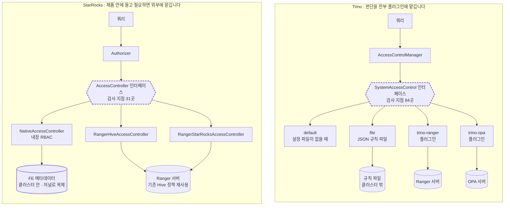
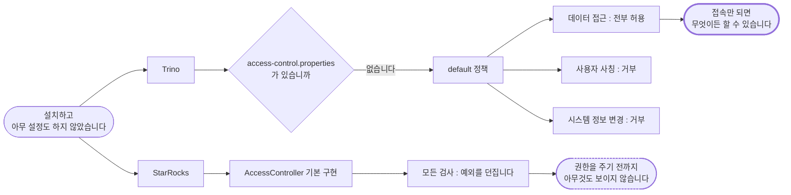
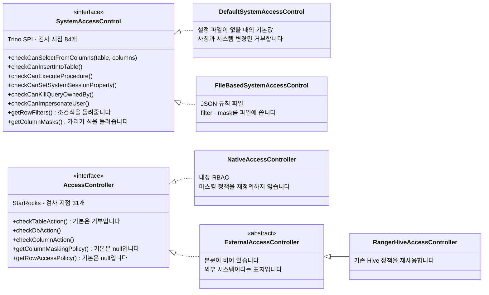
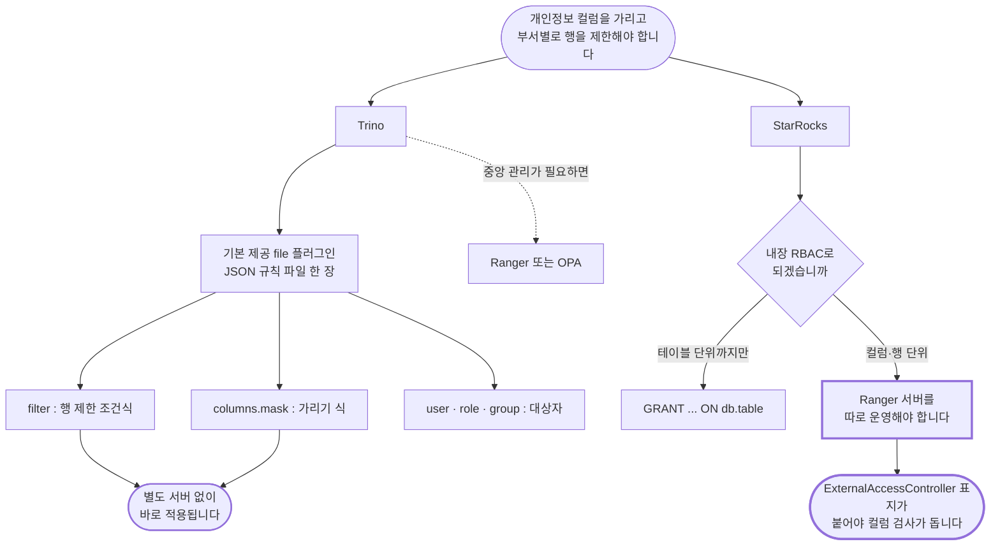

# 설치 직후 상태가 정반대입니다: 권한은 누가 판단하는가

> 비교 기준: Trino **483** (`50b0b50b`) · StarRocks **4.0.14** (`7c18dd9d`) · 2026-10-30 기준
> 랩 구성: 같은 Iceberg 카탈로그(Hive Metastore 4.0.1 + MinIO), Trino worker 1대 / StarRocks BE 1대
> 다루지 않는 것: Ranger와 OPA 서버를 붙인 실측, 권한 검사가 쿼리 속도에 주는 영향, 노드 사이 통신 암호화
> 시리즈: [1편 · 전체 결론](01-스토리지를-소유하는가.md) · [4편 · 운영](04-운영-메모리-격리-장애.md)의 심화편입니다

---

## 결론부터

**컬럼 가리기와 행 제한이 요건이고 Ranger를 쓰지 않는다면 Trino입니다. 설치 직후부터 잠겨 있어야 한다면 StarRocks입니다.**

보안 검토에서 반드시 나오는 질문 셋에 두 엔진이 서로 다르게 답합니다.

| 질문 | Trino 483 | StarRocks 4.0.14 |
|---|---|---|
| 설치 직후에는 누구나 다 볼 수 있는가 | **데이터는 전부 열려 있습니다** | **전부 잠겨 있습니다** (실측) |
| 개인정보 컬럼만 가릴 수 있는가 | **JSON 규칙 파일 한 장으로 됩니다** | **Ranger 서버가 사실상 필수입니다** |
| 기존 권한 관리 시스템에 붙는가 | Ranger, **OPA** | Ranger (**기존 Hive 정책을 그대로 재사용합니다**) |

**우열보다는 "권한이 어디에 사는가"의 차이입니다.** Trino의 권한은 클러스터 밖(설정 파일이나 외부 서비스)에 살고, StarRocks의 권한은 클러스터 안(메타데이터)에 삽니다.

**운영 전에 할 일이 양쪽에 각각 하나씩 있습니다.** Trino를 쓴다면 `etc/access-control.properties`가 있는지 가장 먼저 확인해야 하고, StarRocks에서 컬럼·행 보안이 필요하다면 Ranger 도입을 함께 계획해야 합니다.

---

## 1. 비교 범위와 버전

| 항목 | 내용 |
|---|---|
| 비교 대상 | Trino 483 (tag `483`) / StarRocks 4.0.14 (tag `4.0.14`) |
| 비교 축 | 판단 주체 · 기본 상태 · 검사 입도 · 컬럼·행 보안 · 외부 연동 · 인증 |
| 측정 환경 | macOS arm64, Docker Desktop 14 CPU / 25GB, `functional` 프로파일 |
| 실측 범위 | **StarRocks만 실측했습니다.** Trino 쪽은 전부 코드 확인입니다(4절) |

**권한 체계는 도입 후에 바꾸기 가장 어려운 부분입니다.** 운영 중인 사용자와 정책을 함께 옮겨야 하기 때문입니다. 그래서 세 가지를 도입 전에 알아야 합니다.

- **설치하고 아무 설정도 하지 않았을 때 무엇이 열려 있는가.** 보안 사고의 대부분이 "설정하지 않은 상태"에서 납니다.
- **컬럼 가리기와 부서별 행 제한을 어떤 비용으로 할 수 있는가.** 규제 대응의 핵심 요건입니다.
- **이미 쓰는 권한 관리 시스템을 그대로 쓸 수 있는가.** 정책을 두 번 관리하면 반드시 어긋납니다.

---

## 2. 두 엔진이 푸는 문제

**Trino의 권한은 클러스터 밖에 삽니다.** 설정 파일이거나 Ranger, OPA 같은 외부 서비스입니다. 클러스터를 새로 띄워도 권한이 그대로 따라옵니다. 코디네이터를 이중화하는 계층 없이 **클러스터 자체를 여러 벌 띄우는** 전략과 잘 맞습니다.

**StarRocks의 권한은 클러스터 안에 삽니다.** 메타데이터의 일부이고 FE 저널로 복제됩니다. **클러스터가 곧 권한 경계입니다.**



**이 차이가 다중 클러스터 운영에서 드러납니다.** 업무별이나 개발·운영 분리로 클러스터를 여럿 두는 계획이라면 Trino 구조가 관리하기 쉽습니다. 단일 클러스터라면 StarRocks의 "SQL로 `GRANT` 하면 끝" 방식이 더 간단합니다.

---

## 3. 핵심 동작 비교

### 3-1. 설치 직후 상태가 정반대입니다

**이 글에서 가장 먼저 알아야 할 항목입니다.**

Trino는 설정 파일이 없으면 기본 정책을 씁니다.

```java
// core/trino-main/src/main/java/io/trino/security/AccessControlManager.java#L163-L172 @ 483
public void loadSystemAccessControl()
{
    List<File> configFiles = this.configFiles;
    if (configFiles.isEmpty()) {
        if (!CONFIG_FILE.exists()) {
            loadSystemAccessControl(defaultAccessControlName, ImmutableMap.of());
            log.info("Using system access control: %s", defaultAccessControlName);
            return;
        }
        configFiles = ImmutableList.of(CONFIG_FILE);
```

[AccessControlManager.java#L163-L172](https://github.com/trinodb/trino/blob/483/core/trino-main/src/main/java/io/trino/security/AccessControlManager.java#L163-L172)

그 기본 정책의 이름은 `default`이고, 내용은 이렇습니다.

```java
// lib/trino-plugin-toolkit/src/main/java/io/trino/plugin/base/security/DefaultSystemAccessControl.java#L54-L64 @ 483
@Override
public void checkCanImpersonateUser(Identity identity, String userName)
{
    denyImpersonateUser(identity.getUser(), userName);
}

@Override
public void checkCanWriteSystemInformation(Identity identity)
{
    denyWriteSystemInformationAccess();
}
```

[DefaultSystemAccessControl.java#L54-L64](https://github.com/trinodb/trino/blob/483/lib/trino-plugin-toolkit/src/main/java/io/trino/plugin/base/security/DefaultSystemAccessControl.java#L54-L64)

이 클래스는 "모두 허용"을 물려받고 **딱 두 가지만 거부로 덮어씁니다.** 다른 사용자 사칭과 시스템 정보 변경입니다. **나머지 82개 검사는 전부 통과합니다.** 즉 설정 파일을 두지 않은 Trino는 접속만 되면 어떤 테이블이든 읽고 쓰고 지울 수 있습니다.

StarRocks는 반대입니다.

```java
// fe/fe-core/src/main/java/com/starrocks/authorization/AccessController.java#L60-L63 @ 4.0.14
default void checkTableAction(ConnectContext context, TableName tableName, PrivilegeType privilegeType)
        throws AccessDeniedException {
    throw new AccessDeniedException();
}
```

[AccessController.java#L60-L63](https://github.com/StarRocks/starrocks/blob/4.0.14/fe/fe-core/src/main/java/com/starrocks/authorization/AccessController.java#L60-L63)

**본문이 예외를 던지는 한 줄뿐입니다.** 권한 체계를 명시적으로 구현해 허용하지 않는 한 무조건 거부입니다.



### 3-2. 검사 입도가 84곳과 31곳입니다

Trino는 "이 사용자가 이 동작을 해도 되는가"를 묻는 지점을 인터페이스로 정의하고 실제 판단은 플러그인이 합니다. 그 인터페이스의 검사 항목이 **84개**입니다. 카탈로그와 스키마, 테이블, 컬럼부터 프로시저 호출, 세션 설정 변경, 남의 쿼리 종료, 사용자 사칭까지 각각 따로 묻습니다.

컬럼 단위 검사도 들어 있습니다.

```java
// core/trino-spi/src/main/java/io/trino/spi/security/SystemAccessControl.java#L513-L530 @ 483
/**
 * Check if identity is allowed to select from the specified columns in a relation.
 */
default void checkCanSelectFromColumns(SystemSecurityContext context, CatalogSchemaTableName table, Optional<String> branch, Set<String> columns)
{
    checkCanSelectFromColumns(context, table, columns);
}

@Deprecated
default void checkCanSelectFromColumns(SystemSecurityContext context, CatalogSchemaTableName table, Set<String> columns)
{
    denySelectColumns(table.toString(), columns);
}
```

[SystemAccessControl.java#L513-L530](https://github.com/trinodb/trino/blob/483/core/trino-spi/src/main/java/io/trino/spi/security/SystemAccessControl.java#L513-L530)

**묻는 단위가 테이블이 아니라 컬럼 묶음입니다.** 인터페이스 자체의 기본 답은 거부이고, 이것을 허용으로 바꾸는 것은 어떤 플러그인을 끼우느냐에 달려 있습니다.



StarRocks의 검사 항목은 **31개**입니다. 2.7배 차이는 **커넥터 다양성에서 나옵니다.** Trino는 카탈로그마다 성격이 다르고 프로시저와 테이블 함수, 언어 함수까지 있으니 검사할 동작이 그만큼 많습니다. StarRocks는 대상이 좁아 31개로 덮입니다.

**세밀함이 항상 이득은 아닙니다.** 검사 지점이 많다는 것은 정책을 그만큼 많이 써야 한다는 뜻이기도 합니다. 다만 "이 동작만 막고 싶다"가 되는 것은 Trino 쪽입니다.

### 3-3. 컬럼 가리기와 행 제한의 도입 비용이 갈립니다

**발상은 양쪽이 같습니다.** 권한 시스템이 "허용과 거부"만 답하는 것이 아니라 **조건식**을 돌려주고, 엔진이 그 식을 사용자의 쿼리에 끼워 넣습니다.

```java
// core/trino-spi/src/main/java/io/trino/spi/security/SystemAccessControl.java#L1060-L1070 @ 483
/**
 * Get row filters associated with the given table and identity.
 * <p>
 * Each filter must be a scalar SQL expression of boolean type over the columns in the table.
 */
default List<ViewExpression> getRowFilters(SystemSecurityContext context, CatalogSchemaTableName tableName)
{
    return List.of();
}
```

[SystemAccessControl.java#L1060-L1070](https://github.com/trinodb/trino/blob/483/core/trino-spi/src/main/java/io/trino/spi/security/SystemAccessControl.java#L1060-L1070)

주석이 핵심을 말합니다. "각 필터는 **참과 거짓을 내는 SQL 식**이어야 한다"입니다. `region = 'KR'` 같은 조건식을 돌려주면 엔진이 쿼리에 덧붙입니다. 컬럼 가리기도 같은 방식으로 원래 컬럼 대신 `'***'` 같은 식으로 바꿔 끼웁니다.

**갈리는 것은 그 조건식을 누가 내주는가입니다.**

Trino에는 별도 서버 없이 쓰는 **기본 제공 JSON 규칙 파일** 방식이 있습니다.

```java
// lib/trino-plugin-toolkit/src/main/java/io/trino/plugin/base/security/ColumnConstraint.java#L28-L33 @ 483
@JsonCreator
public ColumnConstraint(
        @JsonProperty("name") String name,
        @JsonProperty("allow") Optional<Boolean> allow,
        @JsonProperty("mask") Optional<String> mask,
        @JsonProperty("mask_environment") Optional<ExpressionEnvironment> maskEnvironment)
```

[ColumnConstraint.java#L28-L33](https://github.com/trinodb/trino/blob/483/lib/trino-plugin-toolkit/src/main/java/io/trino/plugin/base/security/ColumnConstraint.java#L28-L33)

테이블 규칙에 `filter`(행 제한 조건식)와 `columns`(컬럼별 제약)가 있고, 컬럼 제약에는 `allow`(아예 차단)와 `mask`(가리기 식)가 있습니다. `user`와 `role`, `group`으로 대상자를 고릅니다. **즉 "영업팀은 고객 테이블의 주민번호 컬럼을 `***`로 보고 자기 지역 행만 본다"를 JSON 한 장으로 쓸 수 있습니다.**

StarRocks는 구조가 같은데 **내주는 쪽이 비어 있습니다.**

```java
// fe/fe-core/src/main/java/com/starrocks/authorization/AccessController.java#L184-L190 @ 4.0.14
default Map<String, Expr> getColumnMaskingPolicy(ConnectContext context, TableName tableName, List<Column> columns) {
    return null;
}

default Expr getRowAccessPolicy(ConnectContext currentUser, TableName tableName) {
    return null;
}
```

[AccessController.java#L184-L190](https://github.com/StarRocks/starrocks/blob/4.0.14/fe/fe-core/src/main/java/com/starrocks/authorization/AccessController.java#L184-L190)

**기본값이 `null`, 즉 정책 없음입니다.** 내장 권한 체계는 이것을 재정의하지 않습니다. 그리고 `CREATE MASKING POLICY` 같은 **정책을 만드는 SQL 문장도 없습니다.**

컬럼 단위 검사 자체도 외부 권한 시스템을 붙였을 때만 동작합니다.

```java
// fe/fe-core/src/main/java/com/starrocks/authorization/ColumnPrivilege.java#L89-L96 @ 4.0.14
Set<TableName> tableUsedExternalAccessController = new HashSet<>();
for (TableName tableName : tableNameTableObj.keySet()) {
    String catalog = tableName.getCatalog() == null ?
            InternalCatalog.DEFAULT_INTERNAL_CATALOG_NAME : tableName.getCatalog();
    if (Authorizer.getInstance().getAccessControlOrDefault(catalog) instanceof ExternalAccessController) {
        tableUsedExternalAccessController.add(tableName);
    }
}
```

[ColumnPrivilege.java#L89-L96](https://github.com/StarRocks/starrocks/blob/4.0.14/fe/fe-core/src/main/java/com/starrocks/authorization/ColumnPrivilege.java#L89-L96)

**변수 이름이 모든 것을 말합니다.** `tableUsedExternalAccessController`에 든 테이블만 컬럼 하나하나를 검사하고, 나머지는 테이블 단위로 끝납니다. 권한 부여 문법도 `GRANT ... ON db.table`의 두 단계까지만 받습니다.



### 3-4. 외부 연동: 한쪽은 OPA, 한쪽은 기존 Hive 정책입니다

```java
// fe/fe-core/src/main/java/com/starrocks/authorization/ranger/hive/RangerHiveAccessController.java#L30-L33 @ 4.0.14
public class RangerHiveAccessController extends RangerAccessController {
    public RangerHiveAccessController(String serviceName) {
        super("hive", serviceName);
    }
```

[RangerHiveAccessController.java#L30-L33](https://github.com/StarRocks/starrocks/blob/4.0.14/fe/fe-core/src/main/java/com/starrocks/authorization/ranger/hive/RangerHiveAccessController.java#L30-L33)

**`super("hive", ...)`가 핵심입니다.** Ranger에 이미 등록되어 있는 **Hive용 정책 정의를 그대로 가져다 판단합니다.** 회사가 하둡과 Hive 시절부터 Ranger로 권한을 관리해 왔다면 StarRocks를 들여오면서 정책을 새로 만들 필요가 없습니다.

**이것은 StarRocks가 레이크하우스 생태계에 후발로 들어왔다는 사실을 그대로 보여 줍니다.** 이미 Hive와 Ranger로 관리되던 데이터를 읽으러 왔으니 기존 정책을 존중하는 것이 채택의 전제입니다.

반면 **OPA 연동은 Trino에만 있습니다.** StarRocks FE 소스 전체에서 "OPA"를 대소문자 구분 없이 검색해 0건입니다.

### 3-5. 인증: 순서 있는 목록과 Kerberos

```java
// core/trino-main/src/main/java/io/trino/server/security/SecurityConfig.java#L58-L64 @ 483
@Config("http-server.authentication.type")
@ConfigDescription("Ordered list of authentication types")
public SecurityConfig setAuthenticationTypes(List<String> types)
{
    authenticationTypes = ImmutableList.copyOf(types);
    return this;
}
```

[SecurityConfig.java#L58-L64](https://github.com/trinodb/trino/blob/483/core/trino-main/src/main/java/io/trino/server/security/SecurityConfig.java#L58-L64)

**설명 문구 "Ordered list"가 핵심입니다.** 로그인 방식이 하나가 아니라 순서 있는 목록입니다. "사내 SSO를 먼저 시도하고 안 되면 인증서, 그다음 비밀번호"처럼 섞어 쓸 수 있습니다.

| | Trino 483 | StarRocks 4.0.14 |
|---|---|---|
| 지원 방식 | Kerberos, 비밀번호(LDAP 포함), 인증서, JWT, OAuth2, 헤더 | 비밀번호, LDAP, JWT, OAuth2 |
| 여러 방식 동시 사용 | **순서 있는 목록으로 지원합니다** | 확인하지 못했습니다 |
| **Kerberos** | 있습니다 | **없습니다** (`authentication/`에서 0건) |
| 그룹 정보 출처 | SPI (파일, LDAP 등) | 파일, LDAP, 유닉스 계정 |
| 부수 효과 | | MySQL 프로토콜이라 **기존 MySQL용 BI 도구가 그대로 붙습니다** |

---

## 4. 측정 결과

환경: macOS arm64 Docker Desktop 14 CPU / 25GB, `functional` 프로파일, 2026-09-04 실행. **StarRocks만 실측했습니다.**

### 4-1. StarRocks는 권한을 주기 전까지 거부했습니다

새 사용자를 만들고 `nation` 테이블에만 조회 권한을 준 뒤 그 사용자로 접속해 두 테이블을 조회했습니다.

| 대상 | 결과 |
|---|---|
| `nation` (권한을 주었습니다) | **정상 조회, 25건** |
| `lineitem` (권한을 주지 않았습니다) | **거부** |
| 권한을 주기 전의 `nation` | **거부** |

거부 메시지가 친절합니다.

```
ERROR 5203 (42000): Access denied; you need (at least one of) the SELECT privilege(s)
on TABLE lineitem for this operation. Please ask the admin to grant permission(s) or
try activating existing roles using <set [default] role>.
Current role(s): NONE. Inactivated role(s): NONE.
```

**필요한 권한과 대상, 현재 켜진 역할과 꺼진 역할까지 알려 줍니다.** "역할은 받았는데 켜지 않았다"는 흔한 실수를 바로 짚어 줍니다.

### 4-2. Trino 쪽은 실측하지 못했습니다

**랩에 권한 설정 파일이 없어 3-1의 기본 상태로 돌고 있었습니다.** 데이터가 전부 허용되는 상태였으므로 권한 동작을 확인할 수 없었습니다. **이것은 랩 구성의 한계이고, 이 글의 Trino 설명은 전부 코드 확인에 근거합니다.**

### 4-3. 이 글에서 고친 것

**초판에서 Trino 기본값을 "모두 허용(`allow-all`)"이라고 적었습니다.** 기본값을 정하는 코드까지 따라가 보니 실제로는 `default`라는 별도 정책이었고, 사칭과 시스템 정보 변경은 막고 있었습니다. **데이터 접근에 관한 결론은 같지만 정확한 서술로 고쳤습니다.**

그리고 초판에는 **컬럼과 행 단위 보안을 어디까지 기본 기능으로 할 수 있는가**가 빠져 있었습니다. 3-3이 그 보강입니다. 이 항목이 두 엔진의 도입 비용을 가장 크게 가릅니다.

---

## 5. 축별 정리

| 축 | Trino 483 (사실) | StarRocks 4.0.14 (사실) | 어떤 상황에 유리한가 |
|---|---|---|---|
| 판단 주체 | 전부 SPI. 내장 정책도 플러그인입니다 | FE 내장 + 외부 연동 선택 | 정책 엔진을 바꿀 계획이면 Trino |
| 권한 저장 위치 | 설정 파일 또는 외부 서비스 | FE 메타데이터, 저널로 복제 | 다중 클러스터면 Trino |
| 기본 상태 | 데이터 전부 허용, 사칭·시스템 변경만 거부 | **전부 거부** (실측) | 실수로 열리면 안 되면 StarRocks |
| 검사 지점 수 | **84개** | 31개 | 세밀한 통제가 필요하면 Trino |
| 컬럼 단위 검사 | SPI 항목으로 있습니다 | **외부 권한 시스템을 붙였을 때만** | 컬럼 보안이 요건이면 Trino |
| 컬럼 가리기·행 제한 | **JSON 규칙 파일로 가능합니다** | Ranger 경유만 가능합니다 | Ranger가 없으면 Trino |
| 정책 생성 SQL | 없습니다 (파일 또는 외부 서비스) | **없습니다** | |
| 외부 정책 엔진 | Ranger + **OPA** | Ranger | Rego로 통일하려면 Trino |
| 기존 Hive 정책 재사용 | 커넥터별 매핑이 필요합니다 | **서비스 정의를 그대로 재사용합니다** | Hive/Ranger 이력이 있으면 StarRocks |
| 인증 방식 | 6종, **순서 있는 다중** + SPI | 4종 | 사내 SSO가 복잡하면 Trino |
| Kerberos | 있습니다 | 없습니다 | |
| 권한 요청 흐름 | 운영자가 파일이나 외부 서비스를 고칩니다 | **SQL `GRANT` 한 줄** | 단일 클러스터면 StarRocks |

**기본값의 방향이 캐시와 반대라는 점이 흥미롭습니다.** [4편](04-운영-메모리-격리-장애.md)에서 본 대로 캐시는 StarRocks가 켜 두고 Trino가 꺼 두는데, **권한은 StarRocks가 잠가 두고 Trino가 열어 둡니다.** 각자 "운영자가 반드시 결정해야 하는 것"을 다르게 본 결과입니다.

---

## 6. 언제 무엇을 고를까

| 상황 | 선택 | 결정적 근거 |
|---|---|---|
| 개인정보 컬럼 가리기가 요건이고 Ranger를 쓰지 않습니다 | **Trino** | JSON 규칙 파일 한 장으로 됩니다 |
| 정책을 Rego로 통일해 관리합니다 | **Trino** | OPA 연동은 Trino에만 있습니다 |
| 여러 클러스터에 같은 정책을 적용합니다 | **Trino** | 권한이 클러스터 밖에 삽니다 |
| Kerberos 인증이 요건입니다 | **Trino** | StarRocks에는 없습니다 |
| 특정 동작만 막는 세밀한 통제가 필요합니다 | **Trino** | 검사 지점이 84개 대 31개입니다 |
| 실수로 데이터가 열리는 일을 막아야 합니다 | **StarRocks** | 권한을 주기 전까지 전부 거부합니다 |
| 기존 Hive/Ranger 정책이 있습니다 | **StarRocks** | 서비스 정의를 그대로 재사용해 이전 비용이 줄어듭니다 |
| 단일 클러스터이고 권한 관리를 간단히 하려 합니다 | **StarRocks** | SQL `GRANT` 한 줄로 끝납니다 |
| 기존 MySQL용 BI 도구를 그대로 쓰려 합니다 | **StarRocks** | MySQL 프로토콜의 부수 효과입니다 |

### 운영 시작 전 점검 목록

1. **Trino**: `etc/access-control.properties`가 있는지 **가장 먼저** 확인합니다. 없으면 접속할 수 있는 사람 누구나 무엇이든 할 수 있습니다.
2. **StarRocks**: 컬럼·행 단위 보안이 요건이면 **Ranger 도입을 함께 계획합니다.** 내장 RBAC로는 테이블 단위까지만 됩니다.
3. **양쪽 모두**: 정책을 두 곳에서 관리하지 않도록 **권한의 단일 출처를 먼저 정합니다.** 두 번 관리하면 반드시 어긋납니다.
4. **StarRocks**: 사용자에게 역할을 주었는데 안 보인다는 문의가 오면 **역할 활성화**(`SET ROLE`)를 먼저 확인합니다. 4-1의 오류 메시지가 그 안내를 담고 있습니다.

---

## 7. 확인하지 못한 것

| 항목 | 확인하지 못한 이유 | 필요한 조건 |
|---|---|---|
| **Trino 권한 동작 전반** | 랩에 권한 설정이 없었습니다. 2절과 3절의 Trino 설명은 전부 코드 확인입니다 | JSON 규칙 파일을 넣고 같은 시험 반복 |
| Ranger 연동의 실제 동작 | 양쪽 모두 Ranger 서버가 없었습니다. 특히 **Hive 정책을 얼마나 충실히 해석하는지** 모릅니다 | Ranger 서버와 샘플 정책 |
| 컬럼 가리기·행 제한 실측 | 위와 같습니다. Trino 규칙 파일은 Ranger 없이도 시험할 수 있으나 하지 않았습니다 | 규칙 파일 시험 |
| 권한 검사가 쿼리 속도에 주는 영향 | 측정하지 않았습니다. 검사 지점 84곳이 계획 단계 지연을 늘리는지 모릅니다 | 권한 설정 유무별 반복 측정 |
| 노드 사이 통신 암호화 | StarRocks 내부 통신(FE-BE, BE-BE) 구간을 확인하지 않았습니다 | 별도 조사 |
| StarRocks 인증 방식의 다중 사용 | 순서 있는 목록 지원 여부를 확인하지 않았습니다 | 소스 추가 독해 |
| 감사 기록 | 이 글의 범위 밖입니다 | [10편](10-무슨-일이-있었고-왜-느렸는가.md) 참조 |

**이 글은 "권한 체계가 어떻게 설계되어 있고 기본 상태가 어떤가"까지이며, "어느 쪽이 더 안전한가"가 아닙니다.** 안전성은 어떤 정책을 어떻게 설정하느냐에 달려 있습니다.

---

## 출처와 라이선스

- Trino: [trinodb/trino](https://github.com/trinodb/trino) tag `483`, Apache License 2.0. Copyright Trino 프로젝트 기여자
- StarRocks: [StarRocks/starrocks](https://github.com/StarRocks/starrocks) tag `4.0.14`, Apache License 2.0. Copyright StarRocks 프로젝트 기여자
- Apache Ranger, Open Policy Agent: Apache License 2.0
- 인용 코드는 모두 30줄 이하이고 출처를 태그 고정 영구 링크로 표시했습니다
- 상세 근거: [B-5-01 보안과 권한 모델](../B-5-01-보안과-권한-모델.md) · 보고용 판 [report/12](../report/12-보안과-권한-모델-보고.md)

---

**다음 편**: [10편 · 무슨 일이 있었고 왜 느렸는가](10-무슨-일이-있었고-왜-느렸는가.md). 같은 운영 축의 나머지 절반입니다.
