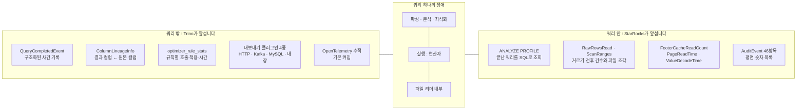
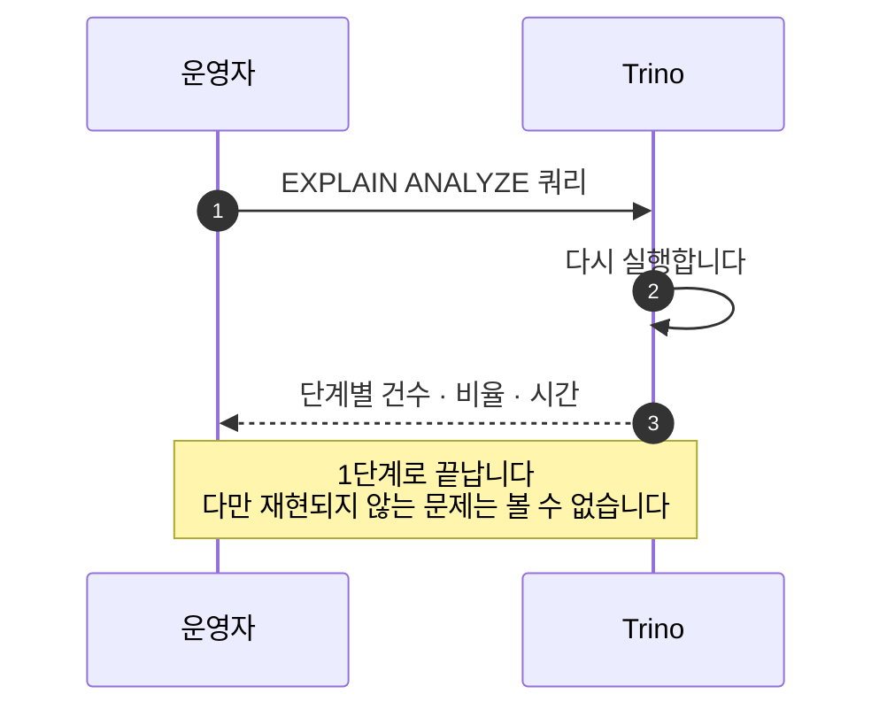
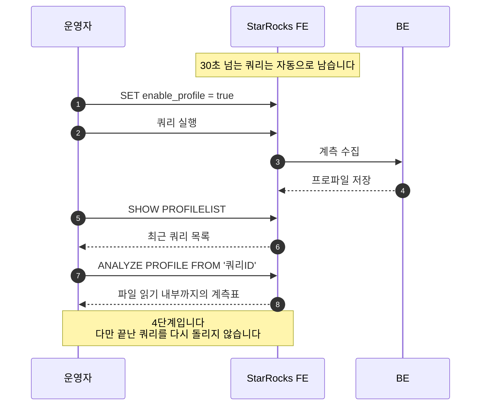
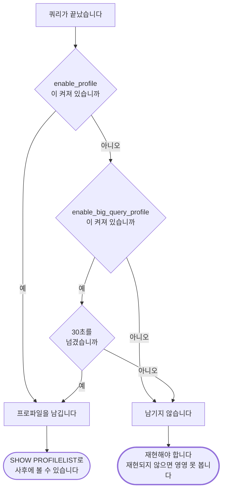

# 서로 반대 방향으로 깊습니다: 무슨 일이 있었고 왜 느렸는가

> 비교 기준: Trino **483** (`50b0b50b`) · StarRocks **4.0.14** (`7c18dd9d`) · 2026-10-30 기준
> 랩 구성: 같은 Iceberg 카탈로그(Hive Metastore 4.0.1 + MinIO), Trino worker 1대 / StarRocks BE 1대
> 다루지 않는 것: 수집 비용 측정, 분산 추적 수집기 연결, 다중 노드 프로파일, 실행 시간 비교
> 시리즈: [1편 · 전체 결론](01-스토리지를-소유하는가.md) · [4편 · 운영](04-운영-메모리-격리-장애.md)의 심화편입니다

---

## 결론부터

**"누가 어떤 데이터를 봤는가"는 Trino가, "이 쿼리는 왜 느렸는가"는 StarRocks가 더 깊이 보여 줍니다.**

운영 중에 받는 질문은 크게 두 종류입니다. 감사와 규제 대응, 그리고 성능 문제 해결입니다. **두 엔진은 이 두 질문에 서로 반대 방향으로 깊게 답합니다.**

| 질문 | 앞서는 쪽 | 결정적 근거 |
|---|---|---|
| 이 컬럼이 어느 원본에서 왔는가 | **Trino** | 엔진이 컬럼 계보를 자동 계산합니다. StarRocks에는 없습니다 |
| 계획 세우는 데 왜 오래 걸리는가 | **Trino** | 옵티마이저 규칙 통계를 SQL로 조회합니다. StarRocks에는 없습니다 |
| 메모리를 누가 먹었는가 | **Trino** | 오류 메시지가 범인 연산을 지목합니다 |
| 파일 읽기가 왜 느렸는가 | **StarRocks** | 캐시 적중과 페이지 읽기 시간까지 계측합니다 |
| 끝난 쿼리를 사후에 볼 수 있는가 | **StarRocks** | `ANALYZE PROFILE`로 조회합니다. Trino는 다시 실행해야 합니다 |

**다만 StarRocks의 깊은 정보는 꺼내는 절차가 길고, 30초 미만의 짧은 쿼리는 미리 켜 두지 않으면 사후에 볼 수 없습니다.** StarRocks의 주 용도가 짧은 분석 쿼리이므로 **문제가 되는 쿼리 대부분이 그 기준 아래에 있습니다.**

**이 글은 비교 전체에서 가장 많이 직접 써 본 영역입니다.** 열여섯 편의 기술 문서를 쓰면서 두 엔진의 관측 수단으로 모든 시험 결과를 확인했고, 어디서 막혔고 어디서 잘 보였는지가 기록에 남아 있습니다. 4절이 그 경험입니다.

---

## 1. 비교 범위와 버전

| 항목 | 내용 |
|---|---|
| 비교 대상 | Trino 483 (tag `483`) / StarRocks 4.0.14 (tag `4.0.14`) |
| 비교 축 | 실행 기록 내보내기 · 컬럼 계보 · 프로파일 깊이 · 수집 정책 · 오류 진단 · 지표와 추적 |
| 측정 환경 | macOS arm64, Docker Desktop 14 CPU / 25GB, TPC-H SF 0.01 |
| 실측 범위 | 별도 시험을 하지 않았습니다. **앞선 열여섯 편의 시험이 전부 이 수단으로 이뤄졌으므로** 그 경험을 모았습니다 |

**관측 수단은 장애가 났을 때 원인을 찾는 데 걸리는 시간을 결정합니다.** 그리고 규제 대응에서는 "이 개인정보 컬럼이 어느 보고서로 흘러갔는가"를 증명해야 하는 경우가 늘고 있습니다.

> **용어 세 개를 먼저 적습니다.**
> - **계보(lineage)**: 결과의 각 컬럼이 어느 원본 테이블의 어느 컬럼에서 왔는지 추적한 정보입니다.
> - **프로파일**: 쿼리 하나를 실행하는 동안 각 처리 단계가 얼마나 걸리고 몇 건을 처리했는지 기록한 상세 계측표입니다.
> - **OpenTelemetry**: 분산 시스템의 처리 단계를 추적 기록으로 남기는 표준입니다.

---

## 2. 두 엔진이 푸는 문제

**Trino는 쿼리 밖에 투자했습니다.** 수십 개 커넥터를 넘나드는 엔진이라 운영자의 질문이 "누가 어떤 데이터에 접근했나"인 경우가 많습니다. 컬럼 계보는 그 질문의 최종형입니다.

**StarRocks는 쿼리 안에 투자했습니다.** 실행 계층과 스토리지를 직접 소유하므로 내부 카운터를 다 갖고 있고, 저지연 분석이 목표라 "왜 20ms가 아니라 200ms인가"에 답해야 합니다.

**각자 자기가 답해야 하는 질문에 맞춰 계측했습니다.** 소유한 만큼 볼 수 있다는 구도가 이 축에서도 반복됩니다.



---

## 3. 핵심 동작 비교

### 3-1. Trino: 끝나면 구조화된 사건 기록을 내보냅니다

```java
// core/trino-spi/src/main/java/io/trino/spi/eventlistener/QueryCompletedEvent.java#L31-L43 @ 483
public class QueryCompletedEvent
{
    private final QueryMetadata metadata;
    private final QueryStatistics statistics;
    private final QueryContext context;
    private final QueryIOMetadata ioMetadata;
    private final Optional<List<ColumnLineageInfo>> selectColumnsLineageInfo;
    private final Optional<QueryFailureInfo> failureInfo;
    private final List<TrinoWarning> warnings;

    private final Instant createTime;
    private final Instant executionStartTime;
    private final Instant endTime;
```

[QueryCompletedEvent.java#L31-L43](https://github.com/trinodb/trino/blob/483/core/trino-spi/src/main/java/io/trino/spi/eventlistener/QueryCompletedEvent.java#L31-L43)

**쿼리 하나가 끝날 때 만들어지는 기록의 목차입니다.** 무슨 쿼리였나(`metadata`), 얼마나 걸렸나(`statistics`), 누가 어디서(`context`), 어떤 테이블을 읽고 썼나(`ioMetadata`), 왜 실패했나(`failureInfo`)가 각각 **별도 묶음**으로 정리되어 있습니다. 이 기록을 받아 밖으로 보내는 부분도 플러그인이고, 기본 제공되는 것이 HTTP와 Kafka, MySQL, 내장 서버용으로 **4종**입니다.

### 3-2. 컬럼 계보를 엔진이 계산해 줍니다

**이 축에서 Trino의 결정적 강점입니다.**

```java
// core/trino-spi/src/main/java/io/trino/spi/eventlistener/ColumnLineageInfo.java#L24-L29 @ 483
/**
 * This record is JSON serializable for storing column lineage information for select queries.
 */
public record ColumnLineageInfo(
        @JsonProperty String name,
        @JsonProperty Set<ColumnDetail> sourceColumns)
```

[ColumnLineageInfo.java#L24-L29](https://github.com/trinodb/trino/blob/483/core/trino-spi/src/main/java/io/trino/spi/eventlistener/ColumnLineageInfo.java#L24-L29)

`name`은 결과 컬럼 이름이고 `sourceColumns`는 **그 컬럼을 만드는 데 쓰인 원본 컬럼들**입니다. 결과의 `고객등급` 컬럼이 `customers.가입일`과 `orders.금액`에서 계산되었다면 그 두 원본이 여기에 담깁니다.

**별도 계보 도구 없이 엔진이 직접 계산해 줍니다.** "주민번호 컬럼이 어떤 보고서로 흘러갔나" 같은 규제 대응 질문에 바로 쓸 수 있습니다. **StarRocks에는 이 개념 자체가 없습니다.**

### 3-3. 옵티마이저 내부 통계를 SQL로 봅니다

```java
// core/trino-main/src/main/java/io/trino/connector/system/RuleStatsSystemTable.java#L62-L69 @ 483
this.ruleStatsTable = tableMetadataBuilder(TABLE_NAME)
        .column("rule_name", VARCHAR)
        .column("invocations", BIGINT)
        .column("matches", BIGINT)
        .column("failures", BIGINT)
        .column("average_time", DOUBLE)
        .column("time_distribution_percentiles", new MapType(DOUBLE, DOUBLE, typeManager.getTypeOperators()))
        .build();
```

[RuleStatsSystemTable.java#L62-L69](https://github.com/trinodb/trino/blob/483/core/trino-main/src/main/java/io/trino/connector/system/RuleStatsSystemTable.java#L62-L69)

`system.runtime.optimizer_rule_stats` 테이블의 컬럼 정의입니다. 실행 계획을 다듬는 규칙마다 **몇 번 불렸고, 몇 번 실제로 적용됐고, 평균 얼마나 걸렸는지**를 보여 줍니다. "계획 세우는 데만 몇 초씩 걸린다"는 문제를 추적할 때 쓰는 창구이고, **StarRocks에 대응물이 없습니다.**

### 3-4. 메모리 부족 오류가 범인을 지목합니다

```java
// core/trino-main/src/main/java/io/trino/memory/QueryContext.java#L353-L360 @ 483
String topConsumers = queryAllocations.entrySet().stream()
        .sorted(comparingByValue(Comparator.reverseOrder()))
        .limit(3)
        .filter(e -> e.getValue() >= 0)
        .collect(toImmutableMap(Entry::getKey, e -> succinctBytes(e.getValue())))
        .toString();

return format("%s, Top Consumers: %s", additionalInfo, topConsumers);
```

[QueryContext.java#L353-L360](https://github.com/trinodb/trino/blob/483/core/trino-main/src/main/java/io/trino/memory/QueryContext.java#L353-L360)

메모리 사용량을 큰 순서로 정렬해 **상위 3개**를 골라 오류 메시지 끝에 붙입니다. 실제 시험에서 `Top Consumers: {PagePartitioner=856B}`처럼 나왔습니다. **어느 처리 단계가 메모리를 먹었는지 오류 메시지가 직접 말해 줍니다.**

### 3-5. StarRocks: 끝난 쿼리의 계측표를 SQL로 꺼냅니다

**이 축에서 StarRocks의 결정적 강점입니다.**

```
// fe/fe-core/src/main/java/com/starrocks/sql/parser/StarRocks.g4#L1721-L1723 @ 4.0.14
showProfilelistStatement
    : SHOW PROFILELIST (LIMIT limit =INTEGER_VALUE)?
    ;

// StarRocks.g4#L1465-L1468
analyzeProfileStatement
    : ANALYZE PROFILE FROM string
    | ANALYZE PROFILE FROM string ',' INTEGER_VALUE (',' INTEGER_VALUE)*
    ;
```

[StarRocks.g4#L1721-L1723](https://github.com/StarRocks/starrocks/blob/4.0.14/fe/fe-core/src/main/java/com/starrocks/sql/parser/StarRocks.g4#L1721-L1723) · [StarRocks.g4#L1465-L1468](https://github.com/StarRocks/starrocks/blob/4.0.14/fe/fe-core/src/main/java/com/starrocks/sql/parser/StarRocks.g4#L1465-L1468)

`SHOW PROFILELIST`로 최근 쿼리 목록을 보고, `ANALYZE PROFILE FROM '<쿼리ID>'`로 그 쿼리의 계측표를, 뒤에 번호를 붙이면 특정 처리 단계의 상세를 봅니다. **핵심은 다시 실행하지 않는다는 점입니다.**

Trino 쪽은 `EXPLAIN ANALYZE`로 봅니다. 쿼리 앞에 이 말을 붙이면 **다시 실행하면서** 단계마다 읽은 건수와 걸러낸 비율, 읽은 용량과 시간을 보여 줍니다.

```
└─ ScanFilterProject[table = iceberg:bench.o_part$data@..., filterPredicate = (o_orderkey < bigint '1000')]
       Input: 14269 rows (169.36kB), Filtered: 98.21%, Physical input: 225.41kB,
       Physical input time: 309.58ms, Splits: 75, Splits generation wait time: 8.08ms
```

**필요한 정보가 한 줄에 다 있고 한 번에 끝납니다.** 한계는 다시 실행해야 한다는 점입니다. 이미 끝난 쿼리의 단계별 상세는 웹 화면의 JSON으로만 볼 수 있고 SQL로는 꺼낼 수 없습니다.





### 3-6. 계측이 파일 읽기 내부까지 들어가 있습니다

```cpp
// be/src/exec/hdfs_scanner_parquet.cpp#L137-L147 @ 4.0.14
footer_cache_read_counter =
        ADD_CHILD_COUNTER(root, "FooterCacheReadCount", TUnit::UNIT, kParquetProfileSectionPrefix);
footer_cache_read_timer = ADD_CHILD_TIMER(root, "FooterCacheReadTimer", kParquetProfileSectionPrefix);

level_decode_timer = ADD_CHILD_TIMER(root, "LevelDecodeTime", kParquetProfileSectionPrefix);
value_decode_timer = ADD_CHILD_TIMER(root, "ValueDecodeTime", kParquetProfileSectionPrefix);

page_read_timer = ADD_CHILD_TIMER(root, "PageReadTime", kParquetProfileSectionPrefix);
page_read_counter = ADD_CHILD_COUNTER(root, "PageReaderCounter", TUnit::UNIT, kParquetProfileSectionPrefix);
page_cache_read_counter =
        ADD_CHILD_COUNTER(root, "PageCacheReadCounter", TUnit::UNIT, kParquetProfileSectionPrefix);
```

[hdfs_scanner_parquet.cpp#L137-L147](https://github.com/StarRocks/starrocks/blob/4.0.14/be/src/exec/hdfs_scanner_parquet.cpp#L137-L147)

**데이터 파일 하나를 읽는 과정을 캐시 적중과 값 해독 시간, 페이지 읽기 시간으로 쪼개 잽니다.** "느린 게 디스크인가, 압축 풀기인가, 캐시를 못 탄 것인가"를 구분할 수 있는 수준이고, **Trino의 `EXPLAIN ANALYZE`에는 이 수준의 항목이 없습니다.**

스캔 단계에도 거르기 전후를 나눈 카운터가 있습니다. `RawRowsRead`(거르기 전)와 `RowsRead`(거른 뒤)가 따로 있고, `ScanRanges`는 **실제로 연 파일 조각 수**입니다. "조건으로 파일을 건너뛰는 최적화가 실제로 먹혔는가"를 이 숫자들로 판단합니다.

### 3-7. 기본은 꺼짐이지만 30초 넘는 쿼리는 자동으로 남습니다

**이 글을 쓰면서 바로잡은 내용입니다.**

```java
// fe/fe-core/src/main/java/com/starrocks/qe/ConnectContext.java#L991-L1002 @ 4.0.14
public boolean isProfileEnabled() {
    if (sessionVariable == null) {
        return false;
    }
    if (sessionVariable.isEnableProfile()) {
        return true;
    }
    if (!sessionVariable.isEnableBigQueryProfile()) {
        return false;
    }
    return System.currentTimeMillis() - getStartTime() > sessionVariable.getBigQueryProfileMilliSecondThreshold();
}
```

[ConnectContext.java#L991-L1002](https://github.com/StarRocks/starrocks/blob/4.0.14/fe/fe-core/src/main/java/com/starrocks/qe/ConnectContext.java#L991-L1002) · 임계값은 [SessionVariable.java#L1578-L1579](https://github.com/StarRocks/starrocks/blob/4.0.14/fe/fe-core/src/main/java/com/starrocks/qe/SessionVariable.java#L1578-L1579)에 `"30s"`로 있습니다.

`enable_profile`의 기본값은 꺼짐입니다. 그러나 이 판단 함수는 스위치가 꺼져 있어도 **마지막 줄에서 "시작한 지 30초가 넘었는가"를 다시 묻습니다.** 넘었으면 수집합니다.



**즉 30초 넘게 걸린 쿼리는 설정 없이도 사후에 볼 수 있고, 그보다 짧은 쿼리는 미리 켜 두지 않으면 볼 수 없습니다.** 이 동작은 **코드로만 확인했고 실제로 돌려 보지 못했습니다.**

### 3-8. 감사 로그는 평면적인 항목 목록입니다

```java
// fe/fe-core/src/main/java/com/starrocks/plugin/AuditEvent.java#L100-L111 @ 4.0.14
@AuditField(value = "Time")
public long queryTime = -1;
@AuditField(value = "ScanBytes")
public long scanBytes = -1;
@AuditField(value = "ScanRows")
public long scanRows = -1;
@AuditField(value = "ReturnRows")
public long returnRows = -1;
@AuditField(value = "CpuCostNs", ignore_zero = true)
public long cpuCostNs = -1;
@AuditField(value = "MemCostBytes", ignore_zero = true)
public long memCostBytes = -1;
```

[AuditEvent.java#L100-L111](https://github.com/StarRocks/starrocks/blob/4.0.14/fe/fe-core/src/main/java/com/starrocks/plugin/AuditEvent.java#L100-L111)

`@AuditField`가 붙은 줄 하나가 감사 로그의 한 항목입니다. 걸린 시간과 읽은 용량, 건수, CPU와 메모리 사용량이 **숫자 하나씩 나란히** 놓여 있습니다. 이런 항목이 **46개**입니다. **3-1의 Trino처럼 "어떤 테이블의 어떤 컬럼"이라는 구조적 정보나 계보는 없습니다.** 민감한 문장을 가리는 장치는 따로 있습니다.

### 3-9. 지표와 분산 추적

```java
// core/trino-main/src/main/java/io/trino/server/Server.java#L98-L103 @ 483
new MBeanModule(),
new PrefixObjectNameGeneratorModule("io.trino"),
new JmxModule(),
new JmxOpenMetricsModule(),
new LogJmxModule(),
new TracingModule("trino", trinoVersion),
```

[Server.java#L98-L103](https://github.com/trinodb/trino/blob/483/core/trino-main/src/main/java/io/trino/server/Server.java#L98-L103)

서버가 뜰 때 함께 올라가는 부품 목록입니다. `JmxModule`과 함께 **`JmxOpenMetricsModule`이 있어 같은 지표를 Prometheus가 읽을 수 있는 형식으로도 내보냅니다.** 마지막 `TracingModule`은 OpenTelemetry 분산 추적이고, 쿼리를 처리하는 동안 메타데이터 조회와 권한 검사 같은 단계가 추적 기록으로 남습니다.

StarRocks 쪽 분산 추적은 대상이 다릅니다.

```java
// fe/fe-core/src/main/java/com/starrocks/common/Config.java#L3222-L3228 @ 4.0.14
/**
 * Endpoint for exporting OpenTelemetry gRPC spans.
 * Empty string disables span export.
 * Default is empty string.
 */
@ConfField
public static String otlp_exporter_grpc_endpoint = "";
```

[Config.java#L3222-L3228](https://github.com/StarRocks/starrocks/blob/4.0.14/fe/fe-core/src/main/java/com/starrocks/common/Config.java#L3222-L3228)

**개발진 주석이 그대로 말합니다.** 빈 값이면 추적 기록을 내보내지 않으며 기본값이 빈 값입니다. 켜더라도 FE에서 추적을 쓰는 곳은 스키마 변경 작업과 트랜잭션 관리, 버전 반영 작업뿐입니다. **Trino가 쿼리 처리 경로를 추적하는 것과 대상이 다릅니다.** 운영 지표는 별도로 Prometheus 형식으로 내보냅니다.

---

## 4. 측정 결과

**이 축은 별도 시험을 하지 않았습니다.** 대신 앞선 열여섯 편의 시험이 전부 이 두 엔진의 관측 수단으로 이뤄졌으므로, 그 경험 중 **관측 수단 때문에 결과가 갈린 사례**를 모았습니다. 환경은 Trino 483 / StarRocks 4.0.14, 각 1노드, TPC-H SF 0.01입니다.

### 4-1. StarRocks가 없었으면 판단할 수 없었던 사례

| 사례 | 무엇을 확인하려 했나 | 경과 |
|---|---|---|
| **파일 건너뛰기 최적화** | 조건으로 파일을 얼마나 건너뛰는가 | StarRocks의 `EXPLAIN`에는 **예측치(250건)만** 나와 비교가 성립하지 않았습니다. 프로파일에서 `RawRowsRead: 14269`와 `ScanRanges: 80`을 꺼내고서야 Trino(`Input: 14269 rows`, `Splits: 75`)와 비교할 수 있었습니다 |
| **캐시 적중** | 두 번째 실행이 캐시를 탔는가 | StarRocks는 `FooterCacheReadCount: 1`로 확인했습니다. **Trino는 대응 수치를 SQL로 꺼낼 수 없어 같은 확인을 못 했습니다** |

### 4-2. Trino가 더 나았던 사례

| 사례 | 경과 |
|---|---|
| **메모리 부족 오류** | Trino는 오류에 `Top Consumers: {PagePartitioner=856B}`를 붙여 **범인 연산을 바로 알려줬습니다.** StarRocks는 위치(노드와 단계)만 알려줬습니다 |
| **조건이 저장소까지 전달됐는지** | Trino는 `EXPLAIN` 한 번으로 판단되었습니다. StarRocks는 계획에 조건이 찍혀 있어도 **실제로 파일을 건너뛰었다는 뜻이 아니어서** 반드시 프로파일을 봐야 했습니다 |

### 4-3. 확인 절차의 길이

| | 판단에 필요한 절차 |
|---|---|
| Trino | `EXPLAIN ANALYZE <쿼리>` **1단계** |
| StarRocks | 스위치 켜기 → 쿼리 실행 → 목록 조회 → 상세 조회 **4단계** |

### 4-4. 이 글에서 고친 것

> **투명성을 위한 기록**: StarRocks 프로파일을 처음 읽을 때 거른 **뒤** 건수(`OutputRows`)를 Trino의 거르기 **전** 건수(`Input rows`)와 짝지어 **"15,000건 대 255건"이라는 틀린 비교표를 만들 뻔했습니다.** 올바른 짝은 `RawRowsRead`였습니다. **계측 항목이 많다는 것은 잘못 고를 여지도 많다는 뜻입니다.**

그리고 초판에서 세 가지를 고쳤습니다. 모두 코드를 다시 확인한 결과입니다.

| 초판에 적은 내용 | 실제로 확인한 내용 |
|---|---|
| StarRocks 프로파일은 기본 꺼짐이라 항상 다시 실행해야 합니다 | **30초 넘는 쿼리는 자동으로 남습니다**(3-7) |
| 감사 로그 항목이 90개입니다 | **46개**입니다(3-8) |
| Trino 지표는 JMX 전용입니다 | **Prometheus 호환 형식으로도 내보냅니다**(3-9) |

**세 건 모두 [4편](04-운영-메모리-격리-장애.md)에도 반영했습니다.**

---

## 5. 축별 정리

| 축 | Trino 483 (사실) | StarRocks 4.0.14 (사실) | 어떤 상황에 유리한가 |
|---|---|---|---|
| 실행 기록 내보내기 | 구조화된 이벤트, 플러그인 4종 | 평면 감사 로그 **46항목** | 로그 파이프라인을 붙이려면 Trino |
| **컬럼 계보** | **엔진이 자동 계산합니다** | 없습니다 | 규제 대응이면 Trino |
| 옵티마이저 내부 통계 | **SQL로 조회합니다** | 없습니다 | 계획 지연을 추적하려면 Trino |
| 연산자 계측 | `EXPLAIN ANALYZE`, 다시 실행합니다 | **`ANALYZE PROFILE`, 사후 조회합니다** | 재현이 어려운 문제면 StarRocks |
| 파일 읽기 내부 | 없습니다 | **캐시 적중 · 해독 시간 · 페이지 읽기** | 스토리지 성능을 파려면 StarRocks |
| 수집 기본값 | `EXPLAIN ANALYZE`는 즉시 | 꺼짐. 단 **30초 초과는 자동** | 짧은 쿼리는 미리 켜야 합니다 |
| 확인 절차 | **1단계** | 4단계 | 빠른 확인은 Trino |
| 오류 진단 | **범인 연산을 지목합니다** | 위치와 해결 방법을 안내합니다 | 서로 보완적입니다 |
| 지표 형식 | JMX + **Prometheus 호환** | Prometheus | 양쪽 모두 한 화면에 모을 수 있습니다 |
| 분산 추적 | **쿼리 처리 경로, 기본 켜짐** | 적재·스키마 변경, 기본 꺼짐 | 쿼리 추적이면 Trino |
| 카운터 수 | 적어서 오독의 여지가 적습니다 | 많아서 **짝을 잘못 지을 위험이 있습니다** | 깊이와 명료함의 교환입니다 |

**카운터가 많다는 것의 이면을 짚어 둡니다.** StarRocks 프로파일에는 비슷한 이름의 카운터가 여럿 있고 어느 것이 무엇의 짝인지 문서가 아니라 소스를 봐야 알 수 있습니다. 4-4에서 실제로 틀릴 뻔했습니다. **Trino의 `EXPLAIN ANALYZE`는 항목이 적어 오독의 여지가 적습니다.**

---

## 6. 언제 무엇을 고를까

| 상황 | 선택 | 결정적 근거 |
|---|---|---|
| 거버넌스와 규제에 대응해야 합니다 | **Trino** | 컬럼 계보를 엔진이 직접 계산합니다 |
| 실행 기록을 Kafka나 외부 시스템으로 보냅니다 | **Trino** | 구조화된 이벤트와 플러그인 4종입니다 |
| 계획 수립이 느린 원인을 찾아야 합니다 | **Trino** | 옵티마이저 규칙 통계가 있습니다 |
| 빠르게 한 번 확인하고 끝내려 합니다 | **Trino** | 1단계 대 4단계입니다 |
| 재현되지 않는 느린 쿼리를 추적합니다 | **StarRocks** | 끝난 쿼리를 사후에 조회합니다. 단 30초 초과만 자동입니다 |
| 스토리지 성능을 파고들어야 합니다 | **StarRocks** | 캐시 적중과 페이지 읽기 시간까지 봅니다 |
| 프루닝이 실제로 먹혔는지 확인해야 합니다 | **StarRocks** | `RawRowsRead`와 `ScanRanges`가 그 답입니다 |

### 두 엔진을 함께 쓸 때의 역할 분담

**감사와 계보는 Trino 쪽에서, 성능 분석은 StarRocks 쪽에서** 얻는 구성이 자연스럽습니다. 두 엔진의 관측이 서로 반대 방향으로 깊기 때문입니다. **운영 지표는 양쪽 모두 Prometheus로 모을 수 있어 한 화면으로 통합하는 데 걸림돌이 없습니다.** 다만 실제로 붙여 보지는 않았습니다.

### 운영 시작 전 점검 목록

1. **StarRocks**: `enable_profile`과 `big_query_profile_threshold` 정책을 미리 정합니다. **"평소 0.2초인데 가끔 3초"** 같은 문제는 미리 켜 두지 않으면 영영 볼 수 없습니다.
2. **StarRocks**: 성능 문제를 볼 때 `EXPLAIN`으로 끝내면 안 됩니다. 술어가 플랜에 찍혀 있어도 프루닝이 걸렸다는 뜻이 아닙니다.
3. **StarRocks**: 프로파일 카운터의 짝을 확인합니다. `OutputRows`(필터 후)와 `RawRowsRead`(필터 전)를 혼동하면 결론이 뒤집힙니다.
4. **Trino**: 이벤트 리스너 플러그인을 구성해야 계보가 실제로 나갑니다. 엔진이 계산해도 받는 곳이 없으면 쓸 수 없습니다.

---

## 7. 확인하지 못한 것

| 항목 | 확인하지 못한 이유 | 필요한 조건 |
|---|---|---|
| Trino 계보 정보의 정확도 | 랩에 이벤트 수신 플러그인이 없었습니다 | HTTP 수신 플러그인 설정 후 복잡한 쿼리로 시험 |
| StarRocks 감사 로그 내용 | 46개 항목을 실제로 열어 보지 않았습니다 | 감사 로그 파일 확인 |
| **30초 자동 수집** | **코드로만 확인했습니다** | 30초 넘는 쿼리를 실행하고 `SHOW PROFILELIST` 확인 |
| 프로파일 수집이 속도에 주는 영향 | 측정하지 않았습니다. StarRocks가 기본을 꺼 둔 이유로 보이나 근거가 없습니다 | 수집 켬과 끔 반복 측정 |
| 분산 추적 | 양쪽 모두 추적 수집기를 붙여 보지 않았습니다 | OpenTelemetry 수집기 |
| 운영 지표 통합 | 실제 모니터링 시스템에 붙여 보지 않았습니다 | Prometheus와 Grafana 연결 |
| 여러 노드에서의 프로파일 | 노드가 1대라 노드별 편차 표시가 의미가 없습니다 | 다중 노드 환경 |
| 최적화 규칙 통계의 실용성 | 조회만 해 보고 분석에 활용하지 않았습니다 | 옵티마이저 비교에서 재활용 |

**이 글은 "두 엔진이 무엇을 어떤 방식으로 보여 주는가"와 "실제 시험에서 어디서 막혔는가"까지이며, "어느 쪽이 장애 대응 시간을 얼마나 줄이는가"가 아닙니다.**

---

## 출처와 라이선스

- Trino: [trinodb/trino](https://github.com/trinodb/trino) tag `483`, Apache License 2.0. Copyright Trino 프로젝트 기여자
- StarRocks: [StarRocks/starrocks](https://github.com/StarRocks/starrocks) tag `4.0.14`, Apache License 2.0. Copyright StarRocks 프로젝트 기여자
- OpenTelemetry, Prometheus: Apache License 2.0
- 인용 코드는 모두 30줄 이하이고 출처를 태그 고정 영구 링크로 표시했습니다
- 상세 근거: [B-6-01 관측성](../B-6-01-관측성.md) · 보고용 판 [report/13](../report/13-관측성-보고.md) · 실측 기록은 [A-5-02 커넥터 푸시다운](../A-5-02-커넥터-푸시다운.md) 실측 절과 `docs/evidence/B/` 에 있습니다

---

**함께 읽을 편**: [9편 · 권한은 누가 판단하는가](09-권한은-누가-판단하는가.md). 같은 운영 축의 나머지 절반입니다. 전체 선택 기준은 [1편](01-스토리지를-소유하는가.md)에 있습니다.
