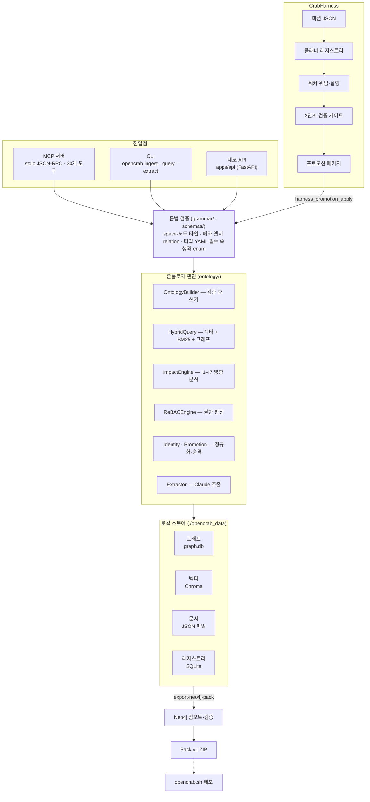
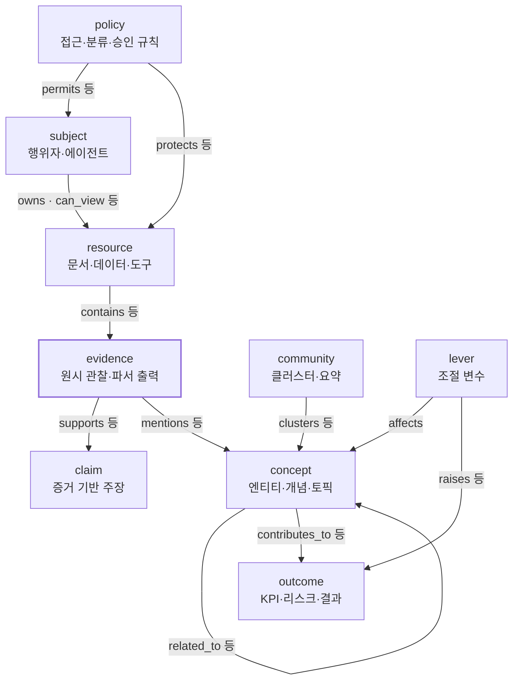

# OpenCrab 가이드: 기능, 아키텍처, 온톨로지 스키마, 사용법

2026-10-12 기준

## 개요

OpenCrab은 문서와 크롤링 결과를 문법 검증된 온톨로지 그래프로 만들고, 이를 MCP 도구로 에이전트에게 제공하는 로컬 엔진입니다. 이 리포지토리는 공개 엔진(LocalCrab)이며, 호스팅 SaaS인 [opencrab.sh](https://opencrab.sh)의 내부 코드는 포함하지 않습니다.

| 레이어 | 역할 | 위치 |
| --- | --- | --- |
| MetaOntology OS | 문법(9 spaces, 메타 엣지), 스키마, ReBAC, 아이덴티티/정규화, 프로모션, MCP 서버 | `opencrab/` |
| CrabHarness | 미션 기반 수집 계획, 워커 위임, 증거 검증, 프로모션 패키지 생성 | `crabharness/` (별도 패키지) |
| LocalCrab 팩 출력 | Neo4j 검증과 OpenCrab Pack v1 ZIP export | `opencrab/pack/`, `docs/opencrab-pack-v1.md` |
| 데모 앱 | 로컬 테스트용 FastAPI + Next.js (운영 SaaS 아님) | `apps/`, `server/` |

전체 흐름은 "수집 대상 → CrabHarness 미션 계획 → 증거 수집 → MetaOntology 문법 추출 → Neo4j 검증 → Pack v1 ZIP → opencrab.sh 배포" 순서입니다. LocalCrab은 증거 커버리지와 추적 가능성을 우선하고, SaaS는 팩의 배포와 호스팅 MCP 접근을 담당합니다.

## 주요 기능

OpenCrab의 모든 기능은 MCP 도구 30개로 노출되며, 주요 기능은 CLI에서도 쓸 수 있습니다. 도구는 `opencrab/mcp/tools.py`에 정의되어 있습니다.

| 기능 영역 | MCP 도구 | 동작 |
| --- | --- | --- |
| 문법 조회 | `ontology_manifest` | 9 spaces, 메타 엣지, I1–I7, ReBAC 설정을 JSON으로 반환 |
| 그래프 쓰기 | `ontology_add_node`, `ontology_add_edge` | 문법 검증 후 노드/엣지를 추가·갱신. 잘못된 space/타입/관계는 거부 |
| 검색 | `ontology_query`, `query_bm25` | 벡터 + BM25 + 그래프 이웃 확장을 RRF로 결합한 하이브리드 검색, 또는 BM25 단독 검색 |
| 영향 분석 | `ontology_impact` | 노드 변경이 I1(데이터)–I7(하위 시스템) 중 무엇을 건드리는지 그래프 탐색으로 판단 |
| 레버 시뮬레이션 | `ontology_lever_simulate` | lever 노드를 움직일 때 outcome 변화 예측 |
| 접근 제어 | `ontology_rebac_check` | 명시적 DENY → GRANT → 직접 엣지 → 팀/조직 멤버십 → 기본 거부 순서로 판정 |
| 문서 인제스트 | `ontology_ingest` | 텍스트 또는 로컬 파일(`path`)을 벡터·문서 스토어에 색인. PDF/HWP/HWPX/DOCX/XLSX/PPTX는 Kordoc 4.x로 파싱 |
| LLM 추출 | `ontology_extract` | Claude가 텍스트에서 9-Space 문법에 맞는 노드·엣지를 추출해 기록 |
| 아이덴티티 / 정규화 | `identity_*`, `canonicalize_*` | 별칭 테이블, 중복 후보 제안과 사람 검토, 노드 병합. 자동 병합은 하지 않음 |
| 프로모션 | `promotion_*` | 추출물을 candidate → validated → promoted (또는 rejected) 단계로 관리 |
| 워크플로우 / 승인 | `workflow_create_run`, `workflow_advance`, `approval_request` | 작업 실행 기록과 승인 요청 |
| 하네스 연동 | `harness_promotion_apply` | CrabHarness가 만든 프로모션 패키지를 그래프에 적용 |
| 스키마 팩 | `schema_pack_list`, `schema_pack_install`, `schema_pack_uninstall` | saas, biomedical, legal 도메인 타입 설치·제거 |
| 사용량 | `billing_get_usage`, `billing_list_events` | 테넌트별 노드 쓰기·쿼리·인제스트 집계 |

MCP 외에도 `opencrab export-neo4j-pack`으로 OpenCrab Pack v1용 Neo4j export를 만들 수 있고, CrabHarness는 미션 파일로 크롤러 워커를 실행해 검증된 증거 번들을 만듭니다.

## 시스템 아키텍처

MCP 서버, CLI, 데모 API는 모두 같은 엔진과 로컬 스토어를 사용하며, 모든 쓰기는 문법 검증을 먼저 통과해야 합니다.



CrabHarness는 그래프에 직접 쓰지 않고 프로모션 패키지만 만듭니다. OpenCrab이 이를 `harness_promotion_apply`로 받아 문법 검증을 거쳐 기록합니다.

- **스토어는 항상 로컬입니다.** `stores/factory.py`는 SQLite 그래프(`LocalGraphStore`), JSON 문서 스토어(`LocalDocStore`), SQLite 레지스트리(`SQLStore`), 로컬 Chroma를 반환합니다. 로컬 스토어는 Neo4j·MongoDB 어댑터와 같은 인터페이스를 구현하므로 엔진 코드는 어느 쪽인지 모릅니다.
- **쓰기는 최선 노력 팬아웃입니다.** `OntologyBuilder`는 그래프·문서·레지스트리에 모두 쓰고, 개별 스토어 실패는 로그만 남기고 중단하지 않습니다.
- **검색은 세 결과를 합칩니다.** `HybridQuery`는 벡터 검색 결과를 그래프 이웃으로 확장하고 BM25 결과와 함께 RRF(k=60)로 재정렬합니다.
- **MCP 서버는 직접 구현한 stdio JSON-RPC입니다.** `initialize`, `tools/list`, `tools/call`을 처리하고, 엔진과 스토어는 첫 도구 호출 때 한 번 만들어집니다(`_get_context()`). 새 도구는 `TOOL_SCHEMAS`와 `_TOOL_FUNCTIONS` 두 곳에 등록해야 합니다.
- **CrabHarness는 플러그인 구조입니다.** 워커는 `codex_workers/*/worker.manifest.json`과 어댑터(`collect_bundle`/`validate_bundle`)만 추가하면 되고, 검증은 완전성 점수, 의미 점수, autoresearch 판정의 3단계입니다.

## 온톨로지 스키마 아키텍처

스키마는 세 층으로 검증됩니다. 문법(space와 노드 타입, 허용된 관계)은 코드에 고정되어 있고, 타입별 속성은 YAML로 선택적으로 검사하며, 메타데이터 레이어는 모든 노드·엣지에 공통으로 붙습니다. 문법 버전은 1.0.0입니다.

### 1. 문법: 9 Spaces

단일 진실 공급원은 `opencrab/grammar/manifest.py`의 `SPACES`입니다. 모든 노드는 하나의 space에 속하며, 그 space에 나열된 타입만 쓸 수 있습니다.

| Space | 의미 | 노드 타입 |
| --- | --- | --- |
| subject | 의도와 권한을 가진 행위자 | User, Team, Org, Agent |
| resource | 행위자가 다루는 산출물·도구 | Project, Document, File, Dataset, Tool, API, CrawlRun |
| evidence | 원시 관찰, 로그, 파서/OCR 출력 | TextUnit, LogEntry, Evidence |
| concept | 엔티티, 개념, 토픽 | Entity, Concept, Topic, Class |
| claim | 증거에서 도출된 주장 | Claim, Covariate, CollectionCompleteness |
| community | 개념·행위자의 클러스터와 요약 | Community, CommunityReport |
| outcome | KPI, 리스크, 측정 가능한 결과 | Outcome, KPI, Risk |
| lever | outcome에 영향을 주는 조절 변수 | Lever |
| policy | 접근, 분류, 승인 규칙 | Policy, Sensitivity, ApprovalRule |

### 2. 문법: 메타 엣지

엣지는 (출발 space, 도착 space) 쌍마다 허용된 relation만 만들 수 있습니다(`META_EDGES`). 목록에 없는 쌍(예: claim → concept)은 어떤 relation도 거부됩니다.

| 출발 → 도착 | 허용 relation |
| --- | --- |
| subject → resource | owns, member_of, manages, can_view, can_edit, can_execute, can_approve |
| resource → evidence | contains, derived_from, logged_as |
| evidence → concept | mentions, describes, exemplifies |
| evidence → claim | supports, contradicts, timestamps |
| concept → concept | related_to, subclass_of, part_of, influences, depends_on |
| concept → outcome | contributes_to, constrains, predicts, degrades |
| lever → outcome | raises, lowers, stabilizes, optimizes |
| lever → concept | affects |
| community → concept | clusters, summarizes |
| policy → resource | protects, classifies, restricts |
| policy → subject | permits, denies, requires_approval |

이 구조가 추적 경로를 만듭니다: 문서(resource)가 증거(evidence)를 담고, 증거가 개념과 주장을 뒷받침하며, 개념과 레버가 outcome에 영향을 줍니다.



엣지는 화살표 방향으로만 만들 수 있습니다. 화살표 라벨은 대표 relation이며 전체 목록은 위 표에 있습니다. evidence가 문서와 개념·주장을 잇는 중심이고, concept는 자기 자신과도 연결됩니다.

### 3. 타입 스키마 (YAML)

`opencrab/schemas/types/<타입>.yaml`은 타입별 속성을 정의합니다. 현재 Claim, CollectionCompleteness, CrawlRun, Document, Entity, Org, Outcome, Policy, Team, User 10개가 등록되어 있습니다. 검사 항목은 필수 필드(기본값이 없는 경우)와 enum 값 두 가지이며, 스키마 파일이 없는 타입은 속성 검사를 건너뜁니다.

```yaml
type: Claim
space: claim
properties:
  statement:  { type: string, required: true }
  confidence: { type: float, required: false }
  status:     { type: string, enum: [candidate, validated, promoted, rejected], default: candidate }
```

### 4. 메타데이터 레이어와 ReBAC

모든 노드·엣지에는 네 가지 레이어의 메타데이터를 붙일 수 있습니다.

- **existence**: identity, provenance, lineage
- **quality**: confidence, freshness, completeness
- **relational**: dependency, sensitivity, maturity
- **behavioral**: usage, mutation, effect

ReBAC는 user, team, org, project, document, lever, tool 객체에 대해 view, edit, execute, simulate, approve, admin 권한을 다룹니다. 권한은 subject → resource 엣지(예: `can_edit`은 view도 부여)와 SQL에 저장된 명시적 정책으로 결정됩니다.

### 5. 스키마 팩과 액션 스키마

- **스키마 팩**(`schemas/packs/*.yaml`): saas, biomedical, legal. 설치하면 팩의 타입(예: biomedical의 Disease, Gene, Drug)마다 `schemas/types/`에 YAML이 생성됩니다. 제거 시 자동 생성 파일만 지우고, 사용자가 수정한 파일은 `force` 없이는 남깁니다.
- **액션 스키마**(`schemas/actions/*.yaml`): add_node, add_edge, promote_claim, request_approval, restrict_access, harness_apply의 파라미터를 정의하며 워크플로우 런타임이 사용합니다.

주의: 팩 타입은 타입 YAML만 추가하고 `SPACES`의 노드 타입 목록은 바꾸지 않습니다. 코드상으로는 `validate_node`가 여전히 Disease 같은 팩 타입을 거부할 것으로 보이므로, 팩 타입을 노드로 쓰기 전에 확인이 필요합니다.

### 6. 검증 순서

`OntologyBuilder`는 쓰기 전에 다음을 차례로 확인합니다.

1. `validate_node(space, node_type)`: 타입이 해당 space에 속하는가
2. `validate_node_properties(node_type, properties)`: 타입 YAML의 필수 필드와 enum
3. 엣지는 `validate_edge(from_space, to_space, relation)`: 메타 엣지 허용 목록

하나라도 실패하면 오류 메시지에 허용된 타입·relation 목록이 함께 반환되고 아무것도 기록되지 않습니다.

## 사용 방법

기본 설치는 Python 3.11 이상과 pip만 있으면 되고, 모든 데이터는 `./opencrab_data` 아래 로컬에 저장됩니다. Docker나 외부 DB는 필요 없습니다.

### 1. 설치와 초기화

```bash
pip install -e ".[dev]"     # 또는 make dev-install
opencrab init               # .env.example → .env 복사
opencrab status             # 스토어 연결 확인
make seed                   # 예제 데이터 적재(선택)
```

주요 환경 변수는 `LOCAL_DATA_DIR`(데이터 위치), `ANTHROPIC_API_KEY`(LLM 추출), `KORDOC_BIN`·`KORDOC_TIMEOUT`(문서 파서), `NEO4J_URI`/`NEO4J_USER`/`NEO4J_PASSWORD`(팩 export용 Neo4j)입니다.

### 2. MCP 서버로 등록

```bash
claude mcp add opencrab -- opencrab serve
```

다른 MCP 호스트에서는 `{"mcpServers": {"opencrab": {"command": "opencrab", "args": ["serve"]}}}`를 추가합니다. 서버는 stdio JSON-RPC로 동작하며 등록 후 에이전트가 `ontology_*` 도구를 호출할 수 있습니다.

### 3. 문서 인제스트와 추출

```bash
npm install --global kordoc@latest          # PDF/HWP/HWPX/DOCX/XLSX/PPTX 파싱에 필요(4.x)
opencrab ingest ./reports -r                # 파싱 후 벡터·문서 스토어에 색인
opencrab extract ./reports -r --dry-run     # Claude로 노드·엣지 추출, 저장하지 않고 확인
opencrab extract ./reports -r               # 추출 결과를 그래프에 기록
```

`-e`로 확장자를, `--model`로 추출 모델을 바꿀 수 있습니다. Kordoc이 파싱하지 못한 파일은 비어 있는 채로 색인되지 않고 건너뜁니다.

### 4. 조회

```bash
opencrab manifest                                  # 문법 출력 (--json-output 가능)
opencrab query "system performance and error rates"   # 하이브리드 검색
opencrab query "인허가 변경 이유" -s concept,claim -n 5
```

MCP에서는 같은 기능을 도구로 호출합니다. 노드·엣지를 직접 추가할 때는 먼저 `ontology_manifest`로 허용 타입과 relation을 확인하는 것이 좋습니다.

```json
{"name": "ontology_add_node", "arguments": {"space": "concept", "node_type": "Concept", "node_id": "c-latency", "properties": {"name": "API latency"}}}
{"name": "ontology_add_edge", "arguments": {"from_space": "concept", "from_id": "c-latency", "relation": "degrades", "to_space": "outcome", "to_id": "o-nps"}}
{"name": "ontology_impact", "arguments": {"node_id": "c-latency", "change_type": "update"}}
```

### 5. CrabHarness로 증거 수집

```bash
cd crabharness && pip install -e ".[dev]"
crabharness catalog                                               # 등록된 워커 목록
crabharness plan missions/examples/github-trending-harvest.json   # 실행 없이 작업 계획 확인
crabharness run  missions/examples/github-trending-harvest.json   # 수집 + 검증 + 프로모션 패키지
crabharness promotion-apply <promotion-package.json> --dry-run      # 문법 검사만
crabharness promotion-apply <promotion-package.json>               # OpenCrab 스토어에 적용
```

미션 JSON은 목표(`objective`), 수집 대상(`target`), 필수 증거, 제약(`max_jobs`, `delay_ms` 등), 성공 기준(`completeness_threshold`, `min_semantic_score`)을 담습니다. 실행 결과는 `artifacts/runs/<mission_id>/<run_id>/`에 남습니다. 문제가 있을 때는 `crabharness doctor <워커>`로 워커 선행 조건을 점검합니다.

### 6. 팩 export

```bash
opencrab export-neo4j-pack -o neo4j/opencrab_ingest.jsonl --pack-id <pack_id>
```

Neo4j 서버가 필요하며, 팩 전체 구성(manifest.json, graph/, evidence/, quality/, neo4j/ 등)은 `docs/opencrab-pack-v1.md`를 따릅니다.

### 7. 개발자용 명령

| 작업 | 명령 |
| --- | --- |
| 전체 테스트 | `make test` |
| 단일 테스트 | `pytest tests/test_mcp.py::TestToolDispatch::test_tools_list_not_empty` |
| 통합 테스트 | `OPENCRAB_INTEGRATION=1 pytest tests/ -v` (실제 서비스 필요) |
| 린트 / 포맷 | `make lint`, `make format` |
| 커버리지 | `make coverage` (기준 80%) |
| 데모 API / 웹 | `uvicorn server.api:app`, `cd apps/web && npm run dev` |

## 알려진 주의사항

최근 Kordoc 4.x 도입 커밋(3ce4463)을 코드 리뷰한 결과, 아직 고치지 않은 문제가 있습니다. 수정 전까지는 아래 우회 방법을 따르세요.

| 문제 | 영향 | 우회 방법 |
| --- | --- | --- |
| 상대 경로로 ingest/extract 시 Kordoc이 파일을 찾지 못함 (`documents.py:91`) | `opencrab ingest docs -r`에서 PDF/HWP/DOCX 등이 모두 건너뛰어짐 | 절대 경로를 넘기기 (`opencrab ingest "$PWD/docs" -r`) |
| `--version` 확인 실패가 프로세스 수명 동안 캐시됨 (`documents.py:66`) | `npx kordoc` 최초 다운로드가 10초를 넘기면 MCP 서버가 HWPX/DOCX/XLSX를 계속 거부 | `npm i -g kordoc@latest`로 전역 설치하거나 서버 재시작 |
| MCP `ontology_ingest`의 `path`가 어떤 로컬 파일이든 읽음 (`tools.py:531`) | `.env`, SSH 키 등이 색인되어 쿼리로 노출될 수 있음 | 신뢰할 수 없는 에이전트에게 이 도구를 열지 않기 |
| 파싱은 성공했지만 텍스트가 빈 파일을 조용히 건너뜀 (`cli.py:211`) | 스캔 이미지 PDF가 메시지 없이 빠짐 | ok 건수를 파일 수와 비교 |
| Kordoc이 dict가 아닌 JSON을 반환하면 예외 (`documents.py:102`) | MCP 호출이 처리되지 않은 오류로 실패 | 지원 버전(4.x) Kordoc 사용 |
| `KORDOC_TIMEOUT`이 숫자가 아니면 모듈 import가 실패 (`documents.py:29`) | `.md` 파일을 포함해 모든 ingest/extract가 중단 | 초 단위 정수만 설정 (`KORDOC_TIMEOUT=180`) |
| MCP 경로 ingest는 page_count 등 메타데이터를 버림 (`tools.py:534`) | CLI와 MCP로 넣은 문서의 메타데이터가 다름 | 메타데이터가 필요하면 CLI 사용 |
| 기본 `--extension` 목록에 `.xls`, `.hwp3`, `.hwpml`이 없음 (`cli.py:179`) | 해당 파일이 디렉터리 인제스트에서 빠짐 | `-e` 옵션에 직접 추가 |

코드 정리 과제로, ingest와 extract에 파일 탐색 로직이 중복되어 있고 `documents.py`의 `is_supported`는 쓰이지 않습니다. 스키마 팩 타입이 `validate_node`를 통과하는지도 확인이 필요합니다(온톨로지 스키마 섹션 5 참고).
